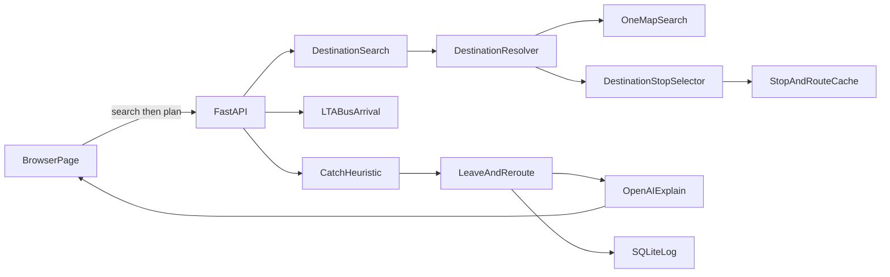
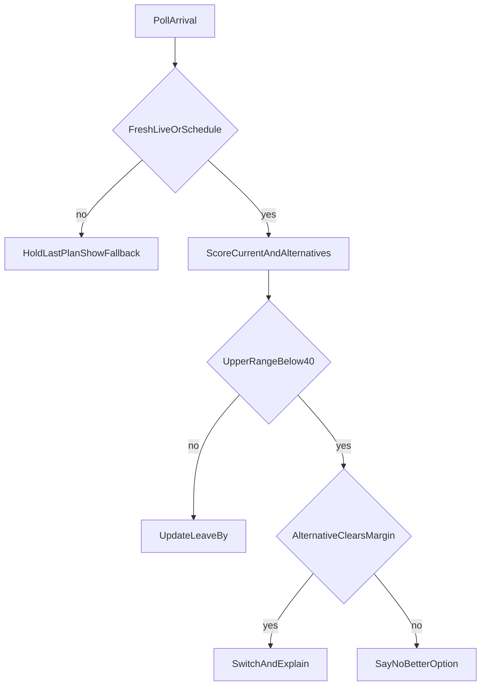

# AI-Powered Public Transport Assistant — Project Plan

Singapore bus catch assistant for the AI Lodge Hackathon ("Projects for Daily Life"). The app predicts whether the user will catch a bus and says when to leave, using live LTA DataMall arrivals plus a heuristic. OpenAI explains the result in plain language. It does not invent the number, the destination coordinates, or the bus stop.

Decisions already made: OpenAI for explanations; this build is **bus-only**. Trains are a later extension (DataMall has no live MRT arrival API). Seat/crowding, background OS location tracking, and fare optimization stay out of scope. The Bus Arrival `Load` field is ignored so crowding cannot sneak in. Destination input is a place search (OneMap), not a bus-stop code. Turn-by-turn walking navigation is out of scope.

## What changed

The user types a place ("Marina Bay Sands", "NUS", "Orchard Road", "Changi Airport") instead of a destination bus-stop name or code. OneMap resolves that text to coordinates. The app then ranks nearby LTA stops and the user confirms one. After that confirm, the existing flow is unchanged: boarding stop, live arrivals, catch probability, leave-by, reroute, OpenAI explanation.

Unchanged on purpose: the catch-probability formula, the 40% / 15-point reroute rule, LTA polling, SQLite observation fields, and the OpenAI fact-sheet guardrail. OpenAI still does not choose coordinates, stops, or probabilities.

## New components

These sit in front of the existing pipeline. They do not replace `StopAndRouteCache`, `CatchHeuristic`, `LeaveAndReroute`, or `OpenAIExplain`.

- **DestinationSearch** — the query box and `GET /api/destinations?q=`. Runs only when the user submits. Not on each keystroke.
- **DestinationResolver** — calls OneMap Search, checks the token, and returns the result list. Zero results and outages stop here. It never picks a coordinate by itself.
- **DestinationStopSelector** — takes the place the user selected, finds nearby stops in the LTA cache, and labels each one. The user confirms one stop. That stop code is the destination the existing journey flow already expects.

## New dependency: OneMap

Provider: OneMap (Singapore Land Authority). No new Python package. The existing `httpx` client calls it.

Current docs (checked against [OneMap Search](https://www.onemap.gov.sg/apidocs/search/) and the [August 2025 workshop notes](https://www.onemap.gov.sg/apidocs/docs/workshopaug2025)):

- Search requires a token. The older unauthenticated `developers.onemap.sg/commonapi/search` URL is not the documented endpoint.
- `GET https://www.onemap.gov.sg/api/common/elastic/search?searchVal=<query>&returnGeom=Y&getAddrDetails=Y&pageNum=1`
- Header: `Authorization: <token>` (the docs pass the token itself, not a `Bearer` prefix).
- Token: `POST https://www.onemap.gov.sg/api/auth/post/getToken` with the OneMap account email and password. Tokens last 3 days. Cache the token until `expiry_timestamp`. Do not call `getToken` on every search.
- A free OneMap account is required. Store `ONEMAP_EMAIL` and `ONEMAP_PASSWORD` in `.env` (gitignored). An optional pasted `ONEMAP_TOKEN` is accepted; if it returns 401 and email/password are absent, show unavailable and ask for a fresh token.
- Routing APIs are not used.

**Zero results.** If `found` is 0 or `results` is empty, say no matches and ask the user to rephrase (building, road, or postal code). Do not guess a place. Do not pick a nearby stop.

**Several results.** Show page 1 (name and address). The user must select the place, including when there is only one hit, so a wrong geocode is never silent. Only the selected result's `LATITUDE` / `LONGITUDE` are used.

**OneMap down.** Timeout (about 8 seconds), HTTP error, 401 after a failed refresh, 403, or 429: status **unavailable**, same pattern as LTA. Say destination search is unavailable. Do not invent coordinates. Do not call a second geocoder. Do not fall back to the old unauthenticated URL. Do not start stop ranking or the catch flow.

**Rate limit.** The August 2025 workshop page says tokenized search is capped at 250 calls and does not say whether that window is per minute, per day, or per token. A demo stays inside that by searching once per submit, first page only. On 429, show unavailable and do not retry in a loop. The 20-second bus poll never calls OneMap.

## Updated user journey

1. Browser location (existing).
2. User enters an arrive-by time and submits a destination phrase.
3. DestinationResolver returns OneMap matches, or an unavailable / no-match message.
4. User selects one place.
5. DestinationStopSelector lists nearby LTA stops with walk distance, whether a bus from near the user can reach that stop, and a rough arrive-by label.
6. User confirms one destination stop.
7. Existing flow: boarding stops within 400 m, live LTA arrivals, catch probability, leave-by, reroute, OpenAI explanation of the fact sheet.

## 1. Tech stack

Hackathon-simple, Windows-native, no frontend build step.

- **Python 3.11+**, venv, `uvicorn`. Activate with `.\.venv\Scripts\Activate.ps1`.
- **FastAPI** serves a single static page and the JSON API.
- **httpx** calls LTA DataMall and OneMap Search.
- **SQLite** (stdlib) logs every scored poll from day one.
- **openai** SDK, model `gpt-4o-mini` (name in config so it can be swapped). Structured Outputs, low temperature.
- **pytest** for the heuristic, staleness rules, destination-search fallbacks, and LLM guardrail. Tests use fixtures, not the live APIs.
- **Frontend:** one `static/index.html` plus vanilla JS. **Leaflet** with OpenStreetMap tiles (no extra key). Browser Geolocation and the Notification API.
- **Secrets:** `LTA_ACCOUNT_KEY`, `OPENAI_API_KEY`, `ONEMAP_EMAIL`, and `ONEMAP_PASSWORD` in `.env`, already covered by `.gitignore`. Optional `ONEMAP_TOKEN`. Commit `.env.example` only.

The existing gitignore is a Node template. Python cache and `*.db` get added when the app exists. No Node, Docker, or database server.

## 2. Architecture

The probability, leave-by time, reroute choice, place coordinates, and destination stop are computed in Python. OpenAI only turns the catch fact sheet into plain language. The model never invents the number, the coordinates, or the stop.



LTA calls used:

- `GET /v3/BusArrival?BusStopCode=&ServiceNo=` — live ETA, lat/lon, `Monitored` (1 = bus location, 0 = operator schedule). Updates about every 20 seconds. Next three buses per service.
- `GET /BusStops` and `GET /BusRoutes` — static, paged at 500 with `$skip`, cached to a local JSON file at startup. Routes give stop sequence, direction, and distance along the route.
- `GET /BusServices` — published frequency (`12-15` minutes). Used only to widen the range when `Monitored` is 0.

Poll only the active boarding stop plus up to two alternate stops, every 20 seconds, and only while a journey is open.

**Journey the user sets up:** browser location, an arrive-by time, and a place phrase. OneMap resolves the phrase the user selects. The selector proposes LTA stops around that point. The user confirms one destination stop. The app then finds boarding stops within 400 m whose route still passes that confirmed stop later in that direction. Optional preferred service number still applies in that existing step.

**Catch** means the user reaches the boarding stop before `EstimatedArrival` minus a 45-second buffer. Ride time onward is `route kilometres / 18 km/h`, labeled as an estimate, and checked against arrive-by.

**Proactive alert** uses the Notification API while this tab is open and location permission is granted. There is no background process.

**Logging addition.** The existing `observations` fields stay as listed in section 3. A journey row also stores the search text, the selected OneMap label, latitude, longitude, and the confirmed destination stop code. That is the only logging change.

## 3. Catch probability

Ship this with no historical data. Historical lateness is logged now and applied only after a bucket has enough rows.

Point walk speed **1.25 m/s**. The range uses **1.1 m/s** (slower, worse slack) and **1.4 m/s** (still a normal walk). The app never tells the user to go faster than that.

```text
walk_s      = distance_m / 1.25
slack       = seconds_until_eta - walk_s - 45 - gps_penalty
slack_low   = seconds_until_eta - (distance_m / 1.1) - 45 - (gps_accuracy_m / 1.25)
slack_high  = seconds_until_eta - (distance_m / 1.4) - 45

P(slack)    = clamp(1 / (1 + exp(-0.025 * (slack - 90))), 0.05, 0.92)
```

50% sits at 90 seconds of slack. The cap is 92% and the floor is 5%, so the UI cannot show certainty. Display the point and the band: **64% (range 51–78%)**.

Adjustments:

- `Monitored == 0`: add half the published headway onto the bad side of slack, and cap the high end at 60%. Label **schedule only**.
- GPS `accuracy` worse than 100 m, or a location fix older than 60 s: same widening, label **location uncertain**. Do not issue "leave now" from that fix.
- ETA already more than 30 s in the past: that bus is missed; score the next bus.
- Stale or API down: return **no probability**. See safety section.
- Historical factor: until 20 logged arrivals exist for that service + stop + hour-of-week, the factor is neutral and the UI says **no historical reliability yet**. Later, subtract median lateness from slack. Do not invent a reliability number before that.

**Log on every scored poll** (SQLite `observations`): timestamp, stop code, service, direction, ETA, `Monitored`, bus lat/lon, user lat/lon, GPS accuracy, walk metres, slack seconds, P / P_low / P_high, data quality (`live`, `schedule`, `stale`, `unavailable`), whether a reroute fired, and the reason. This is the dataset that later becomes on-time reliability.

## 4. Auto-reroute data flow

Threshold: reroute when the **upper** end of the catch range is below **40%**, and only if another option's **lower** end beats the current upper end by at least **15** percentage points. Both numbers are constants.

Candidates, in order: the same service's `NextBus2` / `NextBus3` at the same stop; then other services at stops within 400 m that still reach the destination stop. An option counts only if estimated arrival at the destination is still before arrive-by. If none qualify, say so and keep the current plan.

The destination stop in this section is the stop the user confirmed. A reroute does not pick a new place and does not call OneMap again.



A stale or failed poll never triggers a switch. Leave-by is `ETA - slow_walk - 45s - 60s`. When that time arrives and the range is still acceptable, notify "leave now" with the range. When the range is already under 40%, the notification is the reroute, not a leave-now.

Call OpenAI when a journey starts, when the band changes by 10 points or more, and when a reroute fires. Do not call it on every 20-second poll. Do not call it to choose the place or the destination stop.

## 5. Build order

Each step is one commit with something a judge can see or a test can run.

1. This plan.
2. Skeleton: FastAPI, static page title, `.env.example` (including OneMap), README run steps on Windows.
3. LTA client: download and cache stops and routes; internal stop lookup by code and name for the selector.
4. Map page: browser location, nearest boarding stops within 400 m.
5. Live arrival panel for a chosen stop and service, including the `Monitored` label and the fetch timestamp.
6. Heuristic module plus pytest. Show point and range on the page. No LLM yet.
7. OneMap DestinationSearch and DestinationResolver: submit a phrase, show page-1 matches, require a selection. Tests for zero results, timeout, and 429 using fixtures.
8. DestinationStopSelector: nearby LTA stops, reachability, user confirms one stop.
9. Journey form continues from that confirmed stop: arrive-by, connecting service, estimated ride time, leave-by clock.
10. Notification when leave-by is reached, tab open only.
11. Alternate-route scoring and the reroute trigger, with the reason stored in SQLite.
12. OpenAI explanation with the guardrail below, plus pytest that feeds unsafe and contradictory model output. A separate test asserts the explainer is not called with a request to choose coordinates or a stop.
13. Demo scenario switch (`DEMO_MODE=true` only), badged **SIMULATED**, so the failure cases in section 6 can be shown without waiting for a real outage. Includes OneMap timeout and zero results.

## 6. Safety and guardrails

UI rules:

- Every catch claim shows a point and a range, plus data quality: live, schedule only, location uncertain, or no history yet.
- Copy is "about 64% (range 51–78%) if you leave now and walk at a normal pace." It is never "you'll make it."
- The leave action the code can emit is only `wait`, `leave_now` (normal pace), `switch_route`, or `do_not_rely`.

Fallback when LTA data is bad:

- HTTP error, timeout, or empty body (LTA returns nothing when buses are not in service or during maintenance): status **unavailable**. Show the last success time. Hide the percentage. Do not speak a leave-now or a reroute. Offer the published frequency only as a labeled schedule, not as a fake ETA.
- Last success older than 60 seconds: status **stale**. Keep the last ETA on screen with its timestamp. Freeze leave-now and reroute until a fresh poll arrives.

Fallback when OneMap is bad:

- Zero results: ask the user to rephrase. Do not guess a place or a stop.
- Timeout, HTTP error, expired token that cannot be refreshed, or 429: status **unavailable**. Do not substitute another provider. Do not continue into stop selection or the catch flow.

LLM guardrail:

- Input is the fact sheet the heuristic already produced (range, slack, walk minutes, monitored flag, data quality, chosen action). The prompt requires the model to quote that range, to match the chosen action, and to recommend only a normal walking pace.
- OpenAI never determines destination coordinates, bus-stop selection, or probabilities. Those stay in DestinationResolver, DestinationStopSelector, and CatchHeuristic.
- Response schema: `headline`, `reasoning`, `leave_advice`, `cited_low`, `cited_high`.
- Reject the response if the cited range differs from the code, if `leave_advice` differs from the code, or if the text matches a blocklist (`run`, `sprint`, `dash`, `hurry`, `jaywalk`, `cross against`, `ignore the light`, and close variants). On reject, show a fixed template sentence built from the fact sheet.
- Temperature stays low. The probability digits in the template and in any accepted headline come from the heuristic.

Failure scenarios to test (fixtures in step 13, plus unit tests in steps 6, 7, and 12):

- API timeout and empty body: no percentage, explicit unavailable message, no leave-now.
- Stale poll older than 60 seconds: last ETA kept, labeled stale, alerts paused.
- `Monitored == 0`: schedule-only label, high end capped at 60%.
- GPS accuracy worse than 100 m: wider range, location-uncertain label, no leave-now.
- New service with zero history: neutral reliability, "no historical reliability yet."
- Model text that says "run" or "jaywalk": replaced by the template.
- Model text that quotes a different percentage or says the user will make it: rejected.
- No alternative that still meets arrive-by: the app says none, and does not invent a route.
- OneMap returns zero results: rephrase message, no stop list, no guessed coordinate.
- OneMap timeout or 429: unavailable message, no second geocoder, catch flow does not start.

## 7. Assumptions

- Judges use the app on this Windows machine in a browser. No deploy step.
- Alerts exist only while the tab is open, with notification permission and a current location fix. That is the stand-in for "proactive," because background OS tracking is out of scope.
- The user has a free OneMap account. Email and password live in `.env`. Search uses the tokenized endpoint above.
- The user selects an OneMap result, then confirms one LTA stop. The app does not geocode with any other provider and does not draw a walking route.
- Arrive-by is entered with the destination phrase so the selector can show its rough label. The live catch range still starts only after the stop is confirmed.
- One active journey, no accounts.
- Walk 1.25 m/s, band 1.1–1.4 m/s, board buffer 45 s, leave-now margin 60 s, reroute when the upper range is under 40% and an alternative's lower range wins by 15 points. Boarding-stop search radius 400 m. Ride speed 18 km/h for the arrive-by check only.
- Stale means last good Bus Arrival response is older than 60 seconds.
- `gpt-4o-mini` via the OpenAI API. Keys stay in `.env`.
- On-time history does not affect the score until 20 observations exist in a service/stop/hour bucket.
- Trains, crowding (`Load`), background tracking, fares, and turn-by-turn walking navigation are not in this build.

## Decisions still open

Working default until you say otherwise. The exact ranking formula is the open part.

- Candidate destination stops are LTA stops within **600 m** of the selected coordinates (haversine). If none exist, say so. Do not widen the radius automatically.
- A stop is **reachable** when some service's cached route includes it and also includes a stop within 400 m of the user, with the user's stop earlier in that direction.
- Show up to **5** reachable stops, sorted by shortest walk (1.25 m/s for the minutes label). No blended numeric score yet.
- The arrive-by label on that list is static: walk to a nearby boarding stop, plus the midpoint of the published frequency as a wait, plus `route km / 18 km/h`, plus the walk from the destination stop to the place. If that sum misses arrive-by, label **rough check: may miss arrive-by**. It is not a catch probability. After confirm, section 3 replaces it.
- Unreachable stops, if shown, stay under the reachable list, capped at 3, labeled **no direct bus from near you**, and are not the default confirmation.

Say if the radius, the cap of 5, or the sort (shortest walk versus a weighted score) should be different before implementation.
