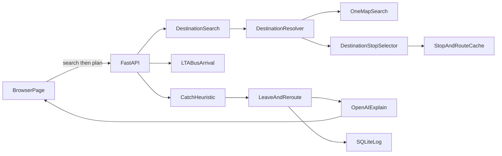
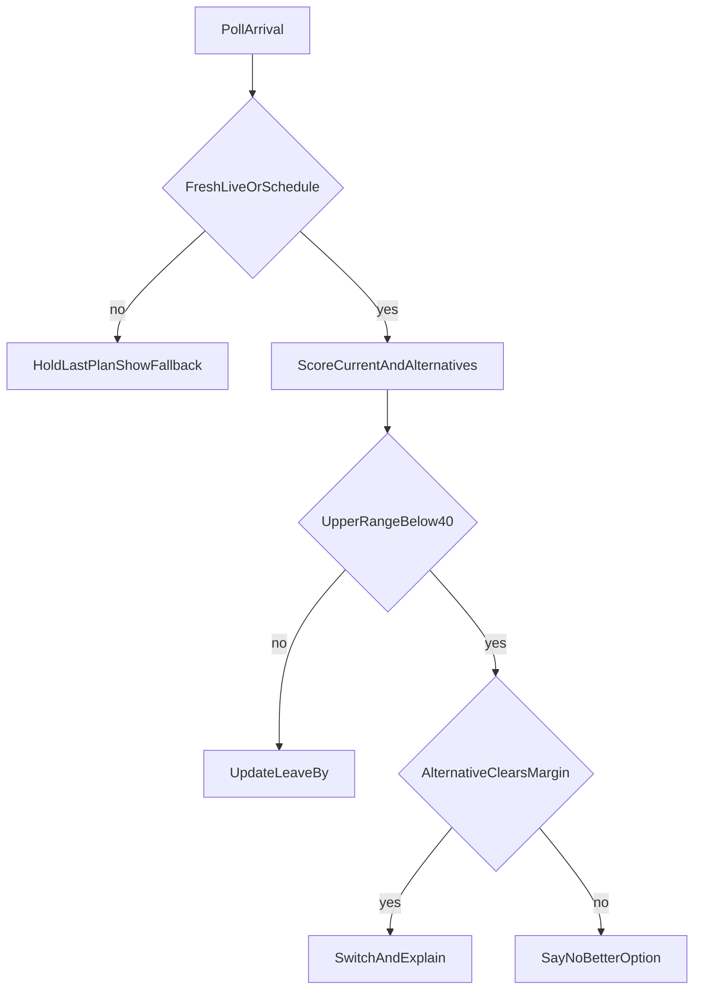

# AI-Powered Public Transport Assistant — Project Plan

Singapore bus catch assistant for the AI Lodge Hackathon ("Projects for Daily Life"). The app predicts whether the user will catch a bus and says when to leave, using live LTA DataMall arrivals plus a heuristic. OpenAI explains the result in plain language. It does not invent the number, the destination coordinates, or the bus stop.

Decisions already made: OpenAI for explanations; this build is **bus-only**. Trains are a later extension (DataMall has no live MRT arrival API). Seat/crowding, background OS location tracking, and fare optimization stay out of scope. The Bus Arrival `Load` field is ignored so crowding cannot sneak in. Destination input is a place search (OneMap), not a bus-stop code. Turn-by-turn walking navigation is out of scope.

## What changed

The user types a place ("Marina Bay Sands", "NUS", "Orchard Road", "Changi Airport") instead of a destination bus-stop name or code. OneMap resolves that text to coordinates. The app then ranks nearby LTA stops and the user confirms one. After that confirm, the existing flow is unchanged: boarding stop, live arrivals, catch probability, leave-by, reroute, OpenAI explanation.

Unchanged on purpose: the catch-probability formula, the 40% / 15-point reroute rule, LTA polling, SQLite observation fields, and the OpenAI fact-sheet guardrail. OpenAI still does not choose coordinates, stops, or probabilities.

## New components

These sit in front of the existing pipeline. They do not replace `StopAndRouteCache`, `CatchHeuristic`, `LeaveAndReroute`, or `OpenAIExplain`.

- **DestinationSearch** — the query box and `GET /api/destinations?q=`. Runs only when the user submits. Not on each keystroke.
- **DestinationResolver** — calls OneMap Search, checks the token, and returns the result list. Zero results and outages stop here. It never picks a coordinate by itself.
- **DestinationStopSelector** — takes the place the user selected, finds nearby stops in the LTA cache, and labels each one. The user confirms one stop. That stop code is the destination the existing journey flow already expects.

## New dependency: OneMap

Provider: OneMap (Singapore Land Authority). No new Python package. The existing `httpx` client calls it.

Current docs (checked against [OneMap Search](https://www.onemap.gov.sg/apidocs/search/) and the [August 2025 workshop notes](https://www.onemap.gov.sg/apidocs/docs/workshopaug2025)):

- Search requires a token. The older unauthenticated `developers.onemap.sg/commonapi/search` URL is not the documented endpoint.
- `GET https://www.onemap.gov.sg/api/common/elastic/search?searchVal=<query>&returnGeom=Y&getAddrDetails=Y&pageNum=1`
- Header: `Authorization: <token>` (the docs pass the token itself, not a `Bearer` prefix).
- Token: `POST https://www.onemap.gov.sg/api/auth/post/getToken` with the OneMap account email and password. Tokens last 3 days. Cache the token until `expiry_timestamp`. Do not call `getToken` on every search.
- A free OneMap account is required. Store `ONEMAP_EMAIL` and `ONEMAP_PASSWORD` in `.env` (gitignored). An optional pasted `ONEMAP_TOKEN` is accepted; if it returns 401 and email/password are absent, show unavailable and ask for a fresh token.
- Routing APIs are not used.

**Zero results.** If `found` is 0 or `results` is empty, say no matches and ask the user to rephrase (building, road, or postal code). Do not guess a place. Do not pick a nearby stop.

**Several results.** Show page 1 (name and address). The user must select the place, including when there is only one hit, so a wrong geocode is never silent. Only the selected result's `LATITUDE` / `LONGITUDE` are used.

**OneMap down.** Timeout (about 8 seconds), HTTP error, 401 after a failed refresh, 403, or 429: status **unavailable**, same pattern as LTA. Say destination search is unavailable. Do not invent coordinates. Do not call a second geocoder. Do not fall back to the old unauthenticated URL. Do not start stop ranking or the catch flow.

**Rate limit.** The August 2025 workshop page says tokenized search is capped at 250 calls and does not say whether that window is per minute, per day, or per token. A demo stays inside that by searching once per submit, first page only. On 429, show unavailable and do not retry in a loop. The 20-second bus poll never calls OneMap.

## Updated user journey

1. Browser location (existing).
2. User enters an arrive-by time and submits a destination phrase.
3. DestinationResolver returns OneMap matches, or an unavailable / no-match message.
4. User selects one place.
5. DestinationStopSelector lists nearby LTA stops with walk distance, whether a bus from near the user can reach that stop, and a rough arrive-by label.
6. User confirms one destination stop.
7. Existing flow: boarding stops within 400 m, live LTA arrivals, catch probability, leave-by, reroute, OpenAI explanation of the fact sheet.

## 1. Tech stack

Hackathon-simple, Windows-native, no frontend build step.

- **Python 3.11+**, venv, `uvicorn`. Activate with `.\.venv\Scripts\Activate.ps1`.
- **FastAPI** serves a single static page and the JSON API.
- **httpx** calls LTA DataMall and OneMap Search.
- **SQLite** (stdlib) logs every scored poll from day one.
- **openai** SDK, model `gpt-4o-mini` (name in config so it can be swapped). Structured Outputs. Temperature is `0.2`, as specified in **Step 12 specification**.
- **pytest** for the heuristic, staleness rules, destination-search fallbacks, and LLM guardrail. Tests use fixtures, not the live APIs.
- **Frontend:** one `static/index.html` plus vanilla JS. **Leaflet** with OpenStreetMap tiles (no extra key). Browser Geolocation and the Notification API.
- **Secrets:** `LTA_ACCOUNT_KEY`, `OPENAI_API_KEY`, `ONEMAP_EMAIL`, and `ONEMAP_PASSWORD` in `.env`, already covered by `.gitignore`. Optional `ONEMAP_TOKEN`. Commit `.env.example` only.

The existing gitignore is a Node template. Python cache and `*.db` get added when the app exists. No Node, Docker, or database server.

## 2. Architecture

The probability, leave-by time, reroute choice, place coordinates, and destination stop are computed in Python. OpenAI only turns the catch fact sheet into plain language. The model never invents the number, the coordinates, or the stop.



LTA calls used:

- `GET /v3/BusArrival?BusStopCode=&ServiceNo=` — live ETA, lat/lon, `Monitored` (1 = bus location, 0 = operator schedule). Updates about every 20 seconds. Next three buses per service.
- `GET /BusStops` and `GET /BusRoutes` — static, paged at 500 with `$skip`, cached to a local JSON file at startup. Routes give stop sequence, direction, and distance along the route.
- `GET /BusServices` — published frequency (`12-15` minutes). Used only to widen the range when `Monitored` is 0.

Poll only the active boarding stop plus up to two alternate stops, every 20 seconds, and only while a journey is open.

**Journey the user sets up:** browser location, an arrive-by time, and a place phrase. OneMap resolves the phrase the user selects. The selector proposes LTA stops around that point. The user confirms one destination stop. The app then finds boarding stops within 400 m whose route still passes that confirmed stop later in that direction. Optional preferred service number still applies in that existing step.

**Catch** means the user reaches the boarding stop before `EstimatedArrival` minus a 45-second buffer. Ride time onward is `route kilometres / 18 km/h`, labeled as an estimate, and checked against arrive-by. When that route distance is unusable, Step 9 does not invent a duration and does not perform the arrive-by comparison. The locked rule is in **Step 9 specification**.

**Proactive leave-now alert** uses the Notification API while this tab is open, including when the tab is not visible. There is no background process. The locked rules are in **Step 10 specification**.

**Logging addition.** The existing `observations` fields stay as listed in section 3. A journey row also stores the search text, the selected OneMap label, latitude, longitude, and the confirmed destination stop code. That is the only logging change.

## 3. Catch probability

Ship this with no historical data. Historical lateness is logged now and applied only after a bucket has enough rows.

Point walk speed **1.25 m/s**. The range uses **1.1 m/s** (slower, worse slack) and **1.4 m/s** (still a normal walk). The app never tells the user to exceed a normal walking pace (up to 1.4 m/s). Pace guidance may say "Walk faster" only when range_high is at least 40%, because range_high is computed at 1.4 m/s. Below that it says "Unlikely at a normal pace" and never advises going faster.

```text
walk_s      = distance_m / 1.25
slack       = seconds_until_eta - walk_s - 45 - gps_penalty
slack_low   = seconds_until_eta - (distance_m / 1.1) - 45 - (gps_accuracy_m / 1.25)
slack_high  = seconds_until_eta - (distance_m / 1.4) - 45

P(slack)    = clamp(1 / (1 + exp(-0.025 * (slack - 90))), 0.05, 0.92)
```

50% sits at 90 seconds of slack. The cap is 92% and the floor is 5%, so the UI cannot show certainty. Display the point and the band: **64% (range 51–78%)**.

Adjustments:

- `Monitored == 0`: add half the published headway onto the bad side of slack, and cap the high end at 60%. Label **schedule only**.
- GPS `accuracy` worse than 100 m, or a location fix older than 60 s: same widening, label **location uncertain**. Do not issue "leave now" from that fix.
- ETA already more than 30 s in the past: that bus is missed; score the next bus.
- Stale or API down: return **no probability**. See safety section.
- Historical factor: until 20 logged arrivals exist for that service + stop + hour-of-week, the factor is neutral and the UI says **no historical reliability yet**. Later, subtract median lateness from slack. Do not invent a reliability number before that.

**Log on every scored poll** (SQLite `observations`): timestamp, stop code, service, direction, ETA, `Monitored`, bus lat/lon, user lat/lon, GPS accuracy, walk metres, slack seconds, P / P_low / P_high, data quality (`live`, `schedule`, `stale`, `unavailable`), whether a reroute fired, and the reason. The insert is part of the main arrivals/scoring pipeline. A poll that does not reroute is still logged. A stale or failed poll with no valid score is not a scored poll. `reroute_fired` and `reroute_reason` values are locked in **Step 11 specification**. This is the dataset that later becomes on-time reliability.

### Pace guidance

Pace guidance is a display hint beside the catch-probability ring. It does not change the point, the range, `chosen_action`, leave-by, notification timing, or reroute decisions. It is not written into the OpenAI fact sheet and it is not stored in SQLite `observations`.

Pace guidance uses the assumed walking speed of 1.25 m/s (range 1.1–1.4 m/s) already used by the catch-probability engine. It does not read or use the browser's measured GPS speed (`coords.speed`), and it does not try to learn the user's own pace.

The scoring response adds a `pace` field. That field is the category from the rules below, before the two-poll display smoother. The page hides the chip when the category is absent.

First match wins:

- Hidden (no chip): `data_quality` is `stale` or `unavailable`, the location is uncertain under the Step 6 rules, or `distance_to_stop_m` < 30.
- `unlikely`: `range_high` < 40
- `faster`: point < 50
- `slightly_faster`: 50 <= point < 65
- `slower`: `range_low` >= 75, except when `data_quality` is `schedule`
- `slightly_slower`: point >= 80, except when `data_quality` is `schedule`
- `steady`: otherwise

A move toward `slower` or `slightly_slower` from a faster or steadier category is shown only after that new category appears on 2 consecutive polls. A move to `unlikely`, `faster`, or `slightly_faster` is shown on the first poll. `steady` is shown on the first poll. The page resets this state at journey start, at reroute, and at leg change.

Copy:

- slower: "Walk slower" / "You have time. A relaxed pace should still work."
- slightly_slower: "Walk slightly slower" / "You can ease your pace a little."
- steady: "Keep a steady pace" / "A normal walking pace works."
- slightly_faster: "Walk slightly faster" / "A slightly brisker walk improves your chances."
- faster: "Walk faster" / "A brisk walk improves your chances. Stay on footpaths and use crossings."
- unlikely: "Unlikely at a normal pace" / "Walking faster is unlikely to be enough. Check the reroute options or the next bus."

## 4. Auto-reroute data flow

The normal trigger is `range_high < 40%` on the current primary bus, and a qualifying alternative whose `range_low` is at least 15 percentage points above that current `range_high`. Both must hold. The point probability is not the trigger. Candidate order, the arrive-by filter, the winner, automatic switching, the cooldown, the card, the notification, and the SQLite reason are locked in **Step 11 specification**.

The destination stop is the stop the user confirmed. A reroute does not change that stop, does not pick a new place, and does not call OneMap again.



A stale or failed poll never triggers a switch. The authoritative Step 9 leave-by formula is `leave_by = ETA - slow_walk - 45s`, where `slow_walk = boarding_stop_distance / 1.1`. The existing 60 s leave-now margin is not part of the Step 9 leave-by calculation. It is used only in Step 10 as `notification_time = leave_by - 60s`. Destination ride duration is not part of the leave-by formula or the notification trigger. Leave-now notification behavior is specified in **Step 10 specification**. Reroute detection and reroute notifications belong to Step 11.

OpenAI call timing, the fact sheet, in-flight handling, and the data-quality filter are locked in **Step 12 specification**. Do not call OpenAI on every 20-second poll. Do not call it to choose the place or the destination stop.

## UI and theme

This section is the single look for every later build step. It does not change catch math, leave-by, notification timing, reroute rules, Step 12 guardrails, or any exact copy string already locked below.

The visual target is the 10-screen mockup. Where that mockup and this section disagree, the mockup wins. The mockup was not attached when this section was written, so every colour, radius, space, font, type size, and icon below is a **PLACEHOLDER**. Replace placeholders from the mockup before Step 2b is implemented. Do not invent final values from the current page.

### Design tokens

All visual values live in `static/theme.css`, as CSS custom properties. Light and dark both come from `prefers-color-scheme`. A Light / Dark / Match system control sets or removes `data-theme` on the document element only. Match system removes `data-theme` so the page follows `prefers-color-scheme`. `static/components.css` is a second stylesheet and uses those tokens only.

The app header has a hamburger that opens a menu sheet. The sheet contains Light, Dark, and Match system. Demo Controls appear in that sheet only when demo mode is on.

| Token | Light | Dark |
| --- | --- | --- |
| `--color-paper` | `#EEF4F8` | `#0E1726` |
| `--color-card` | `#FFFFFF` | `#16223A` |
| `--color-ink` | `#1C2844` | `#E6ECF5` |
| `--color-muted` | `#5B6B82` | `#9AA9BF` |
| `--color-line` | `#DCE5EE` | `#2A3853` |
| `--color-primary` | `#1B6FE7` | `#2B6CE6` |
| `--color-primary-ink` | `#FFFFFF` | `#FFFFFF` |
| `--color-secondary` | `#E4F0FC` | `#1A2F55` |
| `--color-secondary-ink` | `#1556B8` | `#8DBBFF` |
| `--status-live` | `#0B7A4E` | `#5FE0A0` |
| `--status-schedule` | `#475467` | `#AEB9CB` |
| `--status-uncertain` | `#8A5A00` | `#F5C76A` |
| `--status-stale` | `#B42318` | `#FF9AA0` |
| `--status-unavailable` | `#B42318` | `#FF9AA0` |
| `--status-no-history` | `#475467` | `#AEB9CB` |
| `--status-simulated` | `#5B3FD0` | `#B9A6FF` |
| `--prob-point` | `#1B6FE7` | `#2B6CE6` |
| `--prob-band` | `#E4F0FC` | `#1A2F55` |
| `--prob-mark-40` | `#E5484D` | `#E5484D` |
| `--prob-mark-50` | `#F2A900` | `#F2A900` |
| `--radius-card` | `12px` | `12px` |
| `--radius-control` | `10px` | `10px` |
| `--space-1` | `4px` | `4px` |
| `--space-2` | `8px` | `8px` |
| `--space-3` | `16px` | `16px` |
| `--space-4` | `24px` | `24px` |
| `--space-5` | `32px` | `32px` |
| `--font-stack` | `system-ui, sans-serif` | `system-ui, sans-serif` |
| `--type-caption` | `0.75rem` | `0.75rem` |
| `--type-body` | `1rem` | `1rem` |
| `--type-title` | `1.25rem` | `1.25rem` |
| `--type-hero` | `2rem` | `2rem` |
| `--tap-min` | 44px | 44px |

`--tap-min` is 44px because this section requires that tap size. It is not a mockup colour.

No inline styles. No hex codes, rgb(), or hsl() outside `static/theme.css`. JavaScript only adds and removes classes. It does not set `style`, colour, or size.

### Components

Each component is defined once and reused. Variants are classes, not new components.

- **Card.** Shared shell. Variants: `info`, `caution`, `success`, `unavailable`, `simulated`. The simulated variant is how `[SIMULATED]` and the demo header sit on a card. It does not replace those strings.
- **Banner.** One full-width message row. The alert slot below is a banner or a card in that single region, not a second banner component.
- **Badge.** One status label plus its icon. Used for data quality and for the one status badge on the live screen.
- **Probability meter.** Specified under Probability meter. Not a second score widget.
- **Buttons.** `primary` and `secondary` only. Both use `--tap-min`.
- **Form field.** Label, control, and hint as one unit.
- **List item.** One row for a place, a stop, or a route option.

### Status styles

Colour is never the only signal. Each state has a token, an icon token, and the label already used in this plan. Icon art is PLACEHOLDER until the mockup names it.

| State | Colour token | Icon | Label already in this plan |
| --- | --- | --- | --- |
| live | `--status-live` | PLACEHOLDER | live |
| schedule only | `--status-schedule` | PLACEHOLDER | schedule only |
| location uncertain | `--status-uncertain` | PLACEHOLDER | location uncertain |
| stale | `--status-stale` | PLACEHOLDER | stale |
| unavailable | `--status-unavailable` | PLACEHOLDER | unavailable |
| no history yet | `--status-no-history` | PLACEHOLDER | See the copy note. Section 6 says "no history yet". Section 3 and the safety bullet say "no historical reliability yet". |
| SIMULATED | `--status-simulated` | PLACEHOLDER | `SIMULATED DEMO MODE` on the page header, and `[SIMULATED]` on the affected card |

### Probability meter

The meter shows the existing point and the existing range band. It also draws marks at the existing 40% and 50% thresholds. Those marks are visual only.

- 40% stays the Step 10 leave-now gate (`range_high >= 40%`) and the Step 11 reroute trigger (`range_high < 40%`).
- 50% stays the Step 14 caution, which appears when the live Leg 1 point is below 50%. It still does not fire a notification by itself.

Do not change either threshold, the sigmoid, the 5% floor, the 92% cap, or the schedule-only 60% cap.

### Layout

Mobile first. One column at every width until the mockup shows otherwise. The leave-by countdown sticks while the live journey is on screen. Tap targets are at least `--tap-min`.

On the live journey screen, the default view is the hero (probability and leave-by), one status badge, and the AI Explanation card. Arrive-by check, data-quality detail, and the Leg 2 schedule expectation sit in an expandable **Details** region. See Live screen simplification.

### Accessibility

Do not use colour alone. Text, the status icon, and the label travel together. Text and controls meet WCAG AA contrast against the token pairs above, once real mockup colours replace the placeholders. The probability region and the AI Explanation region use `aria-live="polite"`.

### Contrast

Measured against the light and dark tokens in `static/theme.css`. Every pair below is at least 4.5:1.

| Pair | Light | Dark |
| --- | --- | --- |
| Ink on paper | 13.18 | 15.12 |
| Ink on surface | 14.62 | 13.35 |
| Muted on paper | 4.89 | 7.53 |
| Muted on surface | 5.43 | 6.65 |
| White on primary | 4.69 | 4.78 |
| Link on paper | 4.53 | 7.28 |
| Link on surface | 5.02 | 6.43 |
| Info on tint | 5.95 | 6.76 |
| Info on paper | 6.20 | 9.14 |
| Success text on tint | 4.91 | 8.82 |
| Warning text on tint | 5.38 | 8.75 |
| Danger text on tint | 5.56 | 7.94 |
| Neutral text on tint | 6.79 | 6.88 |
| Simulated text on tint | 5.83 | 6.96 |

### Empty, loading, and error

Do not add new empty or error sentences in this section. Reuse the messages already locked in Steps 9–14 and in section 6.

The standard loading indicator is the existing card-header status `● Updating explanation...`. Keep the previous content on screen while it shows. Do not clear the region to a blank loading state.

### Map

Map markers use theme tokens, not hex in JavaScript. Three markers: user, boarding stop, and destination stop. Marker shape and icon art are PLACEHOLDER until the mockup specifies them.

### Screens

| Screen | Components |
| --- | --- |
| Search | Form field, primary button |
| Pick place | List item, info card |
| Pick stop | Map (user and boarding-stop markers), list item, primary button |
| Pick route option | Map (user, boarding stop, destination stop), list item or card, badge, primary button |
| Live journey | Probability meter, sticky leave-by countdown, one status badge, AI Explanation card, alert slot, expandable Details |
| Reroute | Card (`success` while the switch is shown), banner only through the alert slot |
| Unavailable | Card variant `unavailable`, status badge |

### Alert slot

The Step 10 Notifications Optional card, the Step 10 denied-notifications banner, and the Step 14 caution banner share one slot. Only one of those three is shown at a time. Their copy stays exactly as written in **Step 10 specification** and **Step 14 specification**. This rule does not add a permission request and does not change when a leave-now notification fires.

Which of the three wins when more than one would apply is not specified. Do not guess an order until that priority is locked.

The granted line in Step 10 is not named as one of the three slot items. Whether it may sit beside the Step 14 caution banner is also not specified.

### Copy constants

User-facing copy belongs in `static/copy.js`. That file is a classic script: it assigns the `copy` object and is not an ES module. Add a Python mirror only if a test needs to import the same strings. This plan does not name that Python path. Later edits to this plan should point at the constants file instead of pasting the sentence again. Do not delete the strings already written here.

Sections that currently define user-facing strings:

- Section 3, including the point-and-range example and the schedule-only, location-uncertain, and historical-reliability labels
- Section 6, including the catch-claim sentence and the "no history yet" / "no historical reliability yet" wording
- Step 9 specification: ride-time unavailable, and the arrive-by check labels and messages
- Step 10 specification: leave-now title and body, the permission card, the granted line, and the denied banner
- Step 11 specification: both no-better sentences, the reroute card, the reroute notification, and `reroute_reason`
- Step 12 specification: the AI Explanation title, `● Updating explanation...`, the fallback template, and the four action sentences
- Step 13 specification: `SIMULATED DEMO MODE`, `[SIMULATED]`, and the seven scenario names
- Step 14 specification: the no-feasible-route sentence, the three option labels, the caution banner, and the Leg 2 prompt and button names in that section

### Live screen simplification

The live journey shows three things by default: the hero (probability and leave-by), one status badge, and the AI Explanation card. Arrive-by check, data-quality detail, and the Leg 2 schedule expectation move under expandable Details. This is a layout rule. It does not remove arrive-by math, data-quality handling, or the Leg 2 schedule.

Step 14, the multi-leg assistant, is a stretch goal behind a finished single-leg flow. Finish search, place, stop, one route, and the live single-leg screen first. The Step 14 specification stays locked. It does not jump ahead of that single-leg flow.

## 5. Build order

Each step is one commit with something a judge can see or a test can run.

1. This plan.
2. Skeleton: FastAPI, static page title, `.env.example` (including OneMap), README run steps on Windows.
2b. Theme and component kit: `static/theme.css` plus `static/styleguide.html`. The style guide shows every component and every status state in light and dark. This step does not change catch math, thresholds, or existing copy. Numbered steps 3–14 and every **Step N specification** stay numbered as they are.
3. LTA client: download and cache stops and routes; internal stop lookup by code and name for the selector.
4. Map page: browser location, nearest boarding stops within 400 m.
5. Live arrival panel for a chosen stop and service, including the `Monitored` label and the fetch timestamp.
6. Heuristic module plus pytest. Show point and range on the page. No LLM yet.
7. OneMap DestinationSearch and DestinationResolver: submit a phrase, show page-1 matches, require a selection. Tests for zero results, timeout, and 429 using fixtures.
8. DestinationStopSelector: nearby LTA stops, reachability, user confirms one stop.
9. Journey form continues from that confirmed stop: arrive-by, connecting service, estimated ride time, leave-by clock. An unavailable ride duration follows **Step 9 specification** below.
10. Leave-now browser notifications, tab open only, as specified in **Step 10 specification**. This step is separate from the Step 9 leave-by formula. Reroute and alter-service notifications are Step 11.
11. Auto-reroute scoring, the trigger, the automatic switch, the reroute card, the reroute notification, and the reason stored in the existing `observations` table, as specified in **Step 11 specification**. OpenAI explanation of the switch is Step 12.
12. OpenAI explanation, as specified in **Step 12 specification**, including the fixture tests listed there. No live OpenAI calls. All earlier step tests remain passing.
13. Demo Mode, as specified in **Step 13 specification**. It is enabled only when `DEMO_MODE` is exactly `true`. It shows the seven interactive scenarios without waiting for a real outage. README demo instructions belong to the implementation step, not to this specification lock.
14. Multi-leg journey assistant, as specified in **Step 14 specification**. Route options stay static and deterministic. Live catch probability starts only after the user selects one option. This step does not rewrite Steps 1–13 and does not add Step 15. Step 14 is a stretch goal behind a finished single-leg flow. The specification stays locked; this sentence only sets build order.

## Step 9 specification

Approved decision: the journey continues when route distance or ride duration cannot be calculated. The ride estimate is marked unavailable. Step 8 is unchanged: `is_reachable = true` may coexist with `rough_journey_minutes = null`.

### Ride duration

`rough_journey_minutes` from Step 8 may be null. Step 9 may expose this as `ride_minutes`.

If the route distance needed for the ride estimate is unavailable, invalid, non-numeric, non-finite, or otherwise unusable:

- `ride_minutes = null`
- Do not fabricate, infer, substitute, or approximate a route duration.
- The UI displays `Ride time: Unavailable`.

### Arrive-by status

The arrive-by input remains available. This status is a rough journey-duration comparison. It is not a catch probability and must not be presented as one. Catch-probability copy is unchanged: when a catch probability is shown it includes a point and a range, and the app never says "you'll make it."

When a target arrive-by time is set and `ride_minutes` is valid:

On time or early, when estimated journey arrival is at or before the arrive-by target:

- Badge / label: `Arrive-by check: On track`
- Message: `Estimated arrival is at or before your requested time.`

Late, when estimated journey arrival is after the arrive-by target:

- Badge / label: `Arrive-by check: Risk of delay`
- Message: `Rough check: may miss arrive-by time.`

When `ride_minutes` is null:

- Do not perform the arrive-by comparison.
- Badge / label: `Arrive-by check: N/A`
- Message: `Destination ride duration unavailable; cannot verify target arrival time.`
- Do not replace the unavailable duration with an estimate or a guess.
- The journey stays usable, and the leave-by calculation stays functional.

For a one-transfer route, the arrive-by check uses the sum of both legs' ride minutes together with the same walk and half-headway terms as a direct ride, and it shows N/A when either leg's ride_minutes is null.

### Leave-by calculation

The authoritative Step 9 formula is `leave_by = ETA - slow_walk - 45s`, where `slow_walk = boarding_stop_distance / 1.1`.

The 45 s board buffer, the 60 s leave-now margin, the 60 s location-fix age threshold, and the 60 s stale-arrival-data threshold stay separate. The 60 s leave-now margin is not part of the Step 9 leave-by calculation. The 60 s location-fix age threshold and the 60 s stale-arrival-data threshold are not terms in this formula.

Leave-by remains fully functional and is independent of destination ride duration.

Do not add route duration to the leave-by formula. Missing ride duration does not block live catch probability or leave-by.

Leave-now notification timing is specified in **Step 10 specification**. It is `notification_time = leave_by - 60s`. That subtraction is not part of this Step 9 formula.

### Journey flow

A reachable destination stop with `ride_minutes = null` remains selectable and confirmable. Do not block the user from continuing solely because ride duration is unavailable.

### Transparency

Never replace unavailable ride duration with a guessed value. Never perform an arrive-by comparison using an assumed duration.

## Step 10 specification

Step 10 is strictly limited to leave-now browser notifications. Reroute detection, route switching, and reroute or alter-service notifications belong to Step 11 and are not part of Step 10.

### 1. Leave-now trigger

The Step 9 leave-by formula remains `leave_by = ETA - slow_walk - 45s`, where `slow_walk = boarding_stop_distance / 1.1`.

The Step 10 notification trigger is `notification_time = leave_by - 60s`, where the 60 s is the existing leave-now margin.

The 60 s leave-now margin is used only to determine when the notification fires. It is not part of the Step 9 leave-by clock. Do not modify the Step 9 leave-by formula.

A leave-now notification is eligible when the current time reaches `notification_time`.

### 2. Catch-probability requirement

A leave-now notification may fire only when the current primary bus has `range_high >= 40%`.

If `range_high < 40%`, do not issue a leave-now notification.

This requirement applies to the primary bus being evaluated for the notification. Do not substitute point probability for `range_high`. Do not create a new probability formula or threshold.

### 3. Notification payload

When the notification fires, use this payload:

- Title: `Leave Now — Bus {service_no}`
- Body: `Walk to {stop_name} ({stop_code}) now to catch Bus {service_no}. Catch probability: {point}% ({range_low}–{range_high}%).`

Use the current primary bus or service and the selected boarding stop. The displayed probability uses the existing Step 6 point and range.

### 4. Browser permission

The app uses the browser Notification API. This permission lifecycle is part of Step 10 leave-now notifications.

The app must never automatically call `Notification.requestPermission()`. Automatic permission requests are prohibited during page load, destination selection, boarding-stop selection, destination-stop confirmation, Step 9 journey-form opening, arrival polling, leave-by calculation, and notification-trigger evaluation.

When `Notification.permission === "default"`, the journey panel shows an inline action card containing:

- Title: `Notifications Optional`
- Description: `Get an audio/visual alert 60 seconds before your walk deadline.`
- Action: `Enable Notifications`

Only an explicit click on `Enable Notifications` may call `Notification.requestPermission()`.

After that explicit request succeeds and permission is `granted`, replace the enable action with `Notifications active — Leave-now alert set`. Do not request permission again automatically.

When `Notification.permission === "denied"`, keep the core journey UI and live catch-probability calculations active. Show the inline informational banner exactly `Browser notifications are blocked. Keep this page open to see live leave-by alerts.` Do not disable the journey because notifications are blocked. Do not repeatedly request permission.

Permission state controls whether the browser notification can be delivered. It must not alter the leave-by calculation, the catch-probability calculation, or live arrival polling. The Step 10 trigger remains `notification_time = leave_by - 60s`, and the existing `range_high >= 40%` requirement remains unchanged. Do not add any other permission-related timing or automatic permission prompts.

### 5. Hidden or background tab

Notifications may fire when the tab is open even if the tab is not currently visible or active. The requirement is tab-open only. There is no background process, service, or server-side notification system.

### 6. Duplicate notifications

Track the last notified primary bus in frontend state as `lastNotifiedBusId`.

A notification may fire at most once for a specific primary bus arrival. After a notification fires for a bus, do not fire again for that same bus ID while it remains the primary target.

Reset `lastNotifiedBusId` only when a different bus becomes the primary target. Do not add other reset conditions.

### 7. Missed primary bus

If the current primary bus becomes missed under the existing Step 6 rule (ETA already more than 30 s in the past):

- Cancel or clear the pending notification for that bus immediately.
- Reevaluate immediately using the next approaching bus for the selected service.
- Calculate that next bus's notification timing from its own live ETA.
- Apply the same `range_high >= 40%` requirement.

Do not notify for the missed bus. Do not alter the existing Step 6 missed-bus scoring rule.

### 8. Data-quality safety

A leave-now notification must not fire when the existing project rules say the data is not safe.

- Unavailable arrival data: no notification.
- Stale arrival data: no notification.
- Uncertain GPS or location fix under the existing Step 6 rules: no notification.
- Missed primary bus: cancel its notification and reevaluate the next bus.

Do not create a new stale-data or GPS-quality threshold. Reuse the existing Step 5 and Step 6 definitions: last good Bus Arrival response older than 60 seconds is stale; GPS accuracy worse than 100 m, or a location fix older than 60 s, is location uncertain.

### 9. Separation from Step 9

The Step 9 leave-by clock stays independent of notification behavior.

- Step 9: `leave_by = ETA - slow_walk - 45s`
- Step 10: `notification_time = leave_by - 60s`

Destination ride duration is not part of the notification trigger or the leave-by formula.

### 10. Scope

Step 10 covers leave-now notifications only, including the permission lifecycle above. It does not include reroute detection, reroute notifications, route switching, alter-service notifications, alternate-destination notifications, additional notification types, OpenAI explanations, background tracking, or server-side notifications. Reroute detection, the automatic switch, and the reroute notification are **Step 11 specification**. OpenAI explanations remain Step 12.

## Step 11 specification

Step 11 is auto-rerouting. It scores alternate candidates, applies the trigger, selects one winner, switches the active route, shows the reroute card, sends the reroute browser notification when notifications are already enabled, and stores the reason in the existing `observations` table.

### 1. Reroute trigger

The normal auto-reroute trigger requires both:

1. The current primary bus has `range_high < 40%`.
2. A qualifying alternative has `alternative.range_low >= current.range_high + 15` percentage points.

The point probability is not the trigger. Both conditions must hold. A stale or failed poll never triggers a reroute. Evaluation uses only fresh live or schedule arrival data, under the existing data-quality rules.

### 2. Candidate alternatives

Evaluate candidates in this order:

1. The same service at the current boarding stop: `NextBus2`, then `NextBus3`.
2. Other eligible buses and services at alternate boarding stops within 400 m of the user's current location.

A candidate may be the same service number at a different nearby boarding stop, or a different service number at a nearby boarding stop. When more than two eligible alternate boarding stops are within 400 m, poll the two closest by straight-line haversine distance from the user's current GPS location. Do not use another stop-ranking method.

An alternate candidate must still reach the confirmed destination stop in the required route direction. The confirmed destination stop never changes during an auto-reroute. No OneMap search occurs during rerouting.

### 3. Alternative catch scoring

Use the existing Step 6 catch heuristic exactly. Do not create a second probability formula. For each candidate, score catch probability from the user's current location and that candidate's boarding stop, using the candidate bus ETA and the existing walk-speed, range, and buffer rules. Preserve the existing data-quality handling. Reachability determines eligibility. It does not change the probability mathematics.

### 4. Arrive-by filtering

When the journey has an arrive-by time, a candidate is eligible only when its estimated destination arrival is at or before that time. If that candidate's `ride_minutes` is null, the candidate is ineligible, because its destination arrival cannot be verified. Do not guess or fabricate a ride duration.

When the journey has no arrive-by target, skip the destination-arrival-time filter and evaluate eligible alternatives on catch probability alone.

### 5. Winning alternative

If several alternatives satisfy the trigger, choose the candidate with the highest `range_low`. If those `range_low` values tie and an arrive-by target exists, choose the earlier estimated destination arrival. If they tie and there is no arrive-by target, choose the earlier ETA. Do not rank by point probability when `range_low` can distinguish them.

### 6. Automatic route switching

The reroute is automatic. When the trigger and a qualifying alternative are met, replace the active `selectedBoardingStop`, the active `selectedService`, and the active primary-bus target. Keep `confirmedDestinationStop` unchanged. The backend selects the winning alternative and returns the reroute payload. Do not require another user confirmation before switching. Do not change the selected OneMap destination.

#### Same-stop target pinning

`not_before` is not part of the Step 11 contract. Do not filter or alter the raw LTA BusArrival feed in order to pin a rerouted same-service, same-stop bus.

- Do not remove earlier ETA buses from the LTA response.
- Do not add a `not_before` filter to BusArrival polling.
- Do not modify the Step 6 arrival list before `score_buses`.
- Preserve the existing Step 6 arrival-selection flow and the raw arrival list.

When a reroute selects a later bus at the same service and the same boarding stop, store that choice in journey / reroute state. That state must not mutate or filter the underlying LTA arrivals feed.

Subsequent probability calculations continue to use the existing Step 6 logic against the appropriate active target. Do not change the raw arrival response. Do not invent a new probability formula.

This rule supersedes any implication that a `not_before` filter should be used to preserve the pinned target. Do not keep an absent bus in the arrival list by filtering earlier ETAs.

#### Same-stop / same-service pinned target identity

This rule is final. It applies only to a pinned same-service, same-boarding-stop target created by an automatic Step 11 reroute. LTA BusArrival provides the dynamic slots `NextBus`, `NextBus2`, and `NextBus3`. Do not invent a persistent vehicle ID. The slot name is not the identity.

When that reroute selects a later bus as the active target, store:

`pinned_eta_timestamp = target_bus.estimated_arrival_epoch`

On every subsequent fresh poll for the same service and boarding stop, identify the pinned target by ETA continuity:

1. Consider every returned non-missed bus in `NextBus`, `NextBus2`, and `NextBus3`.
2. For each candidate, calculate `eta_difference = abs(candidate_eta_epoch - pinned_eta_timestamp)`.
3. Select the candidate with the smallest absolute ETA difference only when `eta_difference <= 180` seconds.
4. If a matching candidate exists, treat that candidate as the active pinned target and update `pinned_eta_timestamp = matching_candidate_eta_epoch`. The matched candidate's current slot may change among `NextBus`, `NextBus2`, and `NextBus3`.

Before accepting a continuity match, apply the existing Step 6 missed-bus rule to the stored pin. If `current_time - pinned_eta_timestamp > 30` seconds, the pinned target is missed. Clear the pin, set `pinned_eta_timestamp = null`, and do not continue matching it. Return to standard Step 6 primary-bus scoring on the complete, unfiltered arrival list.

Also clear the pin when no returned non-missed candidate satisfies `abs(candidate_eta_epoch - pinned_eta_timestamp) <= 180` seconds. Then set `pinned_eta_timestamp = null`, use the complete raw arrival list, run standard Step 6 primary selection, and use that new primary for catch probability, leave-by, Step 10 leave-now evaluation, and Step 11 reroute evaluation. Do not retain an ETA, probability, or leave-by value for the cleared target. Do not treat an unexplained disappearance as automatically missed. Only the existing Step 6 missed-bus rule determines whether a bus is missed.

ETA continuity matching must not filter the raw LTA arrival response, remove buses before Step 6 scoring, modify `NextBus` / `NextBus2` / `NextBus3` ordering, use `not_before`, or introduce a vehicle-ID field that LTA does not provide. The complete arrival list continues through the normal Step 6 pipeline. The pinned-target state is separate journey state used to identify which already-scored candidate is the active target.

This identity rule does not change normal Step 6 primary selection, the catch-probability formula, the greater-than-30-second missed-bus rule, a different-service reroute, a different-boarding-stop reroute, the confirmed destination stop, Step 9 leave-by, or Step 10 notification timing.

### 7. Cooldown

After an auto-reroute fires, enforce a 120-second cooldown. During those 120 seconds, no reroute evaluation may execute, and no further reroute may execute. Do not display an additional no-better message during the cooldown. After the cooldown expires, a re-switch is allowed only when a new candidate's lower bound is at least 20 percentage points above the current active route's upper end, and the current primary still has `range_high < 40%`. Do not switch only because the cooldown expired. Do not add another reset or debounce rule.

### 8. GPS uncertainty

Auto-rerouting is suppressed when the current location is uncertain under the existing Step 6 rules: GPS accuracy worse than 100 m, or a location fix older than 60 s. When location is uncertain, do not auto-reroute, and keep the current active route. Continue the existing Step 6 location-quality handling. Do not invent another GPS threshold.

### 9. No better option

The no-better message depends on whether this journey has already completed an auto-reroute. Keep the current plan. Do not invent another route. Do not switch.

**Standard state.** Before any auto-reroute has fired, when the current primary has `range_high < 40%` and no alternative satisfies the normal `+15` percentage-point improvement (`alternative.range_low >= current.range_high + 15`), display exactly:

`Primary bus target has low catch probability ({point}%), but no better direct alternative meets the 15% improvement threshold.`

**Post-reroute state.** After an auto-reroute has fired and the 120-second cooldown has expired, when the current primary has `range_high < 40%` and no alternative satisfies the stricter `+20` percentage-point re-reroute threshold (`alternative.range_low >= current.range_high + 20`), display exactly:

`Primary bus target has low catch probability ({point}%), but no better direct alternative meets the post-reroute 20% improvement threshold.`

The post-reroute wording does not replace the normal `+15` trigger. It describes the stricter re-reroute evaluation after the cooldown. During the 120-second cooldown itself, no reroute evaluation may execute. Do not infer an additional no-better message beyond the two states above.

### 10. Reroute card

When an automatic reroute occurs, show a persistent reroute card in the journey view.

- Title: `Route Updated`
- Message: `Switched to Bus {new_service} at {new_stop_name} ({new_stop_code}).`
- Probability line: `Catch probability: {new_point}% (range {new_low}–{new_high}%) vs previous {old_point}%.`

Use the heuristic values from the old and new primary targets. Do not present a catch probability without a point and a range.

### 11. Reroute browser notification

When a reroute occurs and browser notifications are already enabled, fire a browser notification.

- Title: `Route Updated — Bus {new_service}`
- Body: `Switched to Bus {new_service} at {new_stop_name}. Catch probability: {new_point}% (range {new_low}–{new_high}%).`

Do not alter the Step 10 leave-now permission lifecycle. Do not add another automatic permission request. If notifications are not enabled, the in-page reroute card still appears.

### 12. SQLite persistence

Every scored poll inserts one row into the existing `observations` table. The logging path is part of the main arrivals/scoring pipeline. Do not restrict insertion to reroute planning.

Log a scored poll that does not reroute, that finds no better alternative, that is eligible for reroute evaluation but does not switch, that occurs before the first reroute, and that occurs after a reroute. Do not omit a row because no reroute occurred.

A stale or failed poll with no valid score is not a scored poll. Those polls stay under the existing data-quality rules and do not insert an observation under this rule.

Each row keeps the section 3 fields: timestamp, stop code, service, direction, ETA, `Monitored`, bus latitude/longitude, user latitude/longitude, GPS accuracy, walk metres, slack seconds, P, P_low, P_high, data quality, `reroute_fired`, and `reroute_reason`.

When the poll does not reroute, `reroute_fired = 0` and `reroute_reason` is empty. When a reroute fires, `reroute_fired = 1` and `reroute_reason` is exactly:

`Switched from Bus {old_service} ({old_stop_code}) [high: {old_high}%] to Bus {new_service} ({new_stop_code}) [low: {new_low}%]: +{margin}% margin`

`{margin}` is `new_low - old_high`, in percentage points. Do not create a separate reroutes table.

### 13. Polling and freshness

Use the existing active-journey polling. Do not create a second LTA polling loop. A reroute decision uses fresh arrival data. A stale or failed poll does not trigger a reroute, does not switch the route, and keeps the current plan.

### 14. Missed buses

A bus is missed when its ETA is more than 30 seconds in the past, the existing Step 6 rule. Do not create a separate missed-bus probability rule. The existing arrival-selection flow continues to identify the next non-missed bus from the raw arrival list. Do not remove earlier buses from that list to pin a same-stop reroute target. `not_before` is not part of this contract.

### 15. Journey state

The confirmed destination stop stays fixed. The active route changes only through the normal user-selected journey setup or the automatic reroute above. Do not switch the route for any other reason. Do not add reset behavior beyond the 120-second cooldown, the existing journey lifecycle, and clearing `pinned_eta_timestamp` when the stored pin is more than 30 seconds overdue or no non-missed candidate is within 180 seconds, as specified under **Same-stop / same-service pinned target identity**.

### 16. Scope

Step 11 includes alternate-candidate scoring, the reroute trigger, winning-candidate selection, the automatic state switch, the reroute card, the reroute browser notification, and the SQLite reroute audit fields.

Step 11 does not include OneMap searches, changing the destination place, changing the confirmed destination stop, OpenAI explanation, background tracking, server-side notifications, a second polling loop, a `not_before` filter on BusArrival polling, a change to the raw LTA arrival list before `score_buses`, or a change to the Step 6 probability formula.

## Step 12 specification

OpenAI is an explanation layer only. Python remains authoritative for probability, the probability range, leave-by, reroute choice, coordinates, the destination stop, the boarding stop, service and route selection, and the chosen action. OpenAI must never calculate, modify, select, resolve, rank, or override any of those values.

Do not call OpenAI on every 20-second poll. Do not call it for destination-place selection or destination-stop selection. Do not call it before there is a valid scored result.

### 1. Journey-start trigger

After Step 9 confirms the destination stop, the first valid scored bus result triggers the initial OpenAI explanation request. That request uses the already-computed Python fact sheet.

### 2. Band-change trigger

Store the range endpoints from the most recently rendered valid explanation:

- `last_explained_range_low`
- `last_explained_range_high`

A new explanation is triggered when either condition is true:

`abs(current_range_low - last_explained_range_low) >= 10`

or

`abs(current_range_high - last_explained_range_high) >= 10`

The comparison is in percentage points. A change in either direction qualifies, whether the band improves or worsens. Compare against the fact sheet of the last rendered valid explanation, not merely the last requested explanation.

Do not use the point probability alone, the range width, or another derived metric.

### 3. Multiple events on one poll

If one polling tick both causes a qualifying band change and causes an auto-reroute, make exactly one OpenAI request. That request uses the updated post-reroute fact sheet and `chosen_action = "switch_route"`. Do not send separate pre-reroute and post-reroute requests for the same polling tick.

### 4. In-flight requests

Set `explanation_request_in_flight = true` while an OpenAI request is active.

If a new explanation trigger occurs while a request is in flight, do not start another simultaneous request. Retain the latest triggering fact sheet as pending. After the current request completes or times out, evaluate and process that latest pending fact sheet. Do not process obsolete intermediate fact sheets ahead of the latest pending one.

A timeout is longer than 3 seconds. Timing out sets `explanation_request_in_flight = false` before the latest pending fact sheet is processed.

### 5. Data-quality filter

OpenAI may be called only for valid scored data whose `data_quality` is `live`, `schedule`, or `location uncertain`.

Do not call OpenAI when `data_quality` is `stale` or `unavailable`. When data is stale or unavailable, immediately render the deterministic fallback card. Core journey behavior continues normally.

### 6. Fact sheet

Send only this already-computed numerical and state fact sheet:

```json
{
  "point": 74,
  "range_low": 65,
  "range_high": 82,
  "slack_seconds": 180,
  "walk_minutes": 4,
  "monitored": true,
  "data_quality": "live",
  "chosen_action": "wait"
}
```

The numbers above are an example of values Python has already computed. The request contains these fields only: `point`, `range_low`, `range_high`, `slack_seconds`, `walk_minutes`, `monitored`, `data_quality`, and `chosen_action`. OpenAI receives no spatial-selection information: no coordinates, no bus-stop identity, and no request to select, resolve, or rank a place or a stop.

### 7. Deterministic Python action mapping

Python determines `chosen_action` before OpenAI is called. The precedence is exact:

```python
if reroute_fired_this_poll:
    chosen_action = "switch_route"
elif data_quality in ("stale", "unavailable") or range_high < 40:
    chosen_action = "do_not_rely"
elif leave_by_seconds <= 60:
    chosen_action = "leave_now"
else:
    chosen_action = "wait"
```

The allowed values are exactly `wait`, `leave_now`, `switch_route`, and `do_not_rely`. OpenAI must reproduce that action in `leave_advice`. OpenAI must never choose or override the action.

### 8. Strict response schema

Structured Outputs use this JSON Schema:

```json
{
  "type": "object",
  "properties": {
    "headline": {
      "type": "string"
    },
    "reasoning": {
      "type": "string"
    },
    "leave_advice": {
      "type": "string",
      "enum": [
        "wait",
        "leave_now",
        "switch_route",
        "do_not_rely"
      ]
    },
    "cited_low": {
      "type": "integer"
    },
    "cited_high": {
      "type": "integer"
    }
  },
  "required": [
    "headline",
    "reasoning",
    "leave_advice",
    "cited_low",
    "cited_high"
  ],
  "additionalProperties": false
}
```

All five fields are required. No additional fields are allowed.

### 9. Exact range validation

Reject any response where `cited_low != fact_sheet.range_low` or `cited_high != fact_sheet.range_high`. Require exact integer equality. No tolerance. Missing, malformed, or non-integer cited values are rejected. Python heuristic values remain authoritative.

### 10. Unsafe-language guardrail

Perform case-insensitive regex word and phrase matching across both `headline` and `reasoning`. Reject the response if any of these occur:

- `run`
- `running`
- `sprint`
- `sprinting`
- `dash`
- `dashing`
- `hurry`
- `hurrying`
- `jaywalk`
- `jaywalking`
- `cross against`
- `ignore light`
- `ignore traffic`

These are the explicit unsafe close variants for this contract.

### 11. Guaranteed-arrival contradiction

Perform case-insensitive phrase matching across both `headline` and `reasoning`. Reject the response if any of these occur:

- `you'll make it`
- `you will make it`
- `definitely make it`
- `definitely catch`
- `guaranteed`
- `100% guarantee`
- `certain to catch`
- `impossible to miss`

### 12. Deterministic fallback

On any OpenAI rejection or failure, use this exact template:

`Catch probability: {point}% (range {range_low}–{range_high}%). {action_advice_text}`

Map the Python action to `{action_advice_text}` exactly:

- `wait` → `Wait for your leave-by alert.`
- `leave_now` → `Leave now to walk to the bus stop.`
- `switch_route` → `Route updated to an alternate service.`
- `do_not_rely` → `Data uncertain; do not rely solely on this estimate.`

Probability digits come from the Python fact sheet. Do not use model-generated probability values in the fallback.

### 13. OpenAI failure handling

Treat all of the following identically:

- timeout longer than 3 seconds
- HTTP status other than 200
- missing `OPENAI_API_KEY`
- schema parsing or validation failure
- missing required field
- malformed response
- range mismatch
- incorrect `leave_advice`
- unsafe-language rejection
- guaranteed-arrival contradiction

For every one of those failures, use the deterministic fallback. Do not show an error alert. Do not interrupt live polling. Do not interrupt the journey.

### 14. Model configuration

Use model `gpt-4o-mini`. The model name is configuration-driven so it can be swapped later. Temperature is `0.2`.

### 15. Spatial isolation

OpenAI receives only the numerical and state fact sheet in section 6 of this specification. It cannot select, resolve, rank, or modify coordinates or bus stops.

### 16. Explanation UI

Add a separate persistent card in the journey view titled `AI Explanation`. Place it below the live probability meter and above the notification banner. Display `headline`, `reasoning`, and `leave_advice`. The deterministic fallback appears in the same card.

### 17. In-flight UI

When a new explanation request is in flight, preserve the previous valid explanation and show this card-header status: `● Updating explanation...`. Do not replace the previous explanation with a blank state.

### 18. Stale or unavailable data

When `data_quality` is `stale` or `unavailable`, do not call OpenAI. Immediately render the deterministic fallback using the current authoritative fact sheet and action. Do not display stale model-generated text as though it were fresh.

### 19. Storage

Do not store OpenAI prompts, OpenAI responses, or explanation text in SQLite or on disk. Explanations remain transient frontend and application state. Existing numeric heuristic observation logging remains unchanged.

### 20. Security

Read `OPENAI_API_KEY` only from `.env` or the process environment. Never hardcode the key, log the key, send the key to the browser, expose the key in frontend JavaScript, or store the key in SQLite. The frontend continues to call only this project's FastAPI backend.

### 21. Tests

Step 12 tests use fixtures and mocks only. No live OpenAI calls. All existing Step 1–11 tests must remain passing.

Triggering:

- the first valid scored result after destination confirmation
- `range_low` changes by exactly 10
- `range_high` changes by exactly 10
- changes in either direction
- a change below 10 does not trigger
- the comparison uses the last rendered valid explanation
- one poll that both changes the band and reroutes makes exactly one request, using the post-reroute fact sheet and `switch_route`

In-flight:

- no simultaneous second request
- the latest pending fact sheet is retained
- that latest pending fact sheet is processed after completion
- a timeout releases the in-flight state

Data quality:

- `live` is allowed
- `schedule` is allowed
- `location uncertain` is allowed
- `stale` is skipped and the fallback is shown
- `unavailable` is skipped and the fallback is shown

Fact sheet:

- the keys are exactly the fact-sheet keys
- Python values are authoritative
- the request contains no spatial-selection information

Action:

- all four action values are accepted
- `leave_advice` must equal the Python action
- a mismatch is rejected

Schema:

- a missing required field is rejected
- an extra field is rejected
- a malformed field type is rejected

Range:

- an exact low and high match is accepted
- a low mismatch is rejected
- a high mismatch is rejected
- a non-integer cited value is rejected

Safety:

- every listed unsafe term and variant is rejected
- the guaranteed-arrival phrases are rejected

Fallback:

- the exact fallback sentence for each action
- timeout
- HTTP error
- missing key
- malformed response
- range mismatch
- safety rejection

UI:

- the `AI Explanation` card is in the specified position
- the previous explanation remains while updating
- the updating indicator is the exact `● Updating explanation...` text
- the fallback appears in the same card

Security:

- the API key never reaches browser output
- the key is not logged
- prompts and responses are not persisted

Spatial isolation:

- a separate test proves the explainer is never asked to choose, resolve, rank, or modify coordinates or bus stops

### 22. Scope

Step 12 does not implement Step 13 demo mode, new routing logic, new probability logic, new destination logic, background tracking, server-side notifications, or unrelated features.

## Step 13 specification

Step 13 is an explicitly activated demo mode. Judges can show important failure and edge-case behavior without waiting for a real outage or a real timing condition. Simulated state is visibly marked. When demo mode is disabled, the application is the normal live application, with no simulated provider interception.

This is the final build step. It does not add unrelated features, a new probability model, new route logic, new destination logic, background tracking, server-side notification infrastructure, production deployment, or any interactive scenario beyond the seven named below. The README is updated in the implementation step, not in this specification lock.

### 1. Activation

The environment variable is `DEMO_MODE`.

Demo mode is enabled only when that value is exactly `true`.

`DEMO_MODE=true` enables Demo Mode.

Any other value disables Demo Mode. That includes an unset variable, an empty value, `TRUE`, `True`, `1`, and `yes`.

When Demo Mode is disabled, the application runs its normal live behavior. There is no simulated provider interception.

The browser cannot enable Demo Mode through a URL parameter, a query parameter, a frontend control, or client-side state.

### 2. Simulated badges

When Demo Mode is active, the page shows a prominent persistent header banner:

`SIMULATED DEMO MODE`

Any card or calculation panel that is actively rendering simulated fixture data also shows:

`[SIMULATED]`

Those indicators stay visible for the affected simulated state while that fixture is active.

Simulated provider data is never shown without a visible SIMULATED indicator.

### 3. Demo controls

When and only when `DEMO_MODE=true`, the page provides a collapsible panel titled:

`Demo Controls`

The panel contains:

- a scenario dropdown
- a `Run Scenario` button
- a `Reset to Live` button

The controls are not displayed in standard live mode.

Changing the selected scenario, or clicking `Reset to Live`, immediately clears transient demo interception state.

After reset, normal live provider behavior resumes, normal polling resumes, and transient simulated state is cleared.

### 4. Interactive scenarios

The scenario selector exposes exactly these seven scenarios:

1. `LTA API Timeout / Proxy Error`
2. `Stale Data Poll`
3. `Schedule-Only / Monitored = 0`
4. `GPS Fix/Age Penalty`
5. `Auto-Reroute Opportunity`
6. `OneMap Zero Results / API Error`
7. `Unsafe / Contradictory OpenAI Output`

No additional selectable scenario is added. Section 6 behaviors that are not in this list, including a new service with zero history and the Step 11 no-better-option sentences, stay existing product behavior and existing tests. They are not extra demo scenarios.

### 5. Targeted provider interception

The active scenario intercepts only the provider or backend call associated with that scenario.

An LTA scenario intercepts the relevant LTA arrival call. An OneMap scenario intercepts the relevant OneMap call. An OpenAI scenario intercepts the relevant OpenAI call.

Every non-intercepted provider and backend call stays live and normal.

The simulation feeds the fixture through the same downstream application logic used for normal data. It does not bypass CatchHeuristic, reroute logic, journey logic, or the Step 12 guardrails. It does not fabricate the final probability or UI state directly. It does not replace deterministic Python calculations with demo-only calculations.

The fixture simulates the input or the failure. The existing application determines the outcome.

### 6. LTA API Timeout / Proxy Error

This scenario simulates the LTA provider call failing by timeout or by a proxy or API failure. It does not wait for a real LTA outage.

The result follows the existing LTA failure contract:

- data quality becomes `unavailable`
- the percentage is hidden
- leave-now is not issued
- reroute is not issued
- the existing unavailable fallback UI is shown
- a published frequency may be shown only as a labeled schedule, not as a fabricated ETA

The affected result card shows `[SIMULATED]`.

### 7. Stale Data Poll

This scenario simulates a previously successful LTA result whose age is greater than 120 seconds, so the stale condition is unmistakable.

The application still uses its existing stale threshold: the last good Bus Arrival response older than 60 seconds is stale. This fixture does not change that production threshold.

The result follows the existing stale rule:

- data quality becomes `stale`
- the last ETA remains visible
- the stale state is visibly identified
- leave-now is frozen
- reroute is frozen
- the stale state does not generate a new leave-now or a new reroute

The simulated timestamp and age are marked `[SIMULATED]`.

### 8. Schedule-Only / Monitored = 0

This scenario simulates a valid LTA arrival with `Monitored = 0` and passes it through the existing Step 6 scoring logic.

It demonstrates the schedule-only label, the existing published-frequency adjustment, and the existing high-end probability cap of 60%.

There is no demo-specific probability calculation. The Step 6 formula stays authoritative.

### 9. GPS Fix / Age Penalty

This scenario simulates a GPS fix that meets the existing Step 6 uncertainty rules: accuracy greater than 100 m, or a location-fix age greater than 60 seconds.

That simulated location passes through the existing probability logic. It demonstrates the widened low-side probability range, the `location uncertain` status, and the absence of a leave-now alert.

Auto-rerouting stays under the existing Step 11 rule for uncertain GPS. The Step 6 thresholds stay unchanged.

### 10. Auto-Reroute Opportunity

This scenario provides simulated live arrival data that creates a valid Step 11 reroute opportunity. The fixture creates the conditions. Existing Step 6 and Step 11 logic determine the outcome. The final UI outcome is not hardcoded.

The scenario demonstrates the real Step 11 logic:

- the current primary `range_high` is below 40%
- an alternative satisfies the normal improvement of at least 15 percentage points on `range_low`
- Python selects the qualifying winner with the existing Step 11 ranking rules
- the active route switches automatically
- the confirmed destination stop stays unchanged
- the reroute card appears
- the reroute browser notification appears only if notifications are already enabled
- reroute audit information follows the existing SQLite rules
- the following Step 9 and Step 10 calculations use the new active route

Affected simulated data and cards show `[SIMULATED]`.

### 11. OneMap Zero Results / API Error

This one scenario demonstrates OneMap failure handling. It supports both existing outcomes: zero search results, and a simulated API failure. It does not add an eighth selectable scenario.

Zero results use the existing OneMap rule: show the rephrase / no-match behavior, do not guess coordinates, do not select a stop, and do not start the catch flow.

API failure uses the existing OneMap rule: show unavailable, do not call another geocoder, do not guess coordinates, and do not continue into stop selection or the catch flow.

The affected destination-search state shows `[SIMULATED]`.

### 12. Unsafe / Contradictory OpenAI Output

This one scenario demonstrates the existing Step 12 guardrails. It does not bypass `explain.py`. It does not add an eighth selectable scenario.

It supports simulated OpenAI outputs for unsafe language, contradictory probability or arrival language, and a timeout longer than the Step 12 limit of 3 seconds. The timeout is simulated. It is not produced by waiting on the real OpenAI provider.

At least these cases are demonstrated:

- unsafe wording from the existing blocked terms
- a response that quotes an incorrect probability or violates the guaranteed-arrival guardrail
- a timeout longer than 3 seconds

Each simulated response passes through the actual Step 12 validation and guardrail logic.

The result is a rejected model response, the deterministic fallback card, no error alert, a journey that remains functional, and live polling that remains functional. The timeout case uses the existing OpenAI timeout fallback: the deterministic fallback card, no error alert, the journey continues, and polling continues.

The affected AI Explanation state shows `[SIMULATED]`.

### 13. Scenario switching

Selecting a different scenario, or clicking `Reset to Live`, immediately clears transient demo interception state.

The new scenario does not inherit the previous scenario's simulated provider state.

After a switch or a reset, normal polling resumes, normal provider behavior resumes for calls that are not intercepted, stale demo timers and intercepts are cleared, and transient demo state is cleared. A previous scenario's fixture is not kept after the switch.

### 14. Provider isolation

Demo interception is narrowly scoped. Demo Mode being active does not replace every provider.

An LTA demo intercepts only the selected LTA call. OneMap stays live. OpenAI stays live unless an OpenAI scenario is selected.

An OneMap demo intercepts only the selected OneMap call. LTA stays live. OpenAI stays live unless an OpenAI scenario is selected.

An OpenAI demo simulates only the OpenAI response. LTA stays live. OneMap stays live.

### 15. SQLite observations

A simulated scored poll uses the existing observation logging path.

When a simulated fixture produces a valid scored poll, that poll is logged exactly as a normal scored poll, using the existing `observations` schema. No schema change and no separate demo table are required. Observation logging is not skipped because the data is simulated.

A non-scored stale or unavailable fixture stays under the existing rule for whether an observation is created. A stale or failed poll with no valid score is not a scored poll.

No demo-only database field is added.

### 16. Production safety

When `DEMO_MODE` is not exactly `true`:

- there are no demo controls
- there are no simulated fixtures
- there are no simulated badges
- there is no provider interception
- behavior is normal and live

Demo mode does not expose secrets, alter `.env` secrets, alter API keys, change the probability formula, change the reroute thresholds, change destination logic, bypass OneMap selection, enable background tracking, add server-side notifications, change the Step 9 leave-by formula, change Step 10 notification timing, or change the Step 12 guardrails.

A simulated value never appears as live data without a SIMULATED indicator.

### 17. Reset and page reload

Demo state is transient.

On page reload, the application uses the current `DEMO_MODE` environment setting. It does not persist the previously selected scenario in SQLite or in a local file. It does not restore stale simulated provider state.

If `DEMO_MODE` is disabled, the reloaded application is fully live.

### 18. Tests

Step 13 tests use fixtures and mocks only. They do not call a live provider. All existing Step 1–12 tests remain passing.

Activation:

- exact `DEMO_MODE=true` enables demo mode
- an unset value disables it
- an empty value disables it
- `TRUE` disables it
- `1` disables it
- `yes` disables it

UI:

- the `SIMULATED DEMO MODE` header appears only when demo mode is enabled
- `[SIMULATED]` appears on the affected simulated state
- Demo Controls appear only when demo mode is enabled
- the scenario dropdown exists
- `Run Scenario` exists
- `Reset to Live` exists

Scenario isolation:

- each scenario intercepts only its intended provider
- non-targeted providers stay live and unintercepted
- no provider secret reaches the browser

Scenario behavior:

- LTA timeout or proxy failure
- stale data
- `Monitored = 0` schedule-only scoring
- GPS uncertainty
- the auto-reroute opportunity
- OneMap zero results and OneMap API error
- unsafe OpenAI output
- contradictory OpenAI output
- an OpenAI timeout longer than 3 seconds

Pipeline:

- simulated data passes through the existing deterministic logic
- the probability formula is unchanged
- the reroute formula and threshold are unchanged
- Step 9 leave-by is unchanged
- Step 10 timing is unchanged
- the Step 12 guardrails actually execute

SQLite:

- a valid simulated scored poll is logged
- the existing observation fields stay intact
- there is no separate demo table

Reset:

- changing the scenario clears the previous interception
- `Reset to Live` clears simulation state
- normal live polling resumes
- old simulated state cannot leak into a new scenario
- reload does not restore the old scenario state

### 19. Scope

Step 13 does not add features unrelated to demo mode, a new probability model, new route logic, new destination logic, background tracking, server-side notification infrastructure, production deployment, or an interactive scenario beyond the seven in this specification.

## Step 14 specification

Step 14 is the multi-leg journey assistant. It extends the existing catch engine into an end-to-end guide with at most one transfer. Route generation stays deterministic and static. Live arrival polling stays separate and starts only after the user selects one route option. Step 14 is a stretch goal behind a finished single-leg flow. The rules in this specification stay locked. They do not move ahead of that single-leg flow.

This section locks the product. It does not rewrite Steps 1–13. `catch_heuristic.score_buses`, `leave_by_time`, `notification_time = leave_by - 60s`, the Step 11 algorithm, Step 12 explanation, and the seven Step 13 scenarios stay as already specified. This section does not add Step 15.

### 1. Journey planning and route generation

Selection order:

1. Destination search. The user searches for a place and confirms one destination stop, `confirmed_destination_stop`. The existing Step 7 and Step 8 selection rules stay. The destination stop is not chosen automatically.
2. Boarding stop selection. The app lists cached bus stops within 400 m of the current GPS fix, using the existing boarding radius. The user selects `origin_boarding_stop`. Another nearby stop is not substituted.
3. Route pathfinder. The pathfinder reads cached `BusRoutes` and `BusStops` and builds candidate routes from `origin_boarding_stop` to `confirmed_destination_stop`.

A sequence is `ServiceNo` + `Direction` ordered by `StopSequence`.

Constraints:

- A route is direct (0 transfers, one bus leg) or one transfer (exactly two bus legs). There is no second transfer.
- A transfer is valid only when Leg 2 boards at the same `BusStopCode` as Leg 1's alighting stop, or at a different cached stop whose straight-line distance from that alighting stop is at most 50 m. Those are co-located stops. This is not turn-by-turn walking navigation and it is not a pedestrian route.
- Leg 1 must reach the transfer stop after the selected origin on its sequence. Leg 2 must reach `confirmed_destination_stop` after its boarding stop on a different `ServiceNo` + `Direction` sequence.
- The maximum total journey budget is 90 minutes. The budget is the same generalized journey time used for ranking. A candidate above 90 minutes is rejected.

The search does not call OneMap, OpenAI, or `BusArrival`. It does not fetch live arrivals for candidate routes or for a future leg.

If no direct or one-transfer candidate satisfies these constraints:

- `route_status = "no_feasible_route"`
- The UI card says exactly: `No direct or 1-transfer bus connection available for this trip.`

Do not synthesize a route with two or more transfers. Do not offer a low-confidence guess.

`route_km` for a leg remains the existing `Distance` difference along that sequence, or null when that difference cannot be determined. `ride_minutes` remains `route_km / 18 km/h`, or null when `route_km` is null. Do not invent a duration. A candidate with no usable generalized journey time is not one of the labeled options. If that leaves no candidate inside the 90-minute budget, the result is `no_feasible_route`.

### 2. Static route option ranking

The pathfinder keeps at most 3 distinct candidate routes. Distinct means a different sequence of `ServiceNo` + `Direction`, not the same route repeated under another label. If fewer than 3 valid candidates exist, show only those that exist.

Ranking uses static route geometry and scheduled travel time only. Live LTA arrival slots are not fetched during search. Catch probability is not a ranking input.

Generalized journey time is `T_total + transfer penalty`.

- `T_total` reuses the existing door-to-door pieces: the walk to the selected boarding stop at 1.25 m/s, half of Leg 1's published headway, the ride at 18 km/h, and the walk from the confirmed destination stop to the place. For one transfer, the ride term is Leg 1 ride plus Leg 2 ride. No second half-headway is added.
- Direct transfer penalty: 0 minutes.
- One-transfer penalty: 10 equivalent minutes.

The 10 minutes is a ranking penalty only. It is not a measured transfer wait, not an arrive-by input, and not a leave-by input.

Transfer distance, used only by Option 2 below, is the straight-line distance between Leg 1's alighting stop and Leg 2's boarding stop. The same `BusStopCode` has transfer distance 0.

Option labels, in this order:

1. Option 1, `Fastest Route`. The valid candidate with the lowest generalized journey time.
2. Option 2, `Fewest Transfers`. Among the remaining candidates, prefer 0 transfers over 1 transfer. If every remaining candidate has one transfer, choose the shortest transfer distance.
3. Option 3, `Alternative Route`. Among the candidates not already chosen, the next-lowest generalized journey time.

Do not label a route that was not produced by this ranking. Do not let discovery order choose among candidates that these rules already separate.

### 3. Live probability engine activation

Live catch probability starts only after the user selects one of the labeled options. Selecting an option does not change `confirmed_destination_stop`.

Leg 1, Bus A, after selection:

- Start the existing real-time `BusArrival` poll for Leg 1's boarding stop and service.
- Compute `P_Leg1`, the range, slack, and the leave-by clock with the existing Python engine.
- The Catch Chance hero describes Leg 1 until Leg 2 live tracking starts.

Leg 2, Bus B:

- Phase 1, at journey start: do not call `BusArrival` for Leg 2 and do not show a live catch probability, range, ETA, or leave-by for Leg 2. Show a schedule expectation only: the existing published headway for Leg 2's service at the projected arrival epoch at the transfer stop. The projected epoch is the selected Leg 1 ETA plus Leg 1 `ride_minutes`. It is not a second probability formula.
- Phase 2, when Leg 2 live tracking starts: poll `BusArrival` for Leg 2's boarding stop and service, and score Bus B with the same existing engine. The hero, leave-by, Step 10 notification, and Step 12 explanation then describe Leg 2.

### 4. UI warning tier and the notification engine

If the live Leg 1 point is below 50%:

- Show a yellow caution banner on the journey card, exactly: `⚠ Catch chance dropping ({point}%). Tap to enable Leave-Now Alert.`
- `{point}` is the existing Leg 1 point. The banner does not calculate a new percentage.
- The 50% threshold is a UI warning and an opt-in prompt only. It does not fire a browser notification by itself.

Push notifications stay on the existing Step 10 rules:

- Fire at `leave_by_timestamp - 60s`.
- Eligibility still requires `P_high >= 40%`.
- `P_high < 40%` on the primary bus still uses the existing Step 11 reroute framework. Step 14 does not change the Step 11 threshold, cooldown, candidate ranking, or reason text.

The banner tap may open the existing Enable Notifications action. It does not call `Notification.requestPermission()` by itself, and it does not change notification timing.

### 5. Leg 2 transition

While Leg 1 is active and the page is open, foreground GPS checks the straight-line distance to the transfer stop. Leg 1 counts as active for this transition only after "I'm On Board". This is not background tracking and it does not run when the tab is closed.

Transition:

1. When that distance is at most 50 m, show: `Arrived at [Transfer Stop Name] — Activate Leg 2 Live Tracking?`
2. Tapping `Track Leg 2` starts Phase 2 immediately: live `BusArrival` polling for Bus B.
3. If the user stays at most 50 m from the transfer stop for 30 seconds without tapping, Phase 2 starts automatically. Leaving the 50 m radius cancels that 30-second wait. It starts again only on a later entry.

Phase 2 uses the existing poll. It does not add a second polling interval. Leg 1's reroute clock, pinned bus, notification identity, and Step 12 explanation baseline do not carry into Leg 2. `confirmed_destination_stop` and the selected route option stay fixed.

### 6. Missed-stop detection and re-routing

The user taps `I'm On Board` after boarding Leg 1. That tap records that Leg 1 has been boarded. It does not by itself change the route.

A missed stop requires both of the following:

1. Straight-line `distance_to_alighting_stop` is greater than 150 m.
2. The user's live position, snapped to the nearest cached stop on the ordered Leg 1 `ServiceNo` + `Direction` sequence, has a `StopSequence` greater than the alighting stop's `StopSequence`.

If either condition is false, do not re-route.

When both are true:

1. Read the current foreground GPS fix.
2. Choose the nearest cached bus stop within 400 m. If none is within 400 m, expand the search to 800 m.
3. If a stop is found, set it as the new `origin_boarding_stop`.
4. Run the pathfinder again toward the original `confirmed_destination_stop` and show the updated option labels from section 2.
5. If no stop is within 800 m, do not invent an origin and do not invent a route.

The confirmed destination place and `confirmed_destination_stop` stay the same. All of this location monitoring is foreground-only.

### 7. Tests

Step 14 tests, using fixtures and not live APIs, must verify:

1. The pathfinder returns at most 3 candidates, each with 0 or 1 transfer.
2. Static ranking does not call `BusArrival` during search.
3. A journey whose valid candidates all exceed the 90-minute budget returns `route_status = "no_feasible_route"` and does not invent a route.
4. The option labels are exactly `Fastest Route`, `Fewest Transfers`, and `Alternative Route`, and they follow section 2.
5. Live catch probability starts only after the user selects a route option.
6. A Leg 1 point below 50% renders the warning banner and does not fire a push notification.
7. A foreground fix at most 50 m from the transfer stop shows the Leg 2 prompt only after "I'm On Board", and staying inside that radius for 30 seconds without a tap starts Leg 2 live tracking.
8. Missed-stop re-routing runs only when distance to the alighting stop is greater than 150 m and the route sequence index is past that stop.
9. Missed-stop re-routing sets the new origin to the nearest stop within 400 m, or within 800 m when the 400 m search is empty, and keeps the original confirmed destination.

### 8. Scope

Do not implement in this specification lock:

- Step 15 demo enhancements
- Background location tracking
- A live `BusArrival`, OneMap, or OpenAI call during route-option search
- A change to the core Python catch-probability formula, the leave-by formula, or Step 10 notification timing

Step 14 remains bus-only. It does not add trains, crowding, fares, accounts, server-side notifications, or turn-by-turn walking navigation.

## 6. Safety and guardrails

UI rules:

- Every catch claim shows a point and a range, plus data quality: live, schedule only, location uncertain, or no history yet.
- Copy is "about 64% (range 51–78%) if you leave now and walk at a normal pace." It is never "you'll make it." The catch sentence describes the probability, which is calculated at a normal walking pace, and pace guidance is a separate hint.
- The leave action Python can emit is only `wait`, `leave_now`, `switch_route`, or `do_not_rely`, using the precedence in **Step 12 specification**.
- Pace guidance is a display hint, separate from the four leave actions (`wait`, `leave_now`, `switch_route`, `do_not_rely`), and does not change them.

Fallback when LTA data is bad:

- HTTP error, timeout, or empty body (LTA returns nothing when buses are not in service or during maintenance): status **unavailable**. Show the last success time. Hide the percentage. Do not speak a leave-now or a reroute. Offer the published frequency only as a labeled schedule, not as a fake ETA.
- Last success older than 60 seconds: status **stale**. Keep the last ETA on screen with its timestamp. Freeze leave-now and reroute until a fresh poll arrives.

Fallback when OneMap is bad:

- Zero results: ask the user to rephrase. Do not guess a place or a stop.
- Timeout, HTTP error, expired token that cannot be refreshed, or 429: status **unavailable**. Do not substitute another provider. Do not continue into stop selection or the catch flow.

LLM guardrail:

- Input, response schema, range check, unsafe-language list, guaranteed-arrival list, deterministic fallback, failure handling, and temperature `0.2` are the rules in **Step 12 specification**.
- OpenAI never determines destination coordinates, bus-stop selection, or probabilities. Those stay in DestinationResolver, DestinationStopSelector, and CatchHeuristic.

Failure scenarios already covered by unit tests in steps 6, 7, and 12. The judge-facing switch, the seven interactive scenarios, and the Step 13 tests are **Step 13 specification**. These bullets are not extra selectable demo scenarios:

- API timeout and empty body: no percentage, explicit unavailable message, no leave-now.
- Stale poll older than 60 seconds: last ETA kept, labeled stale, alerts paused.
- `Monitored == 0`: schedule-only label, high end capped at 60%.
- GPS accuracy worse than 100 m: wider range, location-uncertain label, no leave-now.
- New service with zero history: neutral reliability, "no historical reliability yet."
- Model text that says "run" or "jaywalk": replaced by the template.
- Model text that quotes a different percentage or says the user will make it: rejected.
- No qualifying alternative: keep the current plan and show the exact standard 15% sentence, or the exact post-reroute 20% sentence, from **Step 11 specification**. Do not invent a route. During the 120-second cooldown, do not add another no-better message.
- OneMap returns zero results: rephrase message, no stop list, no guessed coordinate.
- OneMap timeout or 429: unavailable message, no second geocoder, catch flow does not start.

## 7. Assumptions

- Judges use the app on this Windows machine in a browser. No deploy step.
- Leave-now alerts use the browser Notification API only while the tab is open, including when the tab is not visible. There is no background process or server-side notification. `Notification.requestPermission()` runs only from an explicit `Enable Notifications` click, as specified in **Step 10 specification**. If notification permission is denied, the journey UI continues and the page shows that section's banner. A leave-now notification still requires a location fix that is not uncertain under the existing Step 6 rules.
- The user has a free OneMap account. Email and password live in `.env`. Search uses the tokenized endpoint above.
- The user selects an OneMap result, then confirms one LTA stop. The app does not geocode with any other provider and does not draw a walking route.
- Arrive-by is entered with the destination phrase so the selector can show its rough label. The live catch range still starts only after the stop is confirmed.
- One active journey, no accounts.
- Walk 1.25 m/s, band 1.1–1.4 m/s, board buffer 45 s, leave-now margin 60 s, reroute when the current primary `range_high` is below 40% and an alternative's `range_low` is at least 15 percentage points higher, as specified in **Step 11 specification**. Boarding-stop search radius 400 m. Ride speed 18 km/h for the arrive-by check only. The 60 s leave-now margin is not part of the Step 9 leave-by calculation. It is used only to set Step 10 notification timing: `notification_time = leave_by - 60s`.
- Stale means last good Bus Arrival response is older than 60 seconds.
- `gpt-4o-mini` via the OpenAI API. Keys stay in `.env`.
- On-time history does not affect the score until 20 observations exist in a service/stop/hour bucket.
- Trains, crowding (`Load`), background tracking, fares, and turn-by-turn walking navigation are not in this build.

## Decisions still open

Working default until you say otherwise. The exact ranking formula is the open part.

- Candidate destination stops are LTA stops within **600 m** of the selected coordinates (haversine). If none exist, say so. Do not widen the radius automatically.
- A stop is **reachable** when some service's cached route includes it and also includes a stop within 400 m of the user, with the user's stop earlier in that direction.
- Show up to **5** reachable stops, sorted by shortest walk (1.25 m/s for the minutes label). No blended numeric score yet.
- The static duration used for that check is walk to a nearby boarding stop, plus the midpoint of the published frequency as a wait, plus `route km / 18 km/h`, plus the walk from the destination stop to the place. The arrive-by status labels and messages are the ones in **Arrive-by status** under **Step 9 specification**. That status is not a catch probability.
- Unreachable stops, if shown, stay under the reachable list, capped at 3, labeled **no direct bus from near you — a transfer may still work**, and are not the default confirmation.

Say if the radius, the cap of 5, or the sort (shortest walk versus a weighted score) should be different before implementation.
