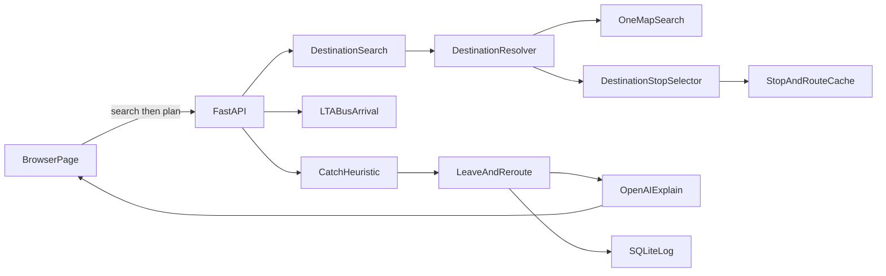
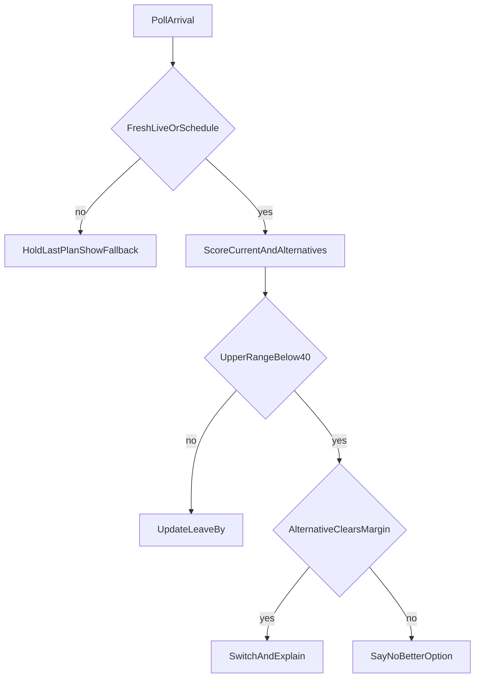

# AI-Powered Public Transport Assistant — Project Plan

Singapore bus catch assistant for the AI Lodge Hackathon ("Projects for Daily Life"). The app predicts whether the user will catch a bus and says when to leave, using live LTA DataMall arrivals plus a heuristic. OpenAI explains the result in plain language. It does not invent the number, the destination coordinates, or the bus stop.

Decisions already made: OpenAI for explanations; this build is **bus-only**. Trains are a later extension (DataMall has no live MRT arrival API). Seat/crowding, background OS location tracking, and fare optimization stay out of scope. The Bus Arrival `Load` field is ignored so crowding cannot sneak in. Destination input is a place search (OneMap), not a bus-stop code. Turn-by-turn walking navigation is out of scope.

## What changed

The user types a place ("Marina Bay Sands", "NUS", "Orchard Road", "Changi Airport") instead of a destination bus-stop name or code. OneMap resolves that text to coordinates. The app then ranks nearby LTA stops and the user confirms one. After that confirm, the existing flow is unchanged: boarding stop, live arrivals, catch probability, leave-by, reroute, OpenAI explanation.

Unchanged on purpose: the catch-probability formula, the 40% / 15-point reroute rule, LTA polling, SQLite observation fields (except that the user's position and GPS accuracy are no longer stored), and the OpenAI fact-sheet guardrail. OpenAI still does not choose coordinates, stops, or probabilities.

## New components

These sit in front of the existing pipeline. They do not replace `StopAndRouteCache`, `CatchHeuristic`, `LeaveAndReroute`, or `OpenAIExplain`.

- **DestinationSearch** — the query box and `GET /api/destinations?q=`. Runs only when the user submits. Not on each keystroke.
- **DestinationResolver** — calls OneMap Search, checks the token, and returns the result list. Zero results and outages stop here. It never picks a coordinate by itself.
- **DestinationStopSelector** — takes the place the user selected, finds nearby stops in the LTA cache, and labels each one. The user confirms one stop. That stop code is the destination the existing journey flow already expects.

## New dependency: OneMap

Provider: OneMap (Singapore Land Authority). No new Python package. The existing `httpx` client calls it.

Current docs (checked against [OneMap Search](https://www.onemap.gov.sg/apidocs/search/) and the [August 2025 workshop notes](https://www.onemap.gov.sg/apidocs/docs/workshopaug2025)):

- Search requires a token. The older unauthenticated `developers.onemap.sg/commonapi/search` URL is not the documented endpoint.
- `GET https://www.onemap.gov.sg/api/common/elastic/search?searchVal=<query>&returnGeom=Y&getAddrDetails=Y&pageNum=1`
- Header: `Authorization: <token>` (the docs pass the token itself, not a `Bearer` prefix).
- Token: `POST https://www.onemap.gov.sg/api/auth/post/getToken` with the OneMap account email and password. Tokens last 3 days. Cache the token until `expiry_timestamp`. Do not call `getToken` on every search.
- A free OneMap account is required. Store `ONEMAP_EMAIL` and `ONEMAP_PASSWORD` in `.env` (gitignored). An optional pasted `ONEMAP_TOKEN` is accepted; if it returns 401 and email/password are absent, show unavailable and ask for a fresh token.
- Routing APIs are not used.

**Zero results.** If `found` is 0 or `results` is empty, say no matches and ask the user to rephrase (building, road, or postal code). Do not guess a place. Do not pick a nearby stop.

**Several results.** Show page 1 (name and address). The user must select the place, including when there is only one hit, so a wrong geocode is never silent. Only the selected result's `LATITUDE` / `LONGITUDE` are used.

**OneMap down.** Timeout (about 8 seconds), HTTP error, 401 after a failed refresh, 403, or 429: status **unavailable**, same pattern as LTA. Say destination search is unavailable. Do not invent coordinates. Do not call a second geocoder. Do not fall back to the old unauthenticated URL. Do not start stop ranking or the catch flow.

**Rate limit.** The August 2025 workshop page says tokenized search is capped at 250 calls and does not say whether that window is per minute, per day, or per token. A demo stays inside that by searching once per submit, first page only. On 429, show unavailable and do not retry in a loop. The 20-second bus poll never calls OneMap.

## Updated user journey

1. Browser location (existing).
2. User enters an arrive-by time and submits a destination phrase.
3. DestinationResolver returns OneMap matches, or an unavailable / no-match message.
4. User selects one place.
5. DestinationStopSelector lists nearby LTA stops with walk distance, whether a bus from near the user can reach that stop, and a rough arrive-by label.
6. User confirms one destination stop.
7. Existing flow: boarding stops within 400 m, live LTA arrivals, catch probability, leave-by, reroute, OpenAI explanation of the fact sheet.

## 1. Tech stack

Hackathon-simple, Windows-native, no frontend build step.

- **Python 3.11+**, venv, `uvicorn`. Activate with `.\.venv\Scripts\Activate.ps1`.
- **FastAPI** serves a single static page and the JSON API.
- **httpx** calls LTA DataMall and OneMap Search.
- **SQLite** (stdlib) logs every scored poll from day one. It does not store the user's position or GPS accuracy.
- **openai** SDK, model `gpt-4o-mini` (name in config so it can be swapped). Structured Outputs. Temperature is `0.2`, as specified in **Step 12 specification**.
- **pytest** for the heuristic, staleness rules, destination-search fallbacks, and LLM guardrail. Tests use fixtures, not the live APIs.
- **Frontend:** one `static/index.html` plus vanilla JS. **Leaflet** with OpenStreetMap tiles (no extra key). Browser Geolocation and the Notification API.
- **Secrets:** `LTA_ACCOUNT_KEY`, `OPENAI_API_KEY`, `ONEMAP_EMAIL`, and `ONEMAP_PASSWORD` in `.env`, already covered by `.gitignore`. Optional `ONEMAP_TOKEN`. Commit `.env.example` only.

The existing gitignore is a Node template. Python cache and `*.db` get added when the app exists. No Node, Docker, or database server.

## 2. Architecture

The probability, leave-by time, reroute choice, place coordinates, and destination stop are computed in Python. OpenAI only turns the catch fact sheet into plain language. The model never invents the number, the coordinates, or the stop.



LTA calls used:

- `GET /v3/BusArrival?BusStopCode=&ServiceNo=` — live ETA, lat/lon, `Monitored` (1 = bus location, 0 = operator schedule). Updates about every 20 seconds. Next three buses per service.
- `GET /BusStops` and `GET /BusRoutes` — static, paged at 500 with `$skip`, cached to a local JSON file at startup. Routes give stop sequence, direction, and distance along the route.
- `GET /BusServices` — published frequency (`12-15` minutes). Used only to widen the range when `Monitored` is 0.

Poll only the active boarding stop plus up to two alternate stops, every 20 seconds, and only while a journey is open.

**Journey the user sets up:** browser location, an arrive-by time, and a place phrase. OneMap resolves the phrase the user selects. The selector proposes LTA stops around that point. The user confirms one destination stop. The app then picks the boarding stop within 400 m and the route itself (Step 14, section 1) and shows why it chose them. Optional preferred service number still applies in that existing step.

**Catch** means the user reaches the boarding stop before `EstimatedArrival` minus a 45-second buffer. Ride time onward is `route kilometres / 18 km/h`, labeled as an estimate, and checked against arrive-by. When that route distance is unusable, Step 9 does not invent a duration and does not perform the arrive-by comparison. The locked rule is in **Step 9 specification**.

**Proactive leave-now alert** uses the Notification API while this tab is open, including when the tab is not visible. There is no background process. A minimal service worker is used only to display local notifications and handle taps (see **Step 14 specification**, section 5). The locked rules are in **Step 10 specification**.

**Logging.** The `observations` fields are as listed in section 3. Nothing else is persisted: the search text, the selected OneMap label, the destination's latitude and longitude, and the confirmed destination stop code are not stored.

## 3. Catch probability

Ship this with no historical data. Historical lateness is logged now and applied only after a bucket has enough rows.

The point walk speed is the speed used for the request: the user's measured walking speed when the page sends one, clamped to **0.5–1.4 m/s**, and otherwise the default **1.25 m/s** (see **Walking speed** below). The range uses a slow end of speed × (1.1 / 1.25), not below 0.5 m/s (slower, worse slack), and a fast end of speed × (1.4 / 1.25), never above **1.4 m/s** (still a normal walk). At the default speed these are exactly 1.1 and 1.4 m/s. The app never tells the user to exceed a normal walking pace (up to 1.4 m/s) A GPS speed of 2.2 m/s or more is not walking, a cadence above 2.8 steps per second is not valid, and the speed is never above 1.4 m/s. Running is not reliably recognised from the motion sensor alone: without GPS a regular running rhythm can be read as a slower walking cadence, which at worst gives the capped 1.4 m/s. Pace guidance may say "Walk faster" only when range_high is at least 40% and the fast end is at least `PACE_MIN_HEADROOM_MPS` (0.05 m/s) above the point speed. With less headroom, because the user is at or near 1.4 m/s, "faster" becomes "Unlikely at a normal pace" and "slightly faster" becomes "Keep a steady pace". Below 40% it says "Unlikely at a normal pace" and never advises going faster. Pace guidance never implies more than 1.4 m/s.

```text
walk_s      = distance_m / speed_used
slack       = seconds_until_eta - walk_s - 45 - gps_penalty
slack_low   = seconds_until_eta - (distance_m / slow_speed) - 45 - (gps_accuracy_m / 1.25)
slack_high  = seconds_until_eta - (distance_m / fast_speed) - 45

P(slack)    = clamp(1 / (1 + exp(-0.025 * (slack - 90))), 0.05, 0.92)
```

The 1.25 in slack_low is the fixed error-model constant ERROR_MODEL_SPEED_MPS, not the user's pace. The probability formula, the clamps, the 40 and 50 thresholds, and the 100 m and 60 s location rules do not change.

50% sits at 90 seconds of slack. The cap is 92% and the floor is 5%, so the UI cannot show certainty. Display the point and the band: **64% (range 51–78%)**.

Adjustments:

- `Monitored == 0`: add half the published headway onto the bad side of slack, and cap the high end at 60%. Label **schedule only**.
- GPS `accuracy` worse than 100 m, or a location fix older than 60 s: same widening, label **location uncertain**. Do not issue "leave now" from that fix. The page refreshes the fix once per poll tick, so a user who stands still is not treated as uncertain; a failed request leaves its age growing. The server says why, with three additive fields on the probability: `location_reason` (`accuracy`, `age` or none; accuracy wins when both apply), `location_age_s` (the age of the fix as the server computed it) and `location_accuracy_m`. The Location uncertain card is built from those fields only, the accuracy text when the reason is `accuracy` and `Your location hasn't updated for {seconds} s.` when it is `age`, and there is no card when there is no reason. The 100 m and 60 s limits are unchanged. The age compares the phone's fix time with the server's clock, so a phone clock that is wrong by more than a few seconds shifts it.
- ETA already more than 30 s in the past: that bus is missed; score the next bus.
- Stale or API down: return **no probability**. See safety section.
- Historical factor: until 20 logged arrivals exist for that service + stop + hour-of-week, the factor is neutral and the UI says **no historical reliability yet**. Later, subtract median lateness from slack. Do not invent a reliability number before that.

**Log on every scored poll** (SQLite `observations`): timestamp, stop code, service, direction, ETA, `Monitored`, bus lat/lon, walk metres, slack seconds, P / P_low / P_high, data quality (`live`, `schedule`, `stale`, `unavailable`), whether a reroute fired, and the reason. The insert is part of the main arrivals/scoring pipeline. A poll that does not reroute is still logged. A stale or failed poll with no valid score is not a scored poll. `reroute_fired` and `reroute_reason` values are locked in **Step 11 specification**. This is the dataset that later becomes on-time reliability. The walking speed is not a column and is never written. P, P_low, P_high and slack seconds depend on it, so any later use of this dataset for on-time reliability must account for the speed each row was scored with. No code in the app reads these columns back today. The log does not store the user's position or GPS accuracy: `user_lat`, `user_lon` and `gps_accuracy` stay in the table as columns, so there is no migration, but they are always NULL. It stores the poll time, the stop, the bus position, ETA, the probabilities and data quality, and the walk distance. The table has no retention limit and no automatic deletion: rows stay until the file `observations.db` is removed. The file is in the project folder and is ignored by git (`*.db`).

### Walking speed

The server takes one walking speed per request and uses it everywhere a walking distance becomes minutes: the catch probability and its range, leave-by, the Step 9 estimate and arrival window, the overview and destination-stop walking labels, pace guidance, the AI sentence's walking time, and the reroute and Page C option scoring. With no client value every number is exactly what it was with the fixed 1.25 m/s. The constants are in `config.py`: `WALK_SPEED_DEFAULT_MPS` 1.25, `WALK_SPEED_MIN_MPS` 0.5, `WALK_SPEED_MAX_MPS` 1.4, `RANGE_SLOW_RATIO` (1.1 / 1.25), `RANGE_FAST_RATIO` (1.4 / 1.25).

- Input: the query fields `walk_speed` (m/s) and `walk_speed_source` (`gps`, `cadence`, `remembered` or `default`) on the scored endpoints (`/api/arrivals`, `/api/reroute-options`, `/api/journey-plan`, `/api/route-plan`, `/api/journey`, `/api/destination-stops`). A value that is missing, not a finite number, or from an unknown source is ignored and the default is used with source `default`. A valid value is clamped to 0.5–1.4 m/s and rounded to two decimals. In Demo Mode the client value is ignored so the fixtures stay fixed.
- Output: every response that returns a probability, an estimate or an option list carries `walk_speed_used` (two decimals) and `walk_speed_source`. The page shows what the server returns, never its own value. The poll also carries `near_stop`, true inside the 30 m rule that hides pace guidance.
- One rounding rule for labels: every walking time shown to the user is rounded half up with a minimum of 1 minute, the same as the AI sentence's walking minutes. The probability and leave-by terms stay in raw seconds, and the Step 9 sums keep rounding up.
- GPS error terms: `gps_accuracy_m / 1.25` and the widening for an old fix use the fixed `ERROR_MODEL_SPEED_MPS` of 1.25. They model GPS error, not the user's pace. For a slow walker the penalty is slightly understated, and for a fast walker slightly overstated.
- Leave-by and `notification_time` follow the slow end of the speed used. A changing speed moves them, but the leave-now notification still fires once per bus id, so a speed change cannot fire it twice.

#### Measuring the speed on the phone

- `static/walk-speed.js` does the measuring. It is the only file that stores walking data in `localStorage`. `index.html` never uses `localStorage`. (`theme-boot.js` separately stores the theme choice.)
- Motion: DeviceMotionEvent only, on the magnitude of the linear acceleration (or of the acceleration with gravity removed by a low-pass filter), so the phone's orientation does not matter. Cadence is the dominant frequency from 1.2 to 2.8 steps per second over an 8 s window (normalised autocorrelation). The pick is made inside that range first: the shortest lag whose score is at least 80% of the best score in the range, score at least 0.3. A peak above 2.8 steps per second can only reject the second: if its score is at least `RUN_REJECT_RATIO` (1.3) times the chosen in-range score, the cadence is not valid. When there is no valid in-range pick, the stride rhythm is tried (one leg cycle, which is two steps, as in a trouser pocket): the best peak between `STRIDE_MIN_HZ` (0.6) and `STRIDE_MAX_HZ` (1.4) per second with a score of at least `STRIDE_MIN_SCORE` (0.5) gives a cadence of twice its rate, valid when that lies in 1.2 to 2.8 (reported as `stride_doubled`). It never overrides a valid in-range pick, a fast peak at `RUN_REJECT_RATIO` times the stride score or more still rejects the second, and a peak below 0.6 per second is never accepted. Nothing else below 1.2 steps per second is accepted. Peaks are not counted.
- Walking detected, either of two ways. By cadence: a valid cadence, regular (coefficient of variation under 0.15, `STEADY_CV_MAX`) for about 8 s, and, when there is a GPS speed, no vehicle speed: two readings in a row at or above 2.2 m/s (`VEHICLE_CONFIRM_READINGS`) are a vehicle, one isolated reading is not. By GPS alone: a GPS speed from a fresh fix (see the next bullet) that stays between `GPS_ONLY_WALK_MIN` (0.7 m/s) and the vehicle limit (2.2 m/s) over 8 s, with a coefficient of variation under `GPS_ONLY_CV_MAX` (0.30). One reading below 0.7 m/s in the window is tolerated, two are not. An isolated reading at or above 2.2 m/s (with neighbours below it) is an outlier: it counts neither as a low reading nor in the coefficient of variation, and the window is judged on the other readings (at least 7 are still needed). Two consecutive readings at or above 2.2 m/s fail the window as a vehicle. A reading still waiting for its next neighbour is excluded provisionally, so a real vehicle is vetoed one second later. GPS alone counts even when the motion sensor is present and the cadence is irregular or missing, but the standing-still rule below still applies first. The cadence is then needed only for the cadence mode and for learning the step length, which keeps all its gates and `STEADY_CV_MAX`.
- GPS speed: `coords.speed` on a fix of at most 30 m accuracy that is at most `GPS_SPEED_MAX_AGE_S` (3 s) old; a speed is never reused from an older fix. Fixes from the location watch are stamped with the time of the position itself (`position.timestamp`), not the time the callback ran. A watch fix that arrives more than `GPS_WATCH_STALE_S` (5 s) old (a cached position) is ignored completely: it gives no speed and it is not passed on for accuracy or position either. A fix of any accuracy that is at most 5 s old is passed to the page for position and accuracy; only a fix of at most 30 m is kept for speed. If the speed is null it is derived from fixes at least 20 s apart, only when the net displacement is at least max(40 m, 4 × the accuracy).
- Standing still: with a fresh fix of at most 30 m accuracy, "walking detected" also needs a GPS speed of at least `GPS_WALK_MIN_MPS` (0.3 m/s). A window is rejected only when the speed has stayed under 0.3 m/s for `GPS_STILL_REJECT_S` (5 s) in a row. With no usable fix the rule is not applied. A rejected window is never used for learning. A phone shaken in place at a walking rhythm is therefore not walking. After the GPS speed drops below 0.3 m/s, "walking detected" can stay true for up to `GPS_STILL_REJECT_S` (5 s) because the motion rhythm persists. In that time the mode is `hold` and the speed is held, not updated.
- Step length: learned from 15 s windows of steady walking (walking in every second, a GPS speed and accuracy in every second, at least `LEARN_MIN_VALID_CADENCE` (10) seconds with a valid cadence (including a stride-doubled cadence) in the window, the cadence median and its coefficient of variation taken over those valid seconds only and steady, GPS speed steady, median accuracy at most 15 m, GPS speed 0.7–2.0 m/s, cadence 1.3–2.6, step length 0.35–1.1 m). An exponential average (weight 0.2) starts from a 0.70 m prior and is clamped to 0.45–0.95 m. A window where GPS speed and cadence × step length differ by more than 0.6 m/s is not learned from.
- Fusion, once a second, first match wins: GPS speed (`gps`); cadence × step length once at least 3 samples are learned (`cadence`); the last speed held for 30 s after walking stops; a remembered pace newer than 30 days (`remembered`); otherwise no value. A GPS speed under 0.3 m/s is a stop, not a walking speed: while the cadence window drains, the last speed is held. The speed is smoothed with a 10 s time constant, the value sent changes by at most 0.15 m/s per poll, and it is clamped to 0.5–1.4 m/s.
- GPS-only: when the motion permission is denied, there is no motion sensor, or no motion event arrives within 3 s, the GPS-alone rule above (coefficient of variation under `GPS_ONLY_CV_MAX`, 0.30, with its tolerances) is the only way to detect walking. In this mode nothing is learned and the source is never `cadence`. With a working motion sensor the same rule applies as a second way to detect walking, and the mode is then `gps`.
- Storage and privacy: motion sensor data stays on the phone. From the sensor work the server receives only the speed number and its source, and the position is sent with each request as before. The speed, its source and the position are never logged (the access log strips `walk_speed`, `walk_speed_source`, the position and the fix time), never written to SQLite, and never given to OpenAI, which still sees only whole minutes. The observations log does not store the user's position or GPS accuracy either (see the logging paragraph in section 3). The local storage keys used for walking data are `bus-catch-step-length` (length, count, date) and `bus-catch-pace` (pace, date). No raw sensor data, position or position time is stored. If storage is unavailable everything still works for the session. A hosting proxy can still record request URLs; the app cannot control that. A request that fails validation returns the usual 422 with each error's `type`, `loc` and `msg` but without the value the client sent (no `input` and no `ctx`), so a bad coordinate or speed is never echoed back. No validator or validation rule changes. The request-logging filter also covers uvicorn's trace-level request records (the `uvicorn.asgi` logger, which prints each request's query string), so the position and the speed are removed there too.
- Lifecycle: the sensors and one `watchPosition` start only after a "Start journey" tap, while polling runs on the live pages, in the foreground. They stop on Yes, No, the end card, Back or Leave, a hidden page (they resume when it is visible again), leaving the live pages, and after two polls in a row with `near_stop` (then the estimator stays off for that leg and the last smoothed speed keeps being sent). They never run on the "on your way" overview or in Demo Mode. The iOS motion permission is requested once, inside the tap, and the journey never waits for it. A new "Start journey" tap or a new leg clears the last smoothed speed, the 30 s hold and the slew state, so an old speed is never sent; a remembered pace, if one is loaded, is then what is sent (source `remembered`). Coming back after a pause (the overview, a hidden page) keeps the current speed. This is not background tracking and adds no polling timer.
- The existing per-poll `getCurrentPosition` is unchanged. A newer fix from the watch may be used by the next request. When "Start journey" is tapped and the last fix is older than 10 s, the page first asks for one fresh fix (`getCurrentPosition`, `maximumAge` 0, timeout 4 s) and then sends the first poll whatever the result, never later than 4 s after the tap. The poll interval and the location limits are unchanged.
- Debug tools (only with `?pace=debug`, removed before submission): a one-line bar fixed to the top of the screen shows the mode, the speed that a poll would send (or `-`) and one reason; a tap opens the full panel. "Record trace" records 90 s, one row per second (numbers and short tokens only, no position and no time of a position, with the values of the main constants on a first line) and, at the same time, the raw motion magnitude at 25 Hz. "Copy trace" and "Copy raw motion" copy them (a text area is the fallback). They are kept in memory only and are never stored or sent.
- The overview shows a muted line above "Start journey": `Motion data stays on your phone. Only the walking speed worked out from it is sent. Your location is sent as before.` or, when the permission is denied or there is no motion sensor, `Motion sensor is off, so your steps are not used.` The line is muted and silent (aria-live off), and it is empty in Demo Mode. No menu row is added.

### Pace guidance

Pace guidance is a display hint beside the catch-probability ring. It does not change the point, the range, `chosen_action`, leave-by, notification timing, or reroute decisions. It is not written into the OpenAI fact sheet and it is not stored in SQLite `observations`.

Pace guidance uses the speed used by the catch-probability engine (the user's measured walking speed, or 1.25 m/s by default) and its range. "Walk slower" and "Walk faster" are therefore relative to the measured pace, and "Walk faster" never implies more than 1.4 m/s (see the headroom rule in the walking-speed paragraph above). The rules below are unchanged. Measuring the speed is done on the phone, as described under **Walking speed**.

The scoring response adds a `pace` field. That field is the category from the rules below, before the two-poll display smoother. The page hides the chip when the category is absent.

First match wins:

- Hidden (no chip): `data_quality` is `stale` or `unavailable`, the location is uncertain under the Step 6 rules, or `distance_to_stop_m` < 30.
- `unlikely`: `range_high` < 40
- `faster`: point < 50
- `slightly_faster`: 50 <= point < 65
- `slower`: `range_low` >= 75, except when `data_quality` is `schedule`
- `slightly_slower`: point >= 80, except when `data_quality` is `schedule`
- `steady`: otherwise

A move toward `slower` or `slightly_slower` from a faster or steadier category is shown only after that new category appears on 2 consecutive polls. A move to `unlikely`, `faster`, or `slightly_faster` is shown on the first poll. `steady` is shown on the first poll. The page resets this state at journey start, at reroute, and at leg change.

Copy:

- slower: "Walk slower" / "You have time. A relaxed pace should still work."
- slightly_slower: "Walk slightly slower" / "You can ease your pace a little."
- steady: "Keep a steady pace" / "A normal walking pace works."
- slightly_faster: "Walk slightly faster" / "A slightly brisker walk improves your chances."
- faster: "Walk faster" / "A brisk walk improves your chances. Stay on footpaths and use crossings."
- unlikely: "Unlikely at a normal pace" / "Walking faster is unlikely to be enough. Check the reroute options or the next bus."

## 4. Auto-reroute data flow

The normal trigger is `range_high < 40%` on the current primary bus, and a qualifying alternative whose `range_low` is at least 15 percentage points above that current `range_high`. Both must hold. The point probability is not the trigger. Candidate order, the arrive-by filter, the winner, automatic switching, the cooldown, the card, the notification, and the SQLite reason are locked in **Step 11 specification**.

The destination stop is the stop the user confirmed. A reroute does not change that stop, does not pick a new place, and does not call OneMap again.



A stale or failed poll never triggers a switch. The authoritative Step 9 leave-by formula is `leave_by = ETA - slow_walk - 45s`, where `slow_walk = boarding_stop_distance / slow_speed`, and `slow_speed` is the slow end of the speed used (1.1 m/s at the default 1.25 m/s). The existing 60 s leave-now margin is not part of the Step 9 leave-by calculation. It is used only in Step 10 as `notification_time = leave_by - 60s`. Destination ride duration is not part of the leave-by formula or the notification trigger. Leave-now notification behavior is specified in **Step 10 specification**. Reroute detection and reroute notifications belong to Step 11.

OpenAI call timing, the fact sheet, in-flight handling, and the data-quality filter are locked in **Step 12 specification**. Do not call OpenAI on every 20-second poll. Do not call it to choose the place or the destination stop.

## UI and theme

Mockup fidelity rules: see .cursor/rules/mockup-fidelity.mdc. Mockup image: Bus_Assistant_Flow_Final_Design.png (repo root). Header subtitle: AI-powered bus guidance in Singapore.

This section is the single look for every later build step. It does not change catch math, leave-by, notification timing, reroute rules, Step 12 guardrails, or any exact copy string already locked below.

The visual target is the 10-screen mockup. Where that mockup and this section disagree, the mockup wins. The mockup was not attached when this section was written, so every colour, radius, space, font, type size, and icon below is a **PLACEHOLDER**. Replace placeholders from the mockup before Step 2b is implemented. Do not invent final values from the current page.

### Design tokens

All visual values live in `static/theme.css`, as CSS custom properties. On a first visit the page picks light or dark from `prefers-color-scheme`. After that the saved Light or Dark choice wins, and `data-theme` is always `light` or `dark`. `static/components.css` is a second stylesheet and uses those tokens only.

The app header has a hamburger that opens a menu panel under the button. The panel contains Appearance (Light and Dark) and Back. Demo Controls appear in that panel only when demo mode is on.

The Arrive-by row opens an inline panel with No target, In 30 min, In 1 hour, and Custom. A chosen offset becomes a fixed Singapore time, rounded up to 5 minutes.

The live journey is two views of one journey, with one poll, one set of state and one shared alert strip at the top (data-quality warnings, the end card, the compact `See other buses` warning, the Leave now banner, the reroute confirmation, the catch warning; the transfer prompt sits above the header). Both are in the page and one shows at a time. **Page A, Catch probability:** the alert strip, the probability card, the pace chip, the Leave by and Estimated arrival tiles with the spare line and Step 9 badge, If you miss it, AI Explanation, and a sticky full-width `See bus arrival times` button. **Page B, Bus arrival:** the alert strip, the bus card (service, LIVE or SCHEDULE ONLY pill, destination, refresh), the `Then Bus {service} at {stop}` line on a transfer route, the next three buses, the live map (route line, bus tag, You marker, boarding-stop chip, destination pin, Full route toggle, range chip), the status grid, and a sticky bar asking `Did you catch the bus?`. After Start journey the first poll decides which page opens (see the next paragraph). The sticky button opens Page B, and Back from Page B returns to the page it came from. In the no-service, stale, unavailable and location-uncertain states Page A shows the status card in place of the probability card, tiles, If you miss it and the AI card, and Page B shows the no-service line in place of the next-bus tiles.

**After Start journey: two scenarios, decided once.** Start journey shows a loading skeleton (`aria-busy`) until the first poll result returns, then decides once. Scenario 1, catchable: the existing unlikely rule is not met (`range_high` at or above `MIN_REAL_CHANCE_RANGE_HIGH`, the existing 40), or there is no probability (stale, unavailable, no service, no ETA). Page A opens and the data-quality layouts do not change. Scenario 2, not feasible: the rule is met (`range_high` below 40) with a live or schedule-only probability. Page C opens (the unlikely entry). The decision never navigates by itself afterwards. If the situation changes later, a compact warning appears on Pages A and B: `You're unlikely to catch the Bus {service} arriving in {n} min`, `Catch probability: {p}% (range {a}–{b}%)` and a `See other buses` button that opens Page C. It sits in the alert slot below the data-quality warnings and the end card and above the Leave now banner, the reroute confirmation, the catch warning and the notification card; the slot shows one occupant at a time, so it never shows together with another occupant, and it clears when `range_high` is back at 40 or above. The existing catch warning (`Catch chance dropping`) is unchanged. A poll no longer renders a reroute proposal in the page; the server evaluation and the locked pending notification stay, and the page asks the server to skip that evaluation (`reroute=0`) while the unlikely entry of Page C is open. After `Switch to Bus N` and `Start journey` the same decision runs again for the new bus.

**Page C, the options page.** Nothing from Page A appears on it: no pace chip, no Leave by or Estimated arrival tiles, no If you miss it, no Page A AI card, no sticky button and no compact warning. Unlikely entry, top to bottom: the current-bus card (the probability ring, `Chance to catch your Bus {service}`, a muted `Arriving in {n} min · {stop name}` line, `Range: {a} – {b}%`, the LIVE or SCHEDULE ONLY pill, `if you leave now and walk at a normal pace`, a warning line `Catching this bus is unlikely. Here are your other options.` and a `See bus arrival times` button that opens Page B for the current bus); the recommended card (heading chip `Better option found`) with its AI Explanation block; the `Alternative options` list. The unlikely entry chooses from all eligible options and does not apply the improvement rule. If the current bus becomes catchable again the warning line hides and the page does not navigate. When nothing is eligible, the current-bus card, the existing no-better-option card and the list (heading `Other buses at your stop`) show, with no recommended card and no AI block. Missed entry (after `No, I missed it`): no current-bus card; `Bus {service} has left. Here are your other options.` is the top element, then the recommended card (chip `Recommended option`) and the list. Every probability names its bus. The header of the list has a refresh icon button and a muted `Updated {time}`: it re-runs the options search with the existing `MANUAL_REFRESH_MIN_SECONDS` cooldown (aria-disabled while cooling down, spinning while it runs and static under reduced motion, disabled in Demo Mode). Back from the unlikely entry asks `Leave this journey?` while polling runs; after `No` polling has stopped, so Back goes to the overview with no confirm. Worst-case LTA calls per minute: Pages A and B 3 (one poll every 20 s), or 12 while the server evaluates a reroute (up to 3 extra calls per poll); Page C 3 from polls plus 3 per refresh at the 10 s cooldown, at most 21; each entry search makes 3 calls.

**Page A wording (a deliberate deviation from mockup 7).** The probability heading is `Chance to catch Bus {service}` with a muted `Arriving in {n} min · {boarding stop name}` line under it (one line, ellipsis, full name in a title attribute; the minutes are the arrival tile's, and with no ETA only the stop name shows). The ring's aria-label reads `{p} percent chance of catching Bus {service} arriving in {n} minutes at {stop name}, range {a} to {b} percent`. The heading replaces `chance to catch`. The Leave by tile shows exactly one of two phrases and no clock time: `Leave now` when the Python action is `leave_now`, `Wait for Leave By Alert` when it is `wait`; it is not shown for `switch_route` or `do_not_rely`. The tile, the AI advice clause and the notification all follow that one action; between two polls the page applies the same leave-by test (60 seconds or less) to a `wait`. The pace chip shows only while the action is `leave_now`; it is hidden for `wait`, `switch_route` and `do_not_rely`. The pace categories keep `Walk slower` and `Walk slightly slower`. The caption under the ring follows the `walk_speed_source` the server returned for the poll: `if you leave now and keep walking at your current pace` for `gps` or `cadence`, `if you leave now and walk at your usual pace` for `remembered`, and the existing `if you leave now and walk at a normal pace` for `default`. A muted line under it, with aria-live off, always shows the server's `walk_speed_used` in km/h to one decimal: `Walking pace: {kmh} km/h · from GPS`, `· from your steps`, `· your usual pace` or `· normal pace` (1.25 m/s shows as 4.5 km/h). If you miss it shows the first later arrival of the same service after the tracked arrival, with its estimate from the one Step 9 estimate (anchored only when that arrival is live), and is hidden when there is none. In the question bar, `Yes, I caught it` is solid green and `No, I missed it` solid red, each with white text at 4.5:1 or better in both themes (`--action-yes`, `--action-no`), an icon, and at least 44 px tall.

The boarding-stop screen and the route-options screen were removed. After the destination stop is confirmed, the app picks the boarding stop and the route (Step 14, section 1) and opens the journey overview.

| Token | Light | Dark |
| --- | --- | --- |
| `--color-paper` | `#EEF4F8` | `#0E1726` |
| `--color-card` | `#FFFFFF` | `#16223A` |
| `--color-ink` | `#1C2844` | `#E6ECF5` |
| `--color-muted` | `#5B6B82` | `#9AA9BF` |
| `--color-line` | `#DCE5EE` | `#2A3853` |
| `--color-primary` | `#1B6FE7` | `#2B6CE6` |
| `--color-primary-ink` | `#FFFFFF` | `#FFFFFF` |
| `--color-secondary` | `#E4F0FC` | `#1A2F55` |
| `--color-secondary-ink` | `#1556B8` | `#8DBBFF` |
| `--status-live` | `#0B7A4E` | `#5FE0A0` |
| `--status-schedule` | `#475467` | `#AEB9CB` |
| `--status-uncertain` | `#8A5A00` | `#F5C76A` |
| `--status-stale` | `#B42318` | `#FF9AA0` |
| `--status-unavailable` | `#B42318` | `#FF9AA0` |
| `--status-no-history` | `#475467` | `#AEB9CB` |
| `--status-simulated` | `#5B3FD0` | `#B9A6FF` |
| `--prob-point` | `#1B6FE7` | `#2B6CE6` |
| `--prob-band` | `#E4F0FC` | `#1A2F55` |
| `--prob-mark-40` | `#E5484D` | `#E5484D` |
| `--prob-mark-50` | `#F2A900` | `#F2A900` |
| `--radius-card` | `12px` | `12px` |
| `--radius-control` | `10px` | `10px` |
| `--space-1` | `4px` | `4px` |
| `--space-2` | `8px` | `8px` |
| `--space-3` | `16px` | `16px` |
| `--space-4` | `24px` | `24px` |
| `--space-5` | `32px` | `32px` |
| `--font-stack` | `system-ui, sans-serif` | `system-ui, sans-serif` |
| `--type-caption` | `0.75rem` | `0.75rem` |
| `--type-body` | `1rem` | `1rem` |
| `--type-title` | `1.25rem` | `1.25rem` |
| `--type-hero` | `2rem` | `2rem` |
| `--tap-min` | 44px | 44px |

`--tap-min` is 44px because this section requires that tap size. It is not a mockup colour.

No inline styles. No hex codes, rgb(), or hsl() outside `static/theme.css`. JavaScript only adds and removes classes. It does not set `style`, colour, or size.

### Components

Each component is defined once and reused. Variants are classes, not new components.

- **Card.** Shared shell. Variants: `info`, `caution`, `success`, `unavailable`, `simulated`. The simulated variant is how `[SIMULATED]` and the demo header sit on a card. It does not replace those strings.
- **Banner.** One full-width message row. The alert slot below is a banner or a card in that single region, not a second banner component.
- **Badge.** One status label plus its icon. Used for data quality and for the one status badge on the live screen.
- **Probability meter.** Specified under Probability meter. Not a second score widget.
- **Buttons.** `primary` and `secondary` only. Both use `--tap-min`.
- **Form field.** Label, control, and hint as one unit.
- **List item.** One row for a place or a stop. The app picks the route, so there is no route-option list.

### Status styles

Colour is never the only signal. Each state has a token, an icon token, and the label already used in this plan. Icon art is PLACEHOLDER until the mockup names it.

| State | Colour token | Icon | Label already in this plan |
| --- | --- | --- | --- |
| live | `--status-live` | PLACEHOLDER | live |
| schedule only | `--status-schedule` | PLACEHOLDER | schedule only |
| location uncertain | `--status-uncertain` | PLACEHOLDER | location uncertain |
| stale | `--status-stale` | PLACEHOLDER | stale |
| unavailable | `--status-unavailable` | PLACEHOLDER | unavailable |
| no history yet | `--status-no-history` | PLACEHOLDER | See the copy note. Section 6 says "no history yet". Section 3 and the safety bullet say "no historical reliability yet". |
| SIMULATED | `--status-simulated` | PLACEHOLDER | `SIMULATED DEMO MODE` on the page header, and `[SIMULATED]` on the affected card |

### Probability meter

The meter shows the existing point and the existing range band. The probability ring has no tick marks: a thick rounded stroke from 12 o'clock, a neutral track from the border token, and the point centred. The stroke is green from 50%, amber from 40 to 49%, and red below 40% (`--prob-ring-ok`, `--prob-ring-mid`, `--prob-ring-low`, aliases of the status tokens, at least 3:1 on the card in both themes). The number, the range and the pace chip always show too, so colour is never the only signal. The ring colour band comes from Python: the scoring response carries a `band` of `ok`, `mid` or `low` (or none when there is no probability), computed from the point with the thresholds named in `config.py`, and the page only maps the band to a token.

- 40% stays the Step 10 leave-now gate (`range_high >= 40%`) and the Step 11 reroute trigger (`range_high < 40%`).
- 50% stays the Step 14 caution, which appears when the live Leg 1 point is below 50%. It still does not fire a notification by itself.

Do not change either threshold, the sigmoid, the 5% floor, the 92% cap, or the schedule-only 60% cap.

### Layout

Mobile first. One column at every width until the mockup shows otherwise. The sticky bottom button (Page A) and question bar (Page B) stay on screen while the live journey is shown. Tap targets are at least `--tap-min`.

On the live journey screen, the default view is the hero (probability and leave-by), one status badge, and the AI Explanation card. Arrive-by check, data-quality detail, and the Leg 2 schedule expectation sit in an expandable **Details** region. See Live screen simplification.

### Accessibility

Do not use colour alone. Text, the status icon, and the label travel together. Text and controls meet WCAG AA contrast against the token pairs above, once real mockup colours replace the placeholders. The probability region and the AI Explanation region use `aria-live="polite"`.

### Contrast

Measured against the light and dark tokens in `static/theme.css`. Every pair below is at least 4.5:1.

| Pair | Light | Dark |
| --- | --- | --- |
| Ink on paper | 13.18 | 15.12 |
| Ink on surface | 14.62 | 13.35 |
| Muted on paper | 4.89 | 7.53 |
| Muted on surface | 5.43 | 6.65 |
| White on primary | 4.69 | 4.78 |
| Link on paper | 4.53 | 7.28 |
| Link on surface | 5.02 | 6.43 |
| Info on tint | 5.95 | 6.76 |
| Info on paper | 6.20 | 9.14 |
| Success text on tint | 4.91 | 8.82 |
| Warning text on tint | 5.38 | 8.75 |
| Danger text on tint | 5.56 | 7.94 |
| Neutral text on tint | 6.79 | 6.88 |
| Simulated text on tint | 5.83 | 6.96 |

### Empty, loading, and error

Do not add new empty or error sentences in this section. Reuse the messages already locked in Steps 9–14 and in section 6.

The standard loading indicator is the existing card-header status `● Updating explanation...`. Keep the previous content on screen while it shows. Do not clear the region to a blank loading state.

### Map

Map markers use theme tokens, not hex in JavaScript. Three markers: user, boarding stop, and destination stop. Marker shape and icon art are PLACEHOLDER until the mockup specifies them.

### Screens

| Screen | Components |
| --- | --- |
| Search | Form field, primary button |
| Pick place | List item, info card |
| Pick stop | Map (user and boarding-stop markers), list item, primary button |
| Journey overview (route picked by the app, with the reason) | Timeline card, badge, primary button |
| Live journey | Page A (probability ring, pace chip, tiles, If you miss it, AI Explanation card) and Page B (bus card, next buses, live map, status grid), one shared alert slot, a sticky button or bar on each |
| Reroute | Card (`success` while the switch is shown), banner only through the alert slot |
| Unavailable | Card variant `unavailable`, status badge |

### Alert slot

The transfer prompt (Step 14) is pinned above the header, outside the slot. In the slot, the data-quality warnings come first: the stale or unavailable banner with its status card, and the no-service status card. The location-uncertain card stacks under them, and it also shows alone. After the warnings come, in this order, the Step 14 end card, the Leave now banner, the reroute block, the Step 14 caution banner, and the Step 10 notification-permission occupant last. That last occupant holds Notifications Optional, the denied banner, or the granted line `Notifications active — Leave-now alert set`. Only the first active occupant after the warnings shows. Every later one is hidden while a higher one is showing, and a data-quality warning hides all of them. The end card never shows together with the Leave now banner or the reroute block, because ending tracking clears both. Their copy stays exactly as written in **Step 10 specification** and **Step 14 specification**. This rule does not add a permission request and does not change when a leave-now notification fires.

### Copy constants

User-facing copy belongs in `static/copy.js`. That file is a classic script: it assigns the `copy` object and is not an ES module. Add a Python mirror only if a test needs to import the same strings. This plan does not name that Python path. Later edits to this plan should point at the constants file instead of pasting the sentence again. Do not delete the strings already written here.

Sections that currently define user-facing strings:

- Section 3, including the point-and-range example and the schedule-only, location-uncertain, and historical-reliability labels
- Section 6, including the catch-claim sentence and the "no history yet" / "no historical reliability yet" wording
- Step 9 specification: ride-time unavailable, and the arrive-by check labels and messages
- Step 10 specification: leave-now title and body, the permission card, the granted line, and the denied banner
- Step 11 specification: both no-better sentences, the reroute card, the reroute notification, and `reroute_reason`
- Step 12 specification: the AI Explanation title, `● Updating explanation...`, the fallback template, and the four action sentences
- Step 13 specification: `SIMULATED DEMO MODE`, `[SIMULATED]`, and the seven scenario names
- Step 14 specification: the no-feasible-route sentence, the three option labels, the caution banner, and the question bar and end card strings in that section (proposed, needs approval)
- Section 3, Walking speed: the two extra probability captions, the four `Walking pace` lines, and the two overview motion-sensor lines (approved)

### Live screen simplification

The live journey shows three things by default: the hero (probability and leave-by), one status badge, and the AI Explanation card. Arrive-by check, data-quality detail, and the Leg 2 schedule expectation move under expandable Details. This is a layout rule. It does not remove arrive-by math, data-quality handling, or the Leg 2 schedule.

Step 14, the multi-leg assistant, is a stretch goal behind a finished single-leg flow. Finish search, place, stop, one route, and the live single-leg screen first. The Step 14 specification stays locked. It does not jump ahead of that single-leg flow.

## 5. Build order

Each step is one commit with something a judge can see or a test can run.

1. This plan.
2. Skeleton: FastAPI, static page title, `.env.example` (including OneMap), README run steps on Windows.
2b. Theme and component kit: `static/theme.css` plus `static/styleguide.html`. The style guide shows every component and every status state in light and dark. This step does not change catch math, thresholds, or existing copy. Numbered steps 3–14 and every **Step N specification** stay numbered as they are.
3. LTA client: download and cache stops and routes; internal stop lookup by code and name for the selector.
4. Map page: browser location, nearest boarding stops within 400 m.
5. Live arrival panel for a chosen stop and service, including the `Monitored` label and the fetch timestamp.
6. Heuristic module plus pytest. Show point and range on the page. No LLM yet.
7. OneMap DestinationSearch and DestinationResolver: submit a phrase, show page-1 matches, require a selection. Tests for zero results, timeout, and 429 using fixtures.
8. DestinationStopSelector: nearby LTA stops, reachability, user confirms one stop.
9. Journey form continues from that confirmed stop: arrive-by, connecting service, estimated ride time, leave-by clock. An unavailable ride duration follows **Step 9 specification** below.
10. Leave-now browser notifications, tab open only, as specified in **Step 10 specification**. This step is separate from the Step 9 leave-by formula. Reroute and alter-service notifications are Step 11.
11. Auto-reroute scoring, the trigger, the automatic switch, the reroute card, the reroute notification, and the reason stored in the existing `observations` table, as specified in **Step 11 specification**. OpenAI explanation of the switch is Step 12.
12. OpenAI explanation, as specified in **Step 12 specification**, including the fixture tests listed there. No live OpenAI calls. All earlier step tests remain passing.
13. Demo Mode, as specified in **Step 13 specification**. It is enabled only when `DEMO_MODE` is exactly `true`. It shows the seven interactive scenarios without waiting for a real outage. README demo instructions belong to the implementation step, not to this specification lock.
14. Multi-leg journey assistant, as specified in **Step 14 specification**. Route options stay static and deterministic. Live catch probability starts only after the app picks one option and the user presses Start journey. This step does not rewrite Steps 1–13 and does not add Step 15. Step 14 is a stretch goal behind a finished single-leg flow. The specification stays locked; this sentence only sets build order.

## Step 9 specification

Approved decision: the journey continues when route distance or ride duration cannot be calculated. The ride estimate is marked unavailable. Step 8 is unchanged: `is_reachable = true` may coexist with `rough_journey_minutes = null`.

### Ride duration

`rough_journey_minutes` from Step 8 may be null. Step 9 may expose this as `ride_minutes`.

If the route distance needed for the ride estimate is unavailable, invalid, non-numeric, non-finite, or otherwise unusable:

- `ride_minutes = null`
- Do not fabricate, infer, substitute, or approximate a route duration.
- The UI displays `Ride time: Unavailable`.

### Arrive-by status

The arrive-by input remains available. This status is a rough journey-duration comparison. It is not a catch probability and must not be presented as one. Catch-probability copy is unchanged: when a catch probability is shown it includes a point and a range, and the app never says "you'll make it."

When a target arrive-by time is set and `ride_minutes` is valid:

On time or early, when estimated journey arrival is at or before the arrive-by target:

- Badge / label: `Arrive-by check: On track`
- Message: `Estimated arrival is at or before your requested time.`

Late, when estimated journey arrival is after the arrive-by target:

- Badge / label: `Arrive-by check: Risk of delay`
- Message: `Rough check: may miss arrive-by time.`

When `ride_minutes` is null:

- Do not perform the arrive-by comparison.
- Badge / label: `Arrive-by check: N/A`
- Message: `Destination ride duration unavailable; cannot verify target arrival time.`
- Do not replace the unavailable duration with an estimate or a guess.
- The journey stays usable, and the leave-by calculation stays functional.

For a one-transfer route, the arrive-by check uses the sum of both legs' ride minutes together with the same walk and half-headway terms as a direct ride, and it shows N/A when either leg's ride_minutes is null.

### Arrival range, spare minutes, and a missed bus

The point estimate stays that same door-to-door total: the walk to the boarding stop at the speed used (1.25 m/s by default), half of Leg 1's published headway, the ride at 18 km/h (both legs on a transfer), and the walk on from the destination stop at the speed used, rounded up to a whole minute. The 45 s board buffer and the 60 s leave-now margin are not part of it. On track means the point is at or before the target. Risk of delay means it is after. Spare minutes are the target minus that same point. They are not shown as a line anywhere: only a negative value is used, as the late wording (`about N min late`) inside If you miss it. The Arrive-by check badge sits at the top left of the AI Explanation card (under the tiles when that card is not shown), is hidden with no target, and is prefixed `If you catch this bus: ` when the ring band is mid or low, because it assumes the user catches this bus. The range changes only the end walk and the ride: early uses the fast end of the speed used (1.4 m/s at the default) and ride × (1 − RIDE_TOLERANCE), late uses the slow end (1.1 m/s at the default) and ride × (1 + RIDE_TOLERANCE), and RIDE_TOLERANCE is 0.15. A null ride still shows N/A and no invented number. A second live arrival can be estimated with those terms, assuming the user catches that bus. When the tracked bus has a live (monitored) arrival time, the estimate is anchored to it: the half-headway wait is replaced by the wait for that bus (the larger of the walk and the time until it arrives) and no other term changes. A schedule-only bus, or a bus with no live arrival, keeps the planned basis. The live tile, the new-journey overview and the reroute options all use this one estimate. If every route option the app considered arrives after the target, a non-blocking warning says so.

### Leave-by calculation

The authoritative Step 9 formula is `leave_by = ETA - slow_walk - 45s`, where `slow_walk = boarding_stop_distance / slow_speed`, and `slow_speed` is the slow end of the speed used (1.1 m/s at the default 1.25 m/s).

The 45 s board buffer, the 60 s leave-now margin, the 60 s location-fix age threshold, and the 60 s stale-arrival-data threshold stay separate. The 60 s leave-now margin is not part of the Step 9 leave-by calculation. The 60 s location-fix age threshold and the 60 s stale-arrival-data threshold are not terms in this formula.

Leave-by remains fully functional and is independent of destination ride duration.

Do not add route duration to the leave-by formula. Missing ride duration does not block live catch probability or leave-by.

Leave-now notification timing is specified in **Step 10 specification**. It is `notification_time = leave_by - 60s`. That subtraction is not part of this Step 9 formula.

### Journey flow

A reachable destination stop with `ride_minutes = null` remains selectable and confirmable. Do not block the user from continuing solely because ride duration is unavailable.

### Transparency

Never replace unavailable ride duration with a guessed value. Never perform an arrive-by comparison using an assumed duration.

## Step 10 specification

Step 10 is strictly limited to leave-now browser notifications. Reroute detection, route switching, and reroute or alter-service notifications belong to Step 11 and are not part of Step 10.

### 1. Leave-now trigger

The Step 9 leave-by formula remains `leave_by = ETA - slow_walk - 45s`, where `slow_walk = boarding_stop_distance / slow_speed`, and `slow_speed` is the slow end of the speed used (1.1 m/s at the default 1.25 m/s).

The Step 10 notification trigger is `notification_time = leave_by - 60s`, where the 60 s is the existing leave-now margin.

The 60 s leave-now margin is used only to determine when the notification fires. It is not part of the Step 9 leave-by clock. Do not modify the Step 9 leave-by formula.

A leave-now notification is eligible when the current time reaches `notification_time`.

### 2. Catch-probability requirement

A leave-now notification may fire only when the current primary bus has `range_high >= 40%`.

If `range_high < 40%`, do not issue a leave-now notification.

This requirement applies to the primary bus being evaluated for the notification. Do not substitute point probability for `range_high`. Do not create a new probability formula or threshold.

### 3. Notification payload

When the notification fires, use this payload:

- Title: `Leave Now — Bus {service_no}`
- Body: `Walk to {stop_name} ({stop_code}) now to catch Bus {service_no}. Catch probability: {point}% ({range_low}–{range_high}%).`

Use the current primary bus or service and the selected boarding stop. The displayed probability uses the existing Step 6 point and range. The leave-now alert is also shown as an in-app banner, with the same title and body and the same once-per-bus rule, at the same moment as the notification, whatever the notification permission is.

### 4. Browser permission

The app uses the browser Notification API. This permission lifecycle is part of Step 10 leave-now notifications.

The app must never automatically call `Notification.requestPermission()`. Automatic permission requests are prohibited during page load, destination selection, boarding-stop selection, destination-stop confirmation, Step 9 journey-form opening, arrival polling, leave-by calculation, and notification-trigger evaluation.

When `Notification.permission === "default"`, the journey panel shows an inline action card containing:

- Title: `Notifications Optional`
- Description: `Get an audio/visual alert 60 seconds before your walk deadline.`
- Action: `Enable Notifications`

Only an explicit click on `Enable Notifications` may call `Notification.requestPermission()`.

After that explicit request succeeds and permission is `granted`, replace the enable action with `Notifications active — Leave-now alert set`. Do not request permission again automatically.

When `Notification.permission === "denied"`, keep the core journey UI and live catch-probability calculations active. Show the inline informational banner exactly `Browser notifications are blocked. Keep this page open to see live leave-by alerts.` Do not disable the journey because notifications are blocked. Do not repeatedly request permission.

Permission state controls whether the browser notification can be delivered. It must not alter the leave-by calculation, the catch-probability calculation, or live arrival polling. The Step 10 trigger remains `notification_time = leave_by - 60s`, and the existing `range_high >= 40%` requirement remains unchanged. Do not add any other permission-related timing or automatic permission prompts.

### 5. Hidden or background tab

Notifications may fire when the tab is open even if the tab is not currently visible or active. The requirement is tab-open only. There is no background process or server-side notification system. The only service worker is the minimal one in **Step 14 specification**, used only to display local notifications and handle taps.

### 6. Duplicate notifications

Track the last notified primary bus in frontend state as `lastNotifiedBusId`.

A notification may fire at most once for a specific primary bus arrival. After a notification fires for a bus, do not fire again for that same bus ID while it remains the primary target.

Reset `lastNotifiedBusId` only when a different bus becomes the primary target. Do not add other reset conditions.

### 7. Missed primary bus

If the current primary bus becomes missed under the existing Step 6 rule (ETA already more than 30 s in the past):

- Cancel or clear the pending notification for that bus immediately.
- Reevaluate immediately using the next approaching bus for the selected service.
- Calculate that next bus's notification timing from its own live ETA.
- Apply the same `range_high >= 40%` requirement.

Do not notify for the missed bus. Do not alter the existing Step 6 missed-bus scoring rule.

### 8. Data-quality safety

A leave-now notification must not fire when the existing project rules say the data is not safe.

- Unavailable arrival data: no notification.
- Stale arrival data: no notification.
- Uncertain GPS or location fix under the existing Step 6 rules: no notification.
- Missed primary bus: cancel its notification and reevaluate the next bus.

Do not create a new stale-data or GPS-quality threshold. Reuse the existing Step 5 and Step 6 definitions: last good Bus Arrival response older than 60 seconds is stale; GPS accuracy worse than 100 m, or a location fix older than 60 s, is location uncertain.

### 9. Separation from Step 9

The Step 9 leave-by clock stays independent of notification behavior.

- Step 9: `leave_by = ETA - slow_walk - 45s`
- Step 10: `notification_time = leave_by - 60s`

Destination ride duration is not part of the notification trigger or the leave-by formula.

### 10. Scope

Step 10 covers leave-now notifications only, including the permission lifecycle above. It does not include reroute detection, reroute notifications, route switching, alter-service notifications, alternate-destination notifications, additional notification types, OpenAI explanations, background tracking, or server-side notifications. Reroute detection, the automatic switch, and the reroute notification are **Step 11 specification**. OpenAI explanations remain Step 12.

## Step 11 specification

Step 11 is auto-rerouting. It scores alternate candidates, applies the trigger, selects one winner, and shows it as a proposal; the active route switches only when the user confirms with the Switch button. After that tap it shows the reroute card, sends the reroute browser notification when notifications are already enabled, and stores the reason in the existing `observations` table.

### 1. Reroute trigger

The normal auto-reroute trigger requires both:

1. The current primary bus has `range_high < 40%`.
2. A qualifying alternative has `alternative.range_low >= current.range_high + 15` percentage points.

The point probability is not the trigger. Both conditions must hold. A stale or failed poll never triggers a reroute. Evaluation uses only fresh live or schedule arrival data, under the existing data-quality rules.

### 2. Candidate alternatives

Evaluate candidates in this order:

1. The same service at the current boarding stop: `NextBus2`, then `NextBus3`.
2. Every other service at the current boarding stop that reaches the destination, all of its arrivals (one `BusArrival` lookup for the stop with `ServiceNo` omitted).
3. Other eligible buses and services at alternate boarding stops within 400 m of the user's current location (one lookup per stop).

A candidate may be the same service number at a different nearby boarding stop, or a different service number at a nearby boarding stop. When more than two eligible alternate boarding stops are within 400 m, poll the two closest by straight-line haversine distance from the user's current GPS location. Do not use another stop-ranking method.

An alternate candidate must still reach the confirmed destination stop in the required route direction. The confirmed destination stop never changes during an auto-reroute. No OneMap search occurs during rerouting.

### 3. Alternative catch scoring

Use the existing Step 6 catch heuristic exactly. Do not create a second probability formula. For each candidate, score catch probability from the user's current location and that candidate's boarding stop, using the candidate bus ETA and the existing walk-speed, range, and buffer rules. Preserve the existing data-quality handling. Reachability determines eligibility. It does not change the probability mathematics.

### 4. Arrive-by target

No candidate is dropped for arriving after the arrive-by time. Each option's estimated destination arrival comes from the one Step 9 estimate (anchored to the bus's live arrival when it has one). An option whose estimate is after the target stays in the list with the label `After your target` and no minute counts. An option with no ride duration has no estimate: it is not on time, it is never preferred over an option that has an estimate, and it never gets the `Reach your destination quickly` pill. Do not guess a ride duration.

### 5. Recommended option

The improvement rule in section 1 now decides only the server-side pending notification. The unlikely entry and the `No, I missed it` entry both choose from all eligible options. Both use one pure function, `recommend_option`, with named constants in `config.py`: `RUSH_MARGIN_MINUTES = 10`, `PROB_TIE_POINTS = 5` and `MIN_REAL_CHANCE_RANGE_HIGH = 40` (the same 40 as the trigger). The rules are ordered and deterministic and there is no blended score. The three factors are the arrive-by target T, the catch probability and the walking distance d to the option's stop (0 at the current stop). The first matching rule wins:

0. Eligible options have `range_high` at or above `MIN_REAL_CHANCE_RANGE_HIGH`. With none, there is no recommendation: the existing no-better-option or no-service card shows. An option that is not eligible is never recommended.
1. T is set. `ontime` is the eligible options whose estimated arrival A is at or before T. With none on time, recommend the eligible option with the earliest A (ties: higher probability, then shorter d), reason `NONE_BY_TARGET`. Otherwise `best` is the on-time option with the highest point probability (a difference of at most `PROB_TIE_POINTS` is a tie and goes to the shorter d, then the earlier A). If T minus A of `best` is less than `RUSH_MARGIN_MINUTES`, recommend the on-time option with the earliest A (ties: higher probability, then shorter d): `FASTEST_RUSHING`, or `HIGHEST_CHANCE_ON_TIME` when it is `best` itself. Otherwise recommend `best`: `HIGHEST_CHANCE_ON_TIME`, or `SHORTER_WALK` when the walk tie-break decided it.
2. T is not set. Recommend the highest point probability (ties within `PROB_TIE_POINTS`: shorter d, then earlier A): `HIGHEST_CHANCE`, or `SHORTER_WALK` when the walk tie-break decided it.

The reason sentences are written by Python and never by the model (`{s}` is the service number): `FASTEST_RUSHING` "Your arrive-by time is close, so Bus {s} is recommended: it should get you to your destination first."; `HIGHEST_CHANCE_ON_TIME` "Bus {s} is recommended: it has the highest chance of catching, and it should still get you there by your arrive-by time."; `HIGHEST_CHANCE` "Bus {s} is recommended: it has the highest chance of catching."; `SHORTER_WALK` "Bus {s} has a similar chance to the other options, and the walk to its stop is shorter."; `NONE_BY_TARGET` "No option should reach your destination by your arrive-by time. Bus {s} should get you there earliest." (proposed wording).

### 6. Automatic route switching

The reroute is automatic. When the trigger and a qualifying alternative are met, replace the active `selectedBoardingStop`, the active `selectedService`, and the active primary-bus target. Keep `confirmedDestinationStop` unchanged. The backend selects the winning alternative and returns the reroute payload. Do not require another user confirmation before switching. Do not change the selected OneMap destination.

#### Same-stop target pinning

`not_before` is not part of the Step 11 contract. Do not filter or alter the raw LTA BusArrival feed in order to pin a rerouted same-service, same-stop bus.

- Do not remove earlier ETA buses from the LTA response.
- Do not add a `not_before` filter to BusArrival polling.
- Do not modify the Step 6 arrival list before `score_buses`.
- Preserve the existing Step 6 arrival-selection flow and the raw arrival list.

When a reroute selects a later bus at the same service and the same boarding stop, store that choice in journey / reroute state. That state must not mutate or filter the underlying LTA arrivals feed.

Subsequent probability calculations continue to use the existing Step 6 logic against the appropriate active target. Do not change the raw arrival response. Do not invent a new probability formula.

This rule supersedes any implication that a `not_before` filter should be used to preserve the pinned target. Do not keep an absent bus in the arrival list by filtering earlier ETAs.

#### Same-stop / same-service pinned target identity

This rule is final. It applies only to a pinned same-service, same-boarding-stop target created by an automatic Step 11 reroute. LTA BusArrival provides the dynamic slots `NextBus`, `NextBus2`, and `NextBus3`. Do not invent a persistent vehicle ID. The slot name is not the identity.

When that reroute selects a later bus as the active target, store:

`pinned_eta_timestamp = target_bus.estimated_arrival_epoch`

On every subsequent fresh poll for the same service and boarding stop, identify the pinned target by ETA continuity:

1. Consider every returned non-missed bus in `NextBus`, `NextBus2`, and `NextBus3`.
2. For each candidate, calculate `eta_difference = abs(candidate_eta_epoch - pinned_eta_timestamp)`.
3. Select the candidate with the smallest absolute ETA difference only when `eta_difference <= 180` seconds.
4. If a matching candidate exists, treat that candidate as the active pinned target and update `pinned_eta_timestamp = matching_candidate_eta_epoch`. The matched candidate's current slot may change among `NextBus`, `NextBus2`, and `NextBus3`.

Before accepting a continuity match, apply the existing Step 6 missed-bus rule to the stored pin. If `current_time - pinned_eta_timestamp > 30` seconds, the pinned target is missed. Clear the pin, set `pinned_eta_timestamp = null`, and do not continue matching it. Return to standard Step 6 primary-bus scoring on the complete, unfiltered arrival list.

Also clear the pin when no returned non-missed candidate satisfies `abs(candidate_eta_epoch - pinned_eta_timestamp) <= 180` seconds. Then set `pinned_eta_timestamp = null`, use the complete raw arrival list, run standard Step 6 primary selection, and use that new primary for catch probability, leave-by, Step 10 leave-now evaluation, and Step 11 reroute evaluation. Do not retain an ETA, probability, or leave-by value for the cleared target. Do not treat an unexplained disappearance as automatically missed. Only the existing Step 6 missed-bus rule determines whether a bus is missed.

ETA continuity matching must not filter the raw LTA arrival response, remove buses before Step 6 scoring, modify `NextBus` / `NextBus2` / `NextBus3` ordering, use `not_before`, or introduce a vehicle-ID field that LTA does not provide. The complete arrival list continues through the normal Step 6 pipeline. The pinned-target state is separate journey state used to identify which already-scored candidate is the active target.

This identity rule does not change normal Step 6 primary selection, the catch-probability formula, the greater-than-30-second missed-bus rule, a different-service reroute, a different-boarding-stop reroute, the confirmed destination stop, Step 9 leave-by, or Step 10 notification timing.

### 7. Cooldown

After an auto-reroute fires, enforce a 120-second cooldown. During those 120 seconds, no reroute evaluation may execute, and no further reroute may execute. Do not display an additional no-better message during the cooldown. After the cooldown expires, a re-switch is allowed only when a new candidate's lower bound is at least 20 percentage points above the current active route's upper end, and the current primary still has `range_high < 40%`. Do not switch only because the cooldown expired. Do not add another reset or debounce rule.

### 8. GPS uncertainty

Auto-rerouting is suppressed when the current location is uncertain under the existing Step 6 rules: GPS accuracy worse than 100 m, or a location fix older than 60 s. When location is uncertain, do not auto-reroute, and keep the current active route. Continue the existing Step 6 location-quality handling. Do not invent another GPS threshold.

### 9. No better option

The no-better message depends on whether this journey has already completed an auto-reroute. Keep the current plan. Do not invent another route. Do not switch.

**Standard state.** Before any auto-reroute has fired, when the current primary has `range_high < 40%` and no alternative satisfies the normal `+15` percentage-point improvement (`alternative.range_low >= current.range_high + 15`), display exactly:

`Primary bus target has low catch probability ({point}%), but no better direct alternative meets the 15% improvement threshold.`

**Post-reroute state.** After an auto-reroute has fired and the 120-second cooldown has expired, when the current primary has `range_high < 40%` and no alternative satisfies the stricter `+20` percentage-point re-reroute threshold (`alternative.range_low >= current.range_high + 20`), display exactly:

`Primary bus target has low catch probability ({point}%), but no better direct alternative meets the post-reroute 20% improvement threshold.`

The post-reroute wording does not replace the normal `+15` trigger. It describes the stricter re-reroute evaluation after the cooldown. During the 120-second cooldown itself, no reroute evaluation may execute. Do not infer an additional no-better message beyond the two states above.

### 10. Reroute card

When an automatic reroute occurs, show a persistent reroute card in the journey view.

- Title: `Route Updated`
- Message: `Switched to Bus {new_service} at {new_stop_name} ({new_stop_code}).`
- Probability line: `Catch probability: {new_point}% (range {new_low}–{new_high}%) vs previous {old_point}%.`

Use the heuristic values from the old and new primary targets. Do not present a catch probability without a point and a range.

### 11. Reroute browser notification

When a reroute occurs and browser notifications are already enabled, fire a browser notification.

- Title: `Route Updated — Bus {new_service}`
- Body: `Switched to Bus {new_service} at {new_stop_name}. Catch probability: {new_point}% (range {new_low}–{new_high}%).`

Do not alter the Step 10 leave-now permission lifecycle. Do not add another automatic permission request. If notifications are not enabled, the in-page reroute card still appears.

While a proposal is waiting for the user's tap, the notification uses the pending wording once it is approved (proposed: title `Better option — Bus {new_service}`, body `A better option is available. Open the app to switch.`). The locked title and body above are used after the user switches.

### 12. SQLite persistence

Every scored poll inserts one row into the existing `observations` table. The logging path is part of the main arrivals/scoring pipeline. Do not restrict insertion to reroute planning.

Log a scored poll that does not reroute, that finds no better alternative, that is eligible for reroute evaluation but does not switch, that occurs before the first reroute, and that occurs after a reroute. Do not omit a row because no reroute occurred.

A stale or failed poll with no valid score is not a scored poll. Those polls stay under the existing data-quality rules and do not insert an observation under this rule.

Each row keeps the section 3 fields: timestamp, stop code, service, direction, ETA, `Monitored`, bus latitude/longitude, walk metres, slack seconds, P, P_low, P_high, data quality, `reroute_fired`, and `reroute_reason`. The user's position and GPS accuracy are not stored: their columns stay in the table and are always NULL.

When the poll does not reroute, `reroute_fired = 0` and `reroute_reason` is empty. When a reroute fires, `reroute_fired = 1` and `reroute_reason` is exactly:

`Switched from Bus {old_service} ({old_stop_code}) [high: {old_high}%] to Bus {new_service} ({new_stop_code}) [low: {new_low}%]: +{margin}% margin`

`{margin}` is `new_low - old_high`, in percentage points. Do not create a separate reroutes table.

### 13. Polling and freshness

Use the existing active-journey polling. Do not create a second LTA polling loop. A reroute decision uses fresh arrival data. A stale or failed poll does not trigger a reroute, does not switch the route, and keeps the current plan.

### 14. Missed buses

A bus is missed when its ETA is more than 30 seconds in the past, the existing Step 6 rule. Do not create a separate missed-bus probability rule. The existing arrival-selection flow continues to identify the next non-missed bus from the raw arrival list. Do not remove earlier buses from that list to pin a same-stop reroute target. `not_before` is not part of this contract.

### 15. Journey state

The confirmed destination stop stays fixed. The active route changes only through the normal user-selected journey setup or the automatic reroute above. Do not switch the route for any other reason. Do not add reset behavior beyond the 120-second cooldown, the existing journey lifecycle, and clearing `pinned_eta_timestamp` when the stored pin is more than 30 seconds overdue or no non-missed candidate is within 180 seconds, as specified under **Same-stop / same-service pinned target identity**.

### 16. Scope

Step 11 includes alternate-candidate scoring, the reroute trigger, winning-candidate selection, the automatic state switch, the reroute card, the reroute browser notification, and the SQLite reroute audit fields.

Step 11 does not include OneMap searches, changing the destination place, changing the confirmed destination stop, OpenAI explanation, background tracking, server-side notifications, a second polling loop, a `not_before` filter on BusArrival polling, a change to the raw LTA arrival list before `score_buses`, or a change to the Step 6 probability formula.

## Step 12 specification

OpenAI is an explanation layer only. Python remains authoritative for probability, the probability range, leave-by, reroute choice, coordinates, the destination stop, the boarding stop, service and route selection, and the chosen action. OpenAI must never calculate, modify, select, resolve, rank, or override any of those values.

Do not call OpenAI on every 20-second poll. Do not call it for destination-place selection or destination-stop selection. Do not call it before there is a valid scored result.

### 1. Journey-start trigger

After Step 9 confirms the destination stop, the first valid scored bus result triggers the initial OpenAI explanation request. That request uses the already-computed Python fact sheet.

### 2. Band-change trigger

Store the range endpoints from the most recently rendered valid explanation:

- `last_explained_range_low`
- `last_explained_range_high`

A new explanation is triggered when either condition is true:

`abs(current_range_low - last_explained_range_low) >= 10`

or

`abs(current_range_high - last_explained_range_high) >= 10`

The comparison is in percentage points. A change in either direction qualifies, whether the band improves or worsens. Compare against the fact sheet of the last rendered valid explanation, not merely the last requested explanation.

Do not use the point probability alone, the range width, or another derived metric.

### 3. Multiple events on one poll

If one polling tick both causes a qualifying band change and causes an auto-reroute, make exactly one OpenAI request. That request uses the updated post-reroute fact sheet and `chosen_action = "switch_route"`. Do not send separate pre-reroute and post-reroute requests for the same polling tick.

### 4. In-flight requests

Set `explanation_request_in_flight = true` while an OpenAI request is active.

If a new explanation trigger occurs while a request is in flight, do not start another simultaneous request. Retain the latest triggering fact sheet as pending. After the current request completes or times out, evaluate and process that latest pending fact sheet. Do not process obsolete intermediate fact sheets ahead of the latest pending one.

A timeout is longer than 3 seconds. Timing out sets `explanation_request_in_flight = false` before the latest pending fact sheet is processed.

### 5. Data-quality filter

OpenAI may be called only for valid scored data whose `data_quality` is `live`, `schedule`, or `location uncertain`.

Do not call OpenAI when `data_quality` is `stale` or `unavailable`. When data is stale or unavailable, immediately render the deterministic fallback card. Core journey behavior continues normally.

### 6. Fact sheet

The model receives only this fact sheet, and nothing else:

```json
{
  "reason_code": "TIME_TO_SPARE",
  "chosen_action": "wait"
}
```

`reason_code` is one of `LOCATION_UNCERTAIN`, `UNLIKELY`, `MAY_NOT_REACH`, `TIME_TO_SPARE` (the variant of sentence two that Python chose). `chosen_action` is one of the four actions. The request contains no number at all: no minutes, no probability, no range, no slack, no seconds. OpenAI receives no spatial-selection information: no coordinates, no bus-stop identity, and no request to select, resolve, or rank a place or a stop. The eight-field fact sheet that this section used to list is replaced by this one.

### 6a. The Page A text, the tracked bus and the snapshot key

The AI Explanation card on Page A has exactly three sentences. Python writes sentences one and two, in the same poll response and from the same numbers as the arrival tile and the catch card: `The bus is {e} minutes away.` (`The bus is 1 minute away.` when e is 1; `The bus is arriving now.` when it is under a minute) and one of four wordings for the walk (`Your location is uncertain, so the walking time may be off.`; `Given the walking time is {w} minutes, catching this bus is unlikely.`; `Given the walking time is {w} minutes, you may not reach the stop before the bus.`; `Given the walking time is only {w} minutes, you have {t} minutes to get to the bus stop.`). Sentence three is `It is advisable to {advice}.`, where the model supplies only the advice words and Python assembles the sentence, falling back to a fixed clause for the action.

The card always describes the tracked bus, the one the arrival tile shows. When a reroute fires, only the action changes to `switch_route` and the wording follows (`... catching this bus is unlikely.` and `It is advisable to switch to another bus.`); the minutes of the better bus never appear in the card. After an arrival is marked Missed, the tracked bus is the next arrival, as on the tile.

Between two polls the page redraws sentences one and two every second from the tile's own minutes (the same value and the same rounding as the tile), so the card and the tile cannot disagree. Each explanation pack and each model request and reply carries a snapshot key (bus id plus poll time). A reply whose key is not the one of the poll on screen is dropped, so a late reply can never overwrite newer text. A poll with no tracked bus clears the card. Page C's explanation (`/api/explain-option`) is separate and unchanged. The page keeps a copy of the sentence templates and the variant rules; any change to the Python templates must change the page copy and the parity tests (a seeded random test and a boundary grid).

### 7. Deterministic Python action mapping

Python determines `chosen_action` before OpenAI is called. The precedence is exact:

```python
if reroute_fired_this_poll:
    chosen_action = "switch_route"
elif data_quality in ("stale", "unavailable") or range_high < 40:
    chosen_action = "do_not_rely"
elif leave_by_seconds <= 60:
    chosen_action = "leave_now"
else:
    chosen_action = "wait"
```

The allowed values are exactly `wait`, `leave_now`, `switch_route`, and `do_not_rely`. OpenAI must reproduce that action in `leave_advice`. OpenAI must never choose or override the action.

### 8. Strict response schema

Structured Outputs use this JSON Schema:

```json
{
  "type": "object",
  "properties": {
    "headline": {
      "type": "string"
    },
    "reasoning": {
      "type": "string"
    },
    "leave_advice": {
      "type": "string",
      "enum": [
        "wait",
        "leave_now",
        "switch_route",
        "do_not_rely"
      ]
    },
    "cited_low": {
      "type": "integer"
    },
    "cited_high": {
      "type": "integer"
    }
  },
  "required": [
    "headline",
    "reasoning",
    "leave_advice",
    "cited_low",
    "cited_high"
  ],
  "additionalProperties": false
}
```

All five fields are required. No additional fields are allowed.

### 9. Exact range validation

Reject any response where `cited_low != fact_sheet.range_low` or `cited_high != fact_sheet.range_high`. Require exact integer equality. No tolerance. Missing, malformed, or non-integer cited values are rejected. Python heuristic values remain authoritative.

### 10. Unsafe-language guardrail

Perform case-insensitive regex word and phrase matching across both `headline` and `reasoning`. Reject the response if any of these occur:

- `run`
- `running`
- `sprint`
- `sprinting`
- `dash`
- `dashing`
- `hurry`
- `hurrying`
- `jaywalk`
- `jaywalking`
- `cross against`
- `ignore light`
- `ignore traffic`

These are the explicit unsafe close variants for this contract.

### 11. Guaranteed-arrival contradiction

Perform case-insensitive phrase matching across both `headline` and `reasoning`. Reject the response if any of these occur:

- `you'll make it`
- `you will make it`
- `definitely make it`
- `definitely catch`
- `guaranteed`
- `100% guarantee`
- `certain to catch`
- `impossible to miss`

### 12. Deterministic fallback

On any OpenAI rejection or failure, use this exact template:

`Catch probability: {point}% (range {range_low}–{range_high}%). {action_advice_text}`

Map the Python action to `{action_advice_text}` exactly:

- `wait` → `Wait for your leave-by alert.`
- `leave_now` → `Leave now to walk to the bus stop.`
- `switch_route` → `Route updated to an alternate service.`
- `do_not_rely` → `Data uncertain; do not rely solely on this estimate.`

While a reroute proposal is waiting for the user's tap, the page shows a pending sentence in place of the `switch_route` one once it is approved (proposed: `A better option is available. Tap Switch to change bus.`). The action value stays `switch_route`.

Page C recommendation explanation. The recommended option on the reroute page carries an AI Explanation block of two sentences: a fixed reason sentence for its reason code (FASTEST_RUSHING, HIGHEST_CHANCE_ON_TIME, HIGHEST_CHANCE, SHORTER_WALK, NONE_BY_TARGET), written by Python from fixed templates, then "It is advisable to {advice}." The model receives only the reason code and chosen_action = "switch_route", with no number, probability, range, coordinate or stop, and returns only the advice clause, which passes the existing clause validation. The fixed clause "switch to another bus" is used when the explanation is off, fails or is rejected. One request is made when a recommendation is first shown or when its reason code or action changes. The existing Step 12 fact sheet, timing and validation are unchanged.

Probability digits come from the Python fact sheet. Do not use model-generated probability values in the fallback.

### 13. OpenAI failure handling

Treat all of the following identically:

- timeout longer than 3 seconds
- HTTP status other than 200
- missing `OPENAI_API_KEY`
- schema parsing or validation failure
- missing required field
- malformed response
- range mismatch
- incorrect `leave_advice`
- unsafe-language rejection
- guaranteed-arrival contradiction

For every one of those failures, use the deterministic fallback. Do not show an error alert. Do not interrupt live polling. Do not interrupt the journey.

### 14. Model configuration

Use model `gpt-4o-mini`. The model name is configuration-driven so it can be swapped later. Temperature is `0.2`.

### 15. Spatial isolation

OpenAI receives only the numerical and state fact sheet in section 6 of this specification. It cannot select, resolve, rank, or modify coordinates or bus stops.

### 16. Explanation UI

Add a separate persistent card in the journey view titled `AI Explanation`. Place it below the live probability meter and above the notification banner. Display `headline`, `reasoning`, and `leave_advice`. The deterministic fallback appears in the same card.

### 17. In-flight UI

When a new explanation request is in flight, preserve the previous valid explanation and show this card-header status: `● Updating explanation...`. Do not replace the previous explanation with a blank state.

### 18. Stale or unavailable data

When `data_quality` is `stale` or `unavailable`, do not call OpenAI. Immediately render the deterministic fallback using the current authoritative fact sheet and action. Do not display stale model-generated text as though it were fresh.

### 19. Storage

Do not store OpenAI prompts, OpenAI responses, or explanation text in SQLite or on disk. Explanations remain transient frontend and application state. Existing numeric heuristic observation logging remains unchanged.

### 20. Security

Read `OPENAI_API_KEY` only from `.env` or the process environment. Never hardcode the key, log the key, send the key to the browser, expose the key in frontend JavaScript, or store the key in SQLite. The frontend continues to call only this project's FastAPI backend.

### 21. Tests

Step 12 tests use fixtures and mocks only. No live OpenAI calls. All existing Step 1–11 tests must remain passing.

Triggering:

- the first valid scored result after destination confirmation
- `range_low` changes by exactly 10
- `range_high` changes by exactly 10
- changes in either direction
- a change below 10 does not trigger
- the comparison uses the last rendered valid explanation
- one poll that both changes the band and reroutes makes exactly one request, using the post-reroute fact sheet and `switch_route`

In-flight:

- no simultaneous second request
- the latest pending fact sheet is retained
- that latest pending fact sheet is processed after completion
- a timeout releases the in-flight state

Data quality:

- `live` is allowed
- `schedule` is allowed
- `location uncertain` is allowed
- `stale` is skipped and the fallback is shown
- `unavailable` is skipped and the fallback is shown

Fact sheet:

- the keys are exactly the fact-sheet keys
- Python values are authoritative
- the request contains no spatial-selection information

Action:

- all four action values are accepted
- `leave_advice` must equal the Python action
- a mismatch is rejected

Schema:

- a missing required field is rejected
- an extra field is rejected
- a malformed field type is rejected

Range:

- an exact low and high match is accepted
- a low mismatch is rejected
- a high mismatch is rejected
- a non-integer cited value is rejected

Safety:

- every listed unsafe term and variant is rejected
- the guaranteed-arrival phrases are rejected

Fallback:

- the exact fallback sentence for each action
- timeout
- HTTP error
- missing key
- malformed response
- range mismatch
- safety rejection

UI:

- the `AI Explanation` card is in the specified position
- the previous explanation remains while updating
- the updating indicator is the exact `● Updating explanation...` text
- the fallback appears in the same card

Security:

- the API key never reaches browser output
- the key is not logged
- prompts and responses are not persisted

Spatial isolation:

- a separate test proves the explainer is never asked to choose, resolve, rank, or modify coordinates or bus stops

### 22. Scope

Step 12 does not implement Step 13 demo mode, new routing logic, new probability logic, new destination logic, background tracking, server-side notifications, or unrelated features.

## Step 13 specification

Step 13 is an explicitly activated demo mode. Judges can show important failure and edge-case behavior without waiting for a real outage or a real timing condition. Simulated state is visibly marked. When demo mode is disabled, the application is the normal live application, with no simulated provider interception.

This is the final build step. It does not add unrelated features, a new probability model, new route logic, new destination logic, background tracking, server-side notification infrastructure, production deployment, or any interactive scenario beyond the seven named below. The README is updated in the implementation step, not in this specification lock.

### 1. Activation

The environment variable is `DEMO_MODE`.

Demo mode is enabled only when that value is exactly `true`.

`DEMO_MODE=true` enables Demo Mode.

Any other value disables Demo Mode. That includes an unset variable, an empty value, `TRUE`, `True`, `1`, and `yes`.

When Demo Mode is disabled, the application runs its normal live behavior. There is no simulated provider interception.

The browser cannot enable Demo Mode through a URL parameter, a query parameter, a frontend control, or client-side state.

### 2. Simulated badges

When Demo Mode is active, the page shows a prominent persistent header banner:

`SIMULATED DEMO MODE`

Any card or calculation panel that is actively rendering simulated fixture data also shows:

`[SIMULATED]`

Those indicators stay visible for the affected simulated state while that fixture is active.

Simulated provider data is never shown without a visible SIMULATED indicator.

### 3. Demo controls

When and only when `DEMO_MODE=true`, the page provides a collapsible panel titled:

`Demo Controls`

The panel contains:

- a scenario dropdown
- a `Run Scenario` button
- a `Reset to Live` button

The controls are not displayed in standard live mode.

Changing the selected scenario, or clicking `Reset to Live`, immediately clears transient demo interception state.

After reset, normal live provider behavior resumes, normal polling resumes, and transient simulated state is cleared.

### 4. Interactive scenarios

The scenario selector exposes exactly these seven scenarios:

1. `LTA API Timeout / Proxy Error`
2. `Stale Data Poll`
3. `Schedule-Only / Monitored = 0`
4. `GPS Fix/Age Penalty`
5. `Auto-Reroute Opportunity`
6. `OneMap Zero Results / API Error`
7. `Unsafe / Contradictory OpenAI Output`

No additional selectable scenario is added. Section 6 behaviors that are not in this list, including a new service with zero history and the Step 11 no-better-option sentences, stay existing product behavior and existing tests. They are not extra demo scenarios.

### 5. Targeted provider interception

The active scenario intercepts only the provider or backend call associated with that scenario.

An LTA scenario intercepts the relevant LTA arrival call. An OneMap scenario intercepts the relevant OneMap call. An OpenAI scenario intercepts the relevant OpenAI call.

Every non-intercepted provider and backend call stays live and normal.

The simulation feeds the fixture through the same downstream application logic used for normal data. It does not bypass CatchHeuristic, reroute logic, journey logic, or the Step 12 guardrails. It does not fabricate the final probability or UI state directly. It does not replace deterministic Python calculations with demo-only calculations.

The fixture simulates the input or the failure. The existing application determines the outcome.

### 6. LTA API Timeout / Proxy Error

This scenario simulates the LTA provider call failing by timeout or by a proxy or API failure. It does not wait for a real LTA outage.

The result follows the existing LTA failure contract:

- data quality becomes `unavailable`
- the percentage is hidden
- leave-now is not issued
- reroute is not issued
- the existing unavailable fallback UI is shown
- a published frequency may be shown only as a labeled schedule, not as a fabricated ETA

The affected result card shows `[SIMULATED]`.

### 7. Stale Data Poll

This scenario simulates a previously successful LTA result whose age is greater than 120 seconds, so the stale condition is unmistakable.

The application still uses its existing stale threshold: the last good Bus Arrival response older than 60 seconds is stale. This fixture does not change that production threshold.

The result follows the existing stale rule:

- data quality becomes `stale`
- the last ETA remains visible
- the stale state is visibly identified
- leave-now is frozen
- reroute is frozen
- the stale state does not generate a new leave-now or a new reroute

The simulated timestamp and age are marked `[SIMULATED]`.

### 8. Schedule-Only / Monitored = 0

This scenario simulates a valid LTA arrival with `Monitored = 0` and passes it through the existing Step 6 scoring logic.

It demonstrates the schedule-only label, the existing published-frequency adjustment, and the existing high-end probability cap of 60%.

There is no demo-specific probability calculation. The Step 6 formula stays authoritative.

### 9. GPS Fix / Age Penalty

This scenario simulates a GPS fix that meets the existing Step 6 uncertainty rules: accuracy greater than 100 m, or a location-fix age greater than 60 seconds.

That simulated location passes through the existing probability logic. It demonstrates the widened low-side probability range, the `location uncertain` status, and the absence of a leave-now alert.

Auto-rerouting stays under the existing Step 11 rule for uncertain GPS. The Step 6 thresholds stay unchanged.

### 10. Auto-Reroute Opportunity

This scenario provides simulated live arrival data that creates a valid Step 11 reroute opportunity. The fixture creates the conditions. Existing Step 6 and Step 11 logic determine the outcome. The final UI outcome is not hardcoded.

The scenario demonstrates the real Step 11 logic:

- the current primary `range_high` is below 40%
- an alternative satisfies the normal improvement of at least 15 percentage points on `range_low`
- Python selects the qualifying winner with the existing Step 11 ranking rules
- the active route switches automatically
- the confirmed destination stop stays unchanged
- the reroute card appears
- the reroute browser notification appears only if notifications are already enabled
- reroute audit information follows the existing SQLite rules
- the following Step 9 and Step 10 calculations use the new active route

Affected simulated data and cards show `[SIMULATED]`.

### 11. OneMap Zero Results / API Error

This one scenario demonstrates OneMap failure handling. It supports both existing outcomes: zero search results, and a simulated API failure. It does not add an eighth selectable scenario.

Zero results use the existing OneMap rule: show the rephrase / no-match behavior, do not guess coordinates, do not select a stop, and do not start the catch flow.

API failure uses the existing OneMap rule: show unavailable, do not call another geocoder, do not guess coordinates, and do not continue into stop selection or the catch flow.

The affected destination-search state shows `[SIMULATED]`.

### 12. Unsafe / Contradictory OpenAI Output

This one scenario demonstrates the existing Step 12 guardrails. It does not bypass `explain.py`. It does not add an eighth selectable scenario.

It supports simulated OpenAI outputs for unsafe language, contradictory probability or arrival language, and a timeout longer than the Step 12 limit of 3 seconds. The timeout is simulated. It is not produced by waiting on the real OpenAI provider.

At least these cases are demonstrated:

- unsafe wording from the existing blocked terms
- a response that quotes an incorrect probability or violates the guaranteed-arrival guardrail
- a timeout longer than 3 seconds

Each simulated response passes through the actual Step 12 validation and guardrail logic.

The result is a rejected model response, the deterministic fallback card, no error alert, a journey that remains functional, and live polling that remains functional. The timeout case uses the existing OpenAI timeout fallback: the deterministic fallback card, no error alert, the journey continues, and polling continues.

The affected AI Explanation state shows `[SIMULATED]`.

### 13. Scenario switching

Selecting a different scenario, or clicking `Reset to Live`, immediately clears transient demo interception state.

The new scenario does not inherit the previous scenario's simulated provider state.

After a switch or a reset, normal polling resumes, normal provider behavior resumes for calls that are not intercepted, stale demo timers and intercepts are cleared, and transient demo state is cleared. A previous scenario's fixture is not kept after the switch.

### 14. Provider isolation

Demo interception is narrowly scoped. Demo Mode being active does not replace every provider.

An LTA demo intercepts only the selected LTA call. OneMap stays live. OpenAI stays live unless an OpenAI scenario is selected.

An OneMap demo intercepts only the selected OneMap call. LTA stays live. OpenAI stays live unless an OpenAI scenario is selected.

An OpenAI demo simulates only the OpenAI response. LTA stays live. OneMap stays live.

### 15. SQLite observations

A simulated scored poll uses the existing observation logging path.

When a simulated fixture produces a valid scored poll, that poll is logged exactly as a normal scored poll, using the existing `observations` schema. No schema change and no separate demo table are required. Observation logging is not skipped because the data is simulated.

A non-scored stale or unavailable fixture stays under the existing rule for whether an observation is created. A stale or failed poll with no valid score is not a scored poll.

No demo-only database field is added.

### 16. Production safety

When `DEMO_MODE` is not exactly `true`:

- there are no demo controls
- there are no simulated fixtures
- there are no simulated badges
- there is no provider interception
- behavior is normal and live

Demo mode does not expose secrets, alter `.env` secrets, alter API keys, change the probability formula, change the reroute thresholds, change destination logic, bypass OneMap selection, enable background tracking, add server-side notifications, change the Step 9 leave-by formula, change Step 10 notification timing, or change the Step 12 guardrails.

A simulated value never appears as live data without a SIMULATED indicator.

### 17. Reset and page reload

Demo state is transient.

On page reload, the application uses the current `DEMO_MODE` environment setting. It does not persist the previously selected scenario in SQLite or in a local file. It does not restore stale simulated provider state.

If `DEMO_MODE` is disabled, the reloaded application is fully live.

### 18. Tests

Step 13 tests use fixtures and mocks only. They do not call a live provider. All existing Step 1–12 tests remain passing.

Activation:

- exact `DEMO_MODE=true` enables demo mode
- an unset value disables it
- an empty value disables it
- `TRUE` disables it
- `1` disables it
- `yes` disables it

UI:

- the `SIMULATED DEMO MODE` header appears only when demo mode is enabled
- `[SIMULATED]` appears on the affected simulated state
- Demo Controls appear only when demo mode is enabled
- the scenario dropdown exists
- `Run Scenario` exists
- `Reset to Live` exists

Scenario isolation:

- each scenario intercepts only its intended provider
- non-targeted providers stay live and unintercepted
- no provider secret reaches the browser

Scenario behavior:

- LTA timeout or proxy failure
- stale data
- `Monitored = 0` schedule-only scoring
- GPS uncertainty
- the auto-reroute opportunity
- OneMap zero results and OneMap API error
- unsafe OpenAI output
- contradictory OpenAI output
- an OpenAI timeout longer than 3 seconds

Pipeline:

- simulated data passes through the existing deterministic logic
- the probability formula is unchanged
- the reroute formula and threshold are unchanged
- Step 9 leave-by is unchanged
- Step 10 timing is unchanged
- the Step 12 guardrails actually execute

SQLite:

- a valid simulated scored poll is logged
- the existing observation fields stay intact
- there is no separate demo table

Reset:

- changing the scenario clears the previous interception
- `Reset to Live` clears simulation state
- normal live polling resumes
- old simulated state cannot leak into a new scenario
- reload does not restore the old scenario state

### 19. Scope

Step 13 does not add features unrelated to demo mode, a new probability model, new route logic, new destination logic, background tracking, server-side notification infrastructure, production deployment, or an interactive scenario beyond the seven in this specification.

## Step 14 specification

Step 14 is the multi-leg journey assistant. It extends the existing catch engine into an end-to-end guide with at most one transfer. Route generation stays deterministic and static. Live arrival polling stays separate and starts only after the app has picked one route option and the user presses Start journey. Step 14 is a stretch goal behind a finished single-leg flow. The rules in this specification stay locked. They do not move ahead of that single-leg flow.

This section locks the product. It does not rewrite Steps 1–13. `catch_heuristic.score_buses`, `leave_by_time`, `notification_time = leave_by - 60s`, the Step 11 algorithm, Step 12 explanation, and the seven Step 13 scenarios stay as already specified. This section does not add Step 15.

### 1. Journey planning and route generation

Selection order:

1. Destination search. The user searches for a place and confirms one destination stop, `confirmed_destination_stop`. The existing Step 7 and Step 8 selection rules stay. The destination stop is not chosen automatically.
2. Boarding stop and route, picked by the app. The app takes every cached bus stop within 400 m of the current GPS fix, using the existing boarding radius, runs the pathfinder below from each one to `confirmed_destination_stop`, and merges the options in the order of section 2 (including the transfer penalty). With an arrive-by time, it picks the first option whose estimated arrival (the Step 9 estimate) is at or before the target; if none is, it picks the first option and shows the existing planning warning. Without a target, it picks the first option. Ties break by fewest transfers, then the shorter walk to the boarding stop, then the lower service number. The picked option's first boarding stop is `origin_boarding_stop`. The overview shows one short line saying why this route was chosen. The user does not pick a boarding stop or a route option.
3. Route pathfinder. The pathfinder reads cached `BusRoutes` and `BusStops` and builds candidate routes from each candidate boarding stop to `confirmed_destination_stop`.

A sequence is `ServiceNo` + `Direction` ordered by `StopSequence`.

Constraints:

- A route is direct (0 transfers, one bus leg) or one transfer (exactly two bus legs). There is no second transfer.
- A transfer is valid only when Leg 2 boards at the same `BusStopCode` as Leg 1's alighting stop, or at a different cached stop whose straight-line distance from that alighting stop is at most 50 m. Those are co-located stops. This is not turn-by-turn walking navigation and it is not a pedestrian route.
- Leg 1 must reach the transfer stop after the selected origin on its sequence. Leg 2 must reach `confirmed_destination_stop` after its boarding stop on a different `ServiceNo` + `Direction` sequence.
- The maximum total journey budget is 90 minutes. The budget is the same generalized journey time used for ranking. A candidate above 90 minutes is rejected.

The search does not call OneMap, OpenAI, or `BusArrival`. It does not fetch live arrivals for candidate routes or for a future leg.

If no direct or one-transfer candidate satisfies these constraints:

- `route_status = "no_feasible_route"`
- The UI card says exactly: `No direct or 1-transfer bus connection available for this trip.`

Do not synthesize a route with two or more transfers. Do not offer a low-confidence guess.

`route_km` for a leg remains the existing `Distance` difference along that sequence, or null when that difference cannot be determined. `ride_minutes` remains `route_km / 18 km/h`, or null when `route_km` is null. Do not invent a duration. A candidate with no usable generalized journey time is not one of the labeled options. If that leaves no candidate inside the 90-minute budget, the result is `no_feasible_route`.

### 2. Static route option ranking

The pathfinder keeps at most 3 distinct candidate routes. Distinct means a different sequence of `ServiceNo` + `Direction`, not the same route repeated under another label. If fewer than 3 valid candidates exist, show only those that exist.

Ranking uses static route geometry and scheduled travel time only. Live LTA arrival slots are not fetched during search. Catch probability is not a ranking input.

Generalized journey time is `T_total + transfer penalty`.

- `T_total` reuses the existing door-to-door pieces: the walk to the boarding stop at the speed used (1.25 m/s by default), half of Leg 1's published headway, the ride at 18 km/h, and the walk from the confirmed destination stop to the place at the same speed. For one transfer, the ride term is Leg 1 ride plus Leg 2 ride. No second half-headway is added.
- Direct transfer penalty: 0 minutes.
- One-transfer penalty: 10 equivalent minutes.

The 10 minutes is a ranking penalty only. It is not a measured transfer wait, not an arrive-by input, and not a leave-by input.

Transfer distance, used only by Option 2 below, is the straight-line distance between Leg 1's alighting stop and Leg 2's boarding stop. The same `BusStopCode` has transfer distance 0.

Option labels, in this order:

1. Option 1, `Fastest Route`. The valid candidate with the lowest generalized journey time.
2. Option 2, `Fewest Transfers`. Among the remaining candidates, prefer 0 transfers over 1 transfer. If every remaining candidate has one transfer, choose the shortest transfer distance.
3. Option 3, `Alternative Route`. Among the candidates not already chosen, the next-lowest generalized journey time.

Do not label a route that was not produced by this ranking. Do not let discovery order choose among candidates that these rules already separate.

### 3. Live probability engine activation

Live catch probability starts only after the user presses Start journey on the option the app picked. Picking an option does not change `confirmed_destination_stop`.

Leg 1, Bus A, after Start journey:

- Start the existing real-time `BusArrival` poll for Leg 1's boarding stop and service.
- Compute `P_Leg1`, the range, slack, and the leave-by clock with the existing Python engine.
- The Catch Chance hero describes Leg 1.

Leg 2, Bus B (never tracked):

- Always: do not call `BusArrival` for Leg 2 and do not show a live catch probability, range, ETA, or leave-by for Leg 2. Show a schedule expectation only: the existing published headway for Leg 2's service at the projected arrival epoch at the transfer stop. The projected epoch is the selected Leg 1 ETA plus Leg 1 `ride_minutes`. It is not a second probability formula. The overview and the "on your way" overview add the muted note `Live tracking covers your first bus only.` under that line. The first-leg live page may show the muted line `Then Bus {service} at {stop}` for a transfer route. It is informational only and starts no tracking.
### 4. UI warning tier and the notification engine

If the live Leg 1 point is below 50%:

- Show a yellow caution banner on the journey card, exactly: `⚠ Catch chance dropping ({point}%). Tap to enable Leave-Now Alert.`
- `{point}` is the existing Leg 1 point. The banner does not calculate a new percentage.
- The 50% threshold is a UI warning and an opt-in prompt only. It does not fire a browser notification by itself.

Push notifications stay on the existing Step 10 rules:

- Fire at `leave_by_timestamp - 60s`.
- Eligibility still requires `P_high >= 40%`.
- `P_high < 40%` on the primary bus still uses the existing Step 11 reroute framework. Step 14 does not change the Step 11 threshold, cooldown, candidate ranking, or reason text.

The banner tap may open the existing Enable Notifications action. It does not call `Notification.requestPermission()` by itself, and it does not change notification timing.

### 5. "Did you catch the bus?" and the end card

Constants live in `config.py` and are written into the page: `UNANSWERED_END_MINUTES = 10` and `MAX_MONITOR_MINUTES = 60`.

**Question bar and sticky buttons.** Page B has a sticky bar fixed to the bottom of the page column (with safe-area padding, and bottom padding on the page so nothing is covered) asking `Did you catch the bus?` with a primary `Yes, I caught it` and a secondary `No, I missed it`. It shows whenever polling runs and the tracked bus has a known arrival time (live, or the last known time while stale or unavailable), and hides after Yes, No or an end card. It also hides in the no-service layout and when the unavailable state has no arrival time, because there is no bus to ask about. There is no lead time before the expected arrival. Page A has the sticky `See bus arrival times` button, shown while polling runs and hidden once tracking has stopped. The same two pages are used for the second bus.

**Yes.** Polling, the leave-now and reroute notifications and the pace state stop for this leg, and any pending proposal is cancelled. The journey overview shows "on your way": the boarding stop and the first bus are marked done (`On board`), the Arrive-by box keeps the latest Step 9 estimate (built from the bus's observed arrival at the stop plus the existing ride and end-walk terms), and `Plan a new journey` resets the app and keeps the destination and arrive-by choice. Tracking is then over for every route, direct or transfer. On a transfer route the second bus shows its schedule line (`Schedule: about every {minutes} min.`, omitted when the headway is not available) and the muted note `Live tracking covers your first bus only.`

**No.** Polling for the missed bus stops and the reroute search runs at once with the current fix. It ignores the unlikely-trigger and the improvement rule, because the missed bus is no longer a comparison. The screen 8 block shows `Bus {service} has left. Here are your other options.` The search lists every arrival it finds (later arrivals of the same service, other services at the stop, other nearby stops), each named by its service and its arrival minutes. The recommendation rules in Step 11 section 5 choose the recommended option. If nothing is found, or no option is eligible, the existing no-service or no-better-option card is shown.

**Unanswered.** `UNANSWERED_END_MINUTES` after the tracked bus's last ETA (frozen once it has passed; with no ETA only the cap applies) the alert slot shows an end card (`Tracking ended. Your bus's expected arrival time has passed.`), or `Tracking stopped after 60 minutes.` at `MAX_MONITOR_MINUTES`, each with `Plan a new journey`. Ending stops polling, the walking-speed sensors and location watch, notifications, timers and the pace state, and cancels any proposal. A confirmed route switch restarts the clocks.

The leave-now alert works only while the page stays open on screen. There is no background tracking. On iPhone the app has to be added to the Home Screen for notifications to work.

**Service worker.** `/sw.js` is used only to display local notifications and handle taps. It installs and activates (`skipWaiting`, `clients.claim`) and, on `notificationclick`, closes the notification and focuses an open app window, or opens `/`. It has no fetch handler, no cache, no push, no background sync, and no storage. The page registers it from the existing Enable Notifications flow and when permission is already granted. The leave-now and reroute notifications use `registration.showNotification` when a registration exists, and `new Notification` otherwise. This does not add a permission prompt.

### 6. Reroute options (screen 8)

Detection, the 40% trigger, the improvement margin and the cooldown do not change. When the existing logic finds the current bus unlikely, the reroute block still appears automatically.

- **One option, one probability, named by its arrival.** The block lists every candidate the search evaluated: the later arrivals of the current service, the other services at the current stop (one `BusArrival` lookup for the stop with `ServiceNo` omitted) and the services at the existing alternate stops (one lookup per stop, at most two, run in parallel), one row per (service, stop, arrival); the missed arrival never appears. The compact warning on Pages A and B reads `You're unlikely to catch the Bus {service} arriving in {n} min` with `Catch probability: {p}% (range {a}–{b}%)` and `See other buses`; on Page C the unlikely entry opens with the current-bus card and the `No` entry with `Bus {service} has left. Here are your other options.` The recommended option is one merged card, not a list row: a heading chip (`Better option found` for the unlikely entry, `Recommended option` for `No`), the pills, the blue bus tile, `Bus {service}`, `Arrives in {n} min` (live arrow for live data), `To {destination}`, `Leave by {time}`, a ring with the point percentage with `Arrive {time}` and `range {a}–{b}%` under it, the AI Explanation block (Step 12) and a full-width `Switch to Bus {service} in {n} min`. The probability shows once per option. The list `Alternative options` has one button per row: `Bus {service}`, `{p}% chance` and `(range {a}–{b}%)` on one line; the pills; `Arrives in {n} min` and `Reach destination about {time}`; `At your stop` or `Walk to {stop name} ({distance})`; a warning row `Unlikely at a normal pace` when `range_high` is below 40%; `After your target` when the estimate is after the target; and a chevron. The list is ordered by point probability (high first), then earlier estimated arrival, then service number, at most 6 rows then `Show more`.
- **Two pills, no blended score.** `Highest catch probability` is on the option with the highest point probability among all options (ties to the earlier arrival). `Reach your destination quickly` is on the option with the earliest estimated arrival among options whose `range_high` is at least 40% (ties to the higher probability). One option may carry both. The recommended option comes from `recommend_option` (Step 11 section 5). This is a pure Python function.
- **Switch opens the new-journey overview.** `Switch to Bus {service} in {n} min` or a row tap opens `Your new journey` in the style of the journey overview (the reason line, the timeline without Edit links, the Arrive-by box, `Start journey`). Nothing changes until `Start journey`; Back returns to the live page and the current journey keeps running. `Start journey` first checks the cached arrivals (one lookup if they are older than 20 seconds). If the chosen bus has left, the live page shows `That bus has already left. Choose another option.` Otherwise it runs the existing switch routine with all its side effects. The estimated arrival on the card, in the overview and on the live tile is the same Step 9 estimate.
- **On demand.** Both entries of Page C open from `/api/reroute-options` (entry `better` for the unlikely entry, `recommended` after `No, I missed it`), which reuses the same candidates and lookups, drops the missed arrival (missed entry only), ignores the trigger and the improvement rule, and recommends with the same function.
- **Pending wording.** Until the switch is confirmed the reroute notification and the Step 12 `switch_route` fallback keep the pending-proposal wording.

### 7. Tests

Step 14 tests, using fixtures and not live APIs, must verify:

1. The pathfinder returns at most 3 candidates, each with 0 or 1 transfer.
2. Static ranking does not call `BusArrival` during search.
3. A journey whose valid candidates all exceed the 90-minute budget returns `route_status = "no_feasible_route"` and does not invent a route.
4. The option labels are exactly `Fastest Route`, `Fewest Transfers`, and `Alternative Route`, and they follow section 2.
5. Live catch probability starts only after the user starts the journey on the route option the app picked.
6. A Leg 1 point below 50% renders the warning banner and does not fire a push notification.
7. The question bar shows on Page B while polling runs and not on Page A, hides after an answer, an end card or in the no-service layout, and Page A has the `See bus arrival times` button that opens Page B.
8. `Yes` ends tracking on every route, direct or transfer. `No` runs the on-demand options search. The unanswered and 60-minute end rules stop everything.
9. `/sw.js` is served and has no fetch, push, cache, or sync handler.
10. The reroute options include every evaluated candidate with its range, apply the badge rules, make no extra LTA call, open the new-journey overview without changing anything, and apply the stale-bus guard on `Start journey`.

### 8. Scope

Do not implement in this specification lock:

- Step 15 demo enhancements
- Background location tracking
- A live `BusArrival`, OneMap, or OpenAI call during route-option search
- A change to the core Python catch-probability formula, the leave-by formula, or Step 10 notification timing

Step 14 remains bus-only. It does not add trains, crowding, fares, accounts, server-side notifications, or turn-by-turn walking navigation.

## 6. Safety and guardrails

UI rules:

- Every catch claim shows a point and a range, plus data quality: live, schedule only, location uncertain, or no history yet.
- Copy is "about 64% (range 51–78%) if you leave now and walk at a normal pace" when the server used the default speed, "about 64% (range 51–78%) if you leave now and keep walking at your current pace" when the source is `gps` or `cadence`, and "about 64% (range 51–78%) if you leave now and walk at your usual pace" when it is `remembered`. It is never "you'll make it." The catch sentence describes the probability, which is calculated at the walking speed the server used and shown on the line under it, and pace guidance is a separate hint.
- The leave action Python can emit is only `wait`, `leave_now`, `switch_route`, or `do_not_rely`, using the precedence in **Step 12 specification**.
- Pace guidance is a display hint, separate from the four leave actions (`wait`, `leave_now`, `switch_route`, `do_not_rely`), and does not change them.

Fallback when LTA data is bad:

- HTTP error, timeout, or empty body (LTA returns nothing when buses are not in service or during maintenance): status **unavailable**. Show the last success time. Hide the percentage. Do not speak a leave-now or a reroute. Offer the published frequency only as a labeled schedule, not as a fake ETA.
- Last success older than 60 seconds: status **stale**. Keep the last ETA on screen with its timestamp. Freeze leave-now and reroute until a fresh poll arrives. When the probability is unavailable or stale, the live page hides the probability card, pace chip, tiles, If you miss it, reroute block and AI Explanation and shows one status card under the warning banner: the bus with a SCHEDULE ONLY pill, the last ETA marked estimated, and the stale explanation.

Fallback when OneMap is bad:

- Zero results: ask the user to rephrase. Do not guess a place or a stop.
- Timeout, HTTP error, expired token that cannot be refreshed, or 429: status **unavailable**. Do not substitute another provider. Do not continue into stop selection or the catch flow.

LLM guardrail:

- Input, response schema, range check, unsafe-language list, guaranteed-arrival list, deterministic fallback, failure handling, and temperature `0.2` are the rules in **Step 12 specification**.
- OpenAI never determines destination coordinates, bus-stop selection, or probabilities. Those stay in DestinationResolver, DestinationStopSelector, and CatchHeuristic.

Failure scenarios already covered by unit tests in steps 6, 7, and 12. The judge-facing switch, the seven interactive scenarios, and the Step 13 tests are **Step 13 specification**. These bullets are not extra selectable demo scenarios:

- API timeout and empty body: no percentage, explicit unavailable message, no leave-now.
- Stale poll older than 60 seconds: last ETA kept, labeled stale, alerts paused.
- `Monitored == 0`: schedule-only label, high end capped at 60%.
- GPS accuracy worse than 100 m: wider range, location-uncertain label, no leave-now.
- New service with zero history: neutral reliability, "no historical reliability yet."
- Model text that says "run" or "jaywalk": replaced by the template.
- Model text that quotes a different percentage or says the user will make it: rejected.
- No qualifying alternative: keep the current plan and show the exact standard 15% sentence, or the exact post-reroute 20% sentence, from **Step 11 specification**. Do not invent a route. During the 120-second cooldown, do not add another no-better message.
- OneMap returns zero results: rephrase message, no stop list, no guessed coordinate.
- OneMap timeout or 429: unavailable message, no second geocoder, catch flow does not start.

## 7. Assumptions

- Judges use the app on this Windows machine in a browser. No deploy step.
- Leave-now alerts use the browser Notification API only while the tab is open, including when the tab is not visible. There is no background process or server-side notification. `Notification.requestPermission()` runs only from an explicit `Enable Notifications` click, as specified in **Step 10 specification**. If notification permission is denied, the journey UI continues and the page shows that section's banner. A leave-now notification still requires a location fix that is not uncertain under the existing Step 6 rules.
- The user has a free OneMap account. Email and password live in `.env`. Search uses the tokenized endpoint above.
- The user selects an OneMap result, then confirms one LTA stop. The app does not geocode with any other provider and does not draw a walking route.
- Arrive-by is entered with the destination phrase so the selector can show its rough label. The live catch range still starts only after the stop is confirmed.
- One active journey, no accounts.
- Walk speed: the user's measured speed (0.5–1.4 m/s) or the 1.25 m/s default, with a range at 1.1/1.25 and 1.4/1.25 times it (1.1–1.4 m/s at the default), board buffer 45 s, leave-now margin 60 s, reroute when the current primary `range_high` is below 40% and an alternative's `range_low` is at least 15 percentage points higher, as specified in **Step 11 specification**. Boarding-stop search radius 400 m. Ride speed 18 km/h for the arrive-by check only. The 60 s leave-now margin is not part of the Step 9 leave-by calculation. It is used only to set Step 10 notification timing: `notification_time = leave_by - 60s`.
- Stale means last good Bus Arrival response is older than 60 seconds.
- `gpt-4o-mini` via the OpenAI API. Keys stay in `.env`.
- On-time history does not affect the score until 20 observations exist in a service/stop/hour bucket.
- Trains, crowding (`Load`), background tracking, fares, and turn-by-turn walking navigation are not in this build.
- The motion sensor and the one location watch (the walking-speed estimator's) run only in the foreground, between "Start journey" and the stop conditions under **Walking speed**. This is not background tracking.

## Decisions still open

Working default until you say otherwise. The exact ranking formula is the open part.

- Candidate destination stops are LTA stops within **600 m** of the selected coordinates (haversine). If none exist, say so. Do not widen the radius automatically.
- A stop is **reachable** when some service's cached route includes it and also includes a stop within 400 m of the user, with the user's stop earlier in that direction.
- Show up to **5** reachable stops, sorted by shortest walk (the speed used, 1.25 m/s by default, for the minutes label, rounded half up with a minimum of 1 minute). No blended numeric score yet.
- The static duration used for that check is walk to a nearby boarding stop, plus the midpoint of the published frequency as a wait, plus `route km / 18 km/h`, plus the walk from the destination stop to the place. The arrive-by status labels and messages are the ones in **Arrive-by status** under **Step 9 specification**. That status is not a catch probability.
- Unreachable stops, if shown, stay under the reachable list, capped at 3, labeled **no direct bus from near you — a transfer may still work**, and are not the default confirmation.

Say if the radius, the cap of 5, or the sort (shortest walk versus a weighted score) should be different before implementation.
